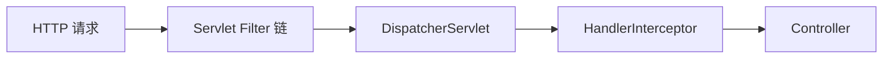

# Servlet Filter 与 Spring MVC Interceptor

[首页](../README.md) · [版本与资料](references.md)

[Spring 分类](interview_spring.md) · [接口耗时排查](topics/runtime-diagnostics.md)

**适用范围：** Servlet / Spring MVC 请求链，不直接套用到 WebFlux。

## 请求经过哪些层

Filter 属于 Servlet 机制，通常覆盖较外层的请求与响应处理。HandlerInterceptor 属于 Spring MVC 的 Handler 执行链，适合使用 Handler 信息做前后置处理。不能用“一个反射、一个回调”解释它们的本质区别。

## 哪些地方需要特别小心

前置阶段读取请求体可能影响后续参数绑定；异步分派、异常、请求转发和资源处理也会影响具体执行次数与时机。权限控制要结合真正覆盖请求的安全链，不能仅凭某个拦截器存在就认为所有入口都受保护。

参考：[Spring 5.2 MVC Interception](https://docs.spring.io/spring-framework/docs/5.2.5.RELEASE/spring-framework-reference/web.html#mvc-handlermapping-interceptor)。
