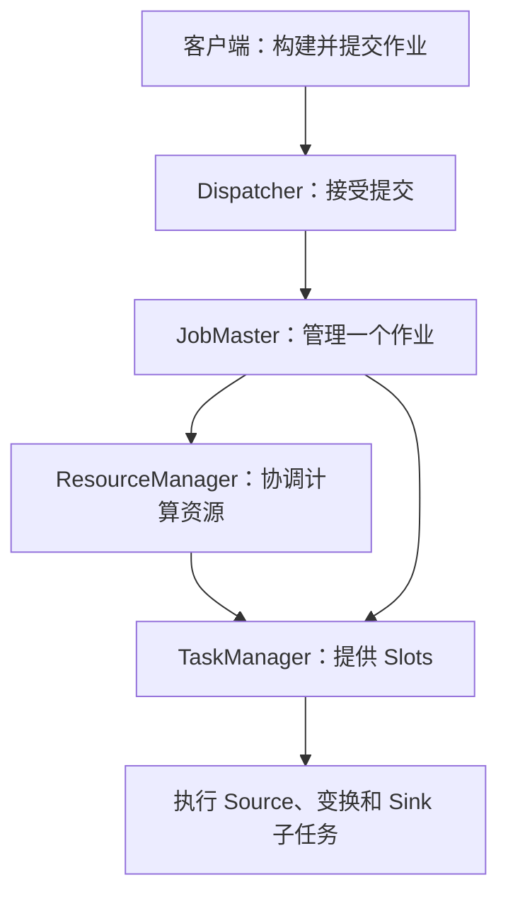

# Flink 运行架构与作业提交

[首页](../README.md) · [版本与资料](references.md)

[数据平台分类](interview_bigdata.md) · [时间、状态与恢复专题](topics/flink.md) · [版本与资料](references.md)

Flink 把数据源、变换和输出组织成分布式执行任务。本页解释这些任务由谁调度、在哪里运行；时间语义和恢复机制集中在相关问答中。

**适用版本：** 参考 Flink 1.20。部署模式与资源提供方式不同，组件进程位置和申请资源的行为会变化。

## 从程序到运行组件

JobManager 是协调组件的总体称呼；JobMaster 管理单个作业。ResourceManager 协调 TaskManager 和资源提供平台，不能与 YARN 自身的 ResourceManager 混为一谈。Standalone 下通常使用已有 TaskManager；是否动态申请资源取决于实际部署。

## 一次作业提交

1. 客户端产生作业描述并提交；不同部署模式下用户程序执行位置不同。
2. JobMaster 构建执行计划，按算子并行度和 slot sharing 规则申请 Slots。
3. TaskManager 注册资源并接受部署，执行各个子任务。
4. 子任务按数据分区交换记录，协调器跟踪执行、失败和恢复。

## 并行度与 Slots

并行度描述一个算子的子任务数；Slot 是资源调度单位，两者不能简单逐项相加。算子链、共享组和资源配置都会影响需要多少 Slots。常规 Slot 不提供独占 CPU 核的保证，也不会自动把热点数据分均匀。

`keyBy` 定义按键分区：同一 key 的记录路由到相应的下游子任务，不会因为 keyBy 本身就新建一个执行算子。并行度变化、key-group 分配和状态重分布需结合实际执行图理解。

## 窗口类型与后续阅读

| 类型 | 主要特征 | 需要确认 |
| --- | --- | --- |
| 滚动窗口 | 固定长度，相邻窗口不重叠 | 时间对齐、时区与边界 |
| 滑动窗口 | 按长度与步长产生窗口，可以重叠 | 一条数据可能进入多个窗口 |
| 会话窗口 | 按间隔划分活动区间，可能合并 | 事件时间或处理时间、会话合并 |
| 全局窗口 | 数据进入同一个全局范围 | 必须明确触发与状态清理 |
| 计数窗口 | 按记录数触发相应计算 | 计数范围、键与清理机制 |

- [Q31 时间、Watermark 与迟到数据](topics/flink.md#q31-event-time-watermark-与迟到数据如何解释)
- [Q32 状态与 Checkpoint](topics/flink.md#q32-flink-state-与-checkpoint-分别是什么)
- [Q34 Sink 的不重不丢边界](topics/flink.md#q34-开启-checkpoint-就能保证写入-clickhouse-不重不丢吗)
- [Q35 反压与数据倾斜](topics/flink.md#q35-反压和数据倾斜怎么区分)

比较 Spark 与 Flink 时，先写清 API、运行模式、端到端延迟、状态规模和外部系统语义，避免只用“秒级/毫秒级”或“精确一次”替代完整的方案判断。

参考：[Flink 1.20 Architecture](https://nightlies.apache.org/flink/flink-docs-release-1.20/docs/concepts/flink-architecture/)。
