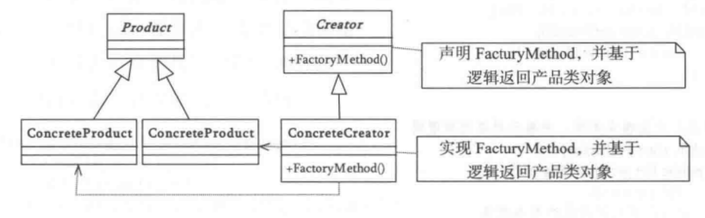
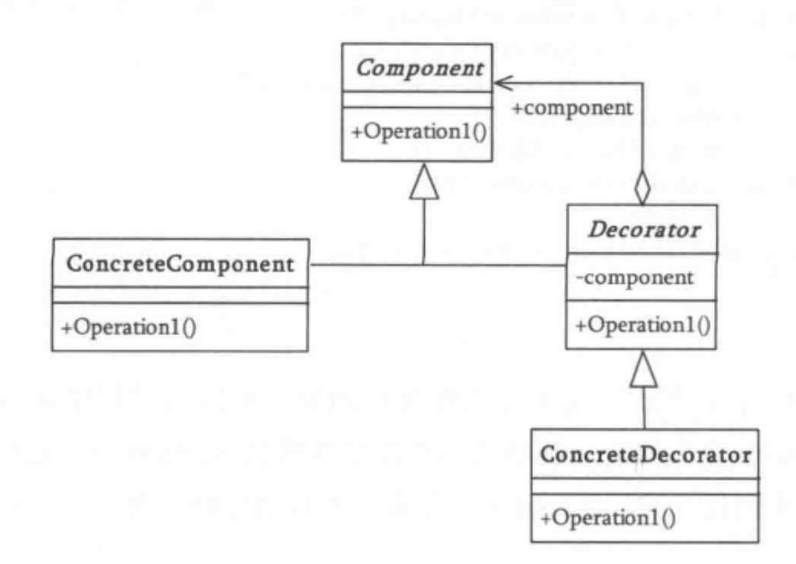
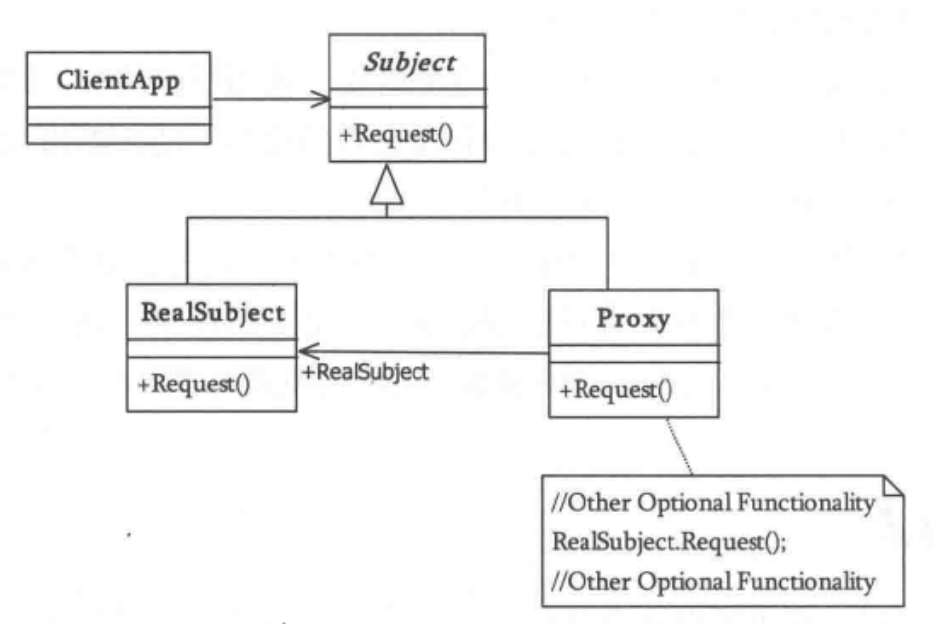
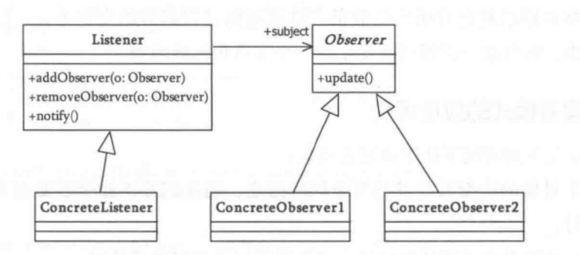
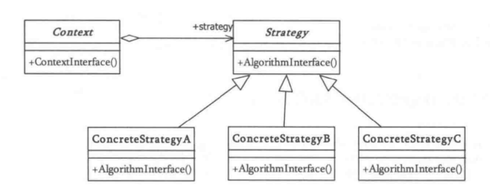

# 设计模式图解

[分布式设计分类](interview_design.md) · [完整素材索引](assets/README.md)

先识别变化点和对象之间的职责，再选择模式。以下图形是经典面向对象结构示意；它不证明引入某个模式就会提升性能或扩展性。

## 模式速览

| 模式 | 关注的变化或协作 | 结构图 |
| --- | --- | --- |
| 工厂方法 | 将创建具体产品的决策交给工厂方法 | [查看原图](../_v_images/1588679646408-22276075-76c2-42b2-8b20-84e3401fdbf7.png) |
| 抽象工厂 | 创建相互配合的一族产品 | [查看原图](../_v_images/1588681690229-615d93e2-9429-42cc-812e-fa8cb7eb49a4.png) |
| 建造者 | 分步骤构造复杂对象 | [查看原图](../_v_images/1588687137859-38493900-8c93-43ef-bbe7-c67c14e9ba75.png) |
| 单例 | 约束实例创建与访问范围 | [查看原图](../_v_images/1588689300339-c33a3d0d-7544-4754-8695-b08fc843183d.png) |
| 原型 | 按已有对象复制新对象 | [查看原图](../_v_images/1588746617916-a21ed08c-42df-40c0-bc79-6701209c2f55.png) |
| 桥接 | 让抽象与实现分别变化 | [查看原图](../_v_images/1588760917772-e4e10a15-0c43-456e-88f2-279fdd3e2d12.png) |
| 类适配器 | 通过继承适配接口 | [查看原图](../_v_images/1588761010089-ced9b3a9-3232-4729-943a-67c133909d7c.png) |
| 对象适配器 | 通过组合适配接口 | [查看原图](../_v_images/1588762859910-c08b6230-8358-42e8-aa48-5835af2d2940.png) |
| 装饰器 | 在保持接口的同时叠加职责 | [查看原图](../_v_images/1588776261625-d6b2f2b2-85c7-4752-ba71-ac38f9ca639c.png) |
| 外观 | 给一组复杂接口提供统一入口 | [查看原图](../_v_images/1588776769193-d3a6ae4a-83d5-4fbf-b187-339039a22f25.png) |
| 代理 | 在访问真实对象前后增加控制 | [查看原图](../_v_images/1588778531181-f78a0447-263d-40cf-bbfd-dfc565997dcd.png) |
| 享元 | 共享可复用的细粒度状态 | [查看原图](../_v_images/1588820461937-2a508c21-4203-4629-bcc1-ca0750f9fe84.png) |
| 责任链 | 沿处理链选择或组合处理职责 | [查看原图](../_v_images/1588839044031-1dcdb9c4-a7c0-43b0-af86-4fb919336801.png) |
| 命令 | 把请求封装为可传递对象 | [查看原图](../_v_images/1588841461626-35402966-4817-4f7c-bc64-7fa4dbfc6a84.png) |
| 解释器 | 用语法结构解释表达式 | [查看原图](../_v_images/1588846767979-ce72003e-375a-4eea-8d13-eed6b726aa3b.png) |
| 迭代器 | 统一遍历聚合对象 | [查看原图](../_v_images/1588848682603-c5da8658-bbda-4c63-9c3f-f9bc80a93299.png) |
| 中介者 | 集中处理对象之间的协作 | [查看原图](../_v_images/1588850989407-80696883-cc5d-472b-a4de-0d5f5edd4cc4.png) |
| 备忘录 | 保存与恢复对象状态 | [查看原图](../_v_images/1588858153516-9c6b4ce0-aa41-42c4-b4c5-ae14e7faae51.png) |
| 观察者 | 让订阅者感知状态变化 | [查看原图](../_v_images/1588859146567-662ae183-11ae-475d-8d8d-a8549f3d4026.png) |
| 状态 | 随状态切换行为 | [查看原图](../_v_images/1588860191434-2b5ff1d1-06e8-4036-8f95-0adfe7e383c1.png) |
| 策略 | 替换一组同类算法 | [查看原图](../_v_images/1588861529453-aa147daa-653f-4559-b2ee-fdb0a370bf11.png) |
| 模板方法 | 固定骨架并允许局部步骤变化 | [查看原图](../_v_images/1588862264475-f62b4542-a18a-410e-b841-96049a3f2b44.png) |
| 访问者 | 为稳定对象结构增加操作 | [查看原图](../_v_images/1588863690354-5649da92-3741-4812-9f63-b5b7d0960238.png) |

## 工厂方法

调用方依赖产品抽象，工厂方法负责选择具体产品。避免让调用方散落创建条件；也要考虑是否只是多加了一层没有变化需求的间接调用。

## 装饰器

装饰器持有被装饰对象，并在相同接口前后叠加行为。与继承相比，它强调运行时组合；叠加顺序和异常传播需要明确。

## 代理

代理控制对真实对象的访问。Spring 代理需要真正经过代理入口，普通的自调用不会自动新增拦截边界。

## 观察者

发布者维护订阅关系并通知观察者。同步回调与可靠消息机制不同，异常隔离、顺序和重复通知应独立设计。

## 策略

上下文依赖策略接口，根据输入或配置选择算法。仅当算法确实需要替换时才引入，避免把简单条件过度抽象。
