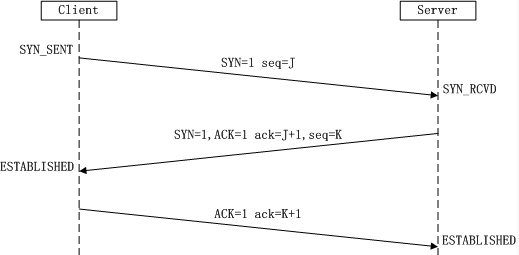
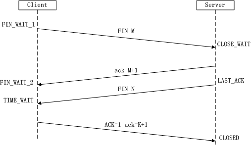
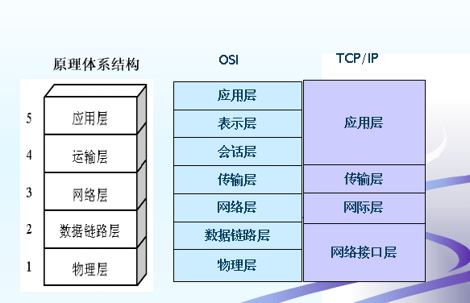
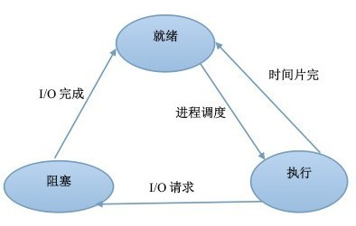
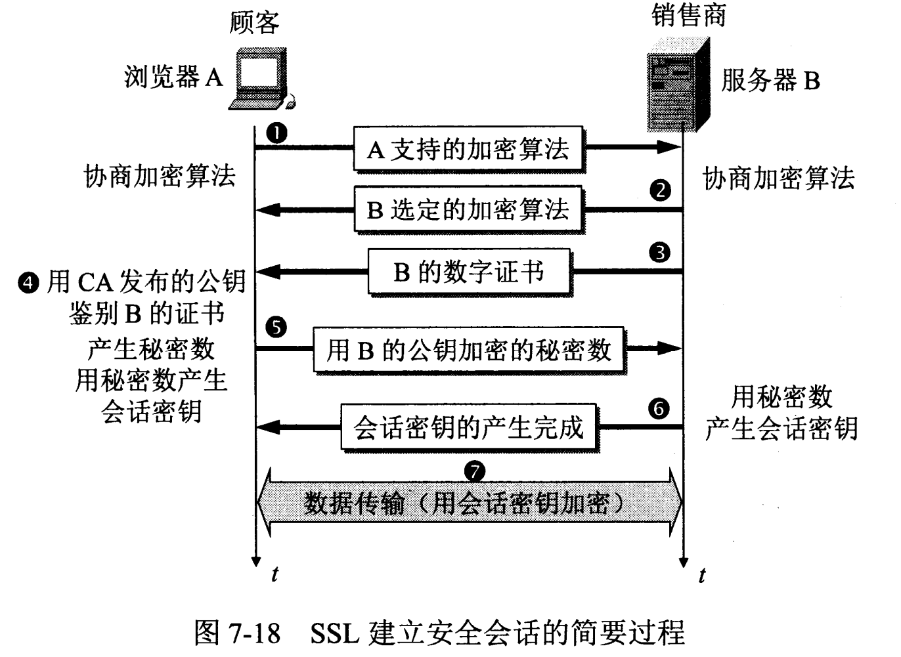

# 计算机基础与网络

[首页](../README.md) · [版本与资料](references.md)

- [请说说你对守护进程，僵尸进程和孤儿进程的理解](../src/main/java/com/sxw/learn/leetcode/md/守护进程、僵尸进程和孤儿进程的理解.md)
- [请解释一下什么是虚拟内存？分段？分页？](../src/main/java/com/sxw/learn/leetcode/md/虚拟内存.md)

**版本与前提：** 网络图用于理解常规协议模型；操作系统参数、Java 线程和 TLS 行为需按平台与版本核对。

## 本页目录

展开专题与代码目录

- [计算机基础&网络](#计算机基础网络)
  - [TCP和UDP的区别](#tcp和udp的区别)
  - [ping命令是基于什么协议](#ping命令是基于什么协议)
  - [数据链路层的主要功能是什么?](#数据链路层的主要功能是什么)
  - [四次挥手](#四次挥手)
  - [TCP四次挥手可以变成三次吗？](#tcp四次挥手可以变成三次吗)
  - [TCP time_wait](#tcp-time_wait)
  - [time_wait有什么作用？](#time_wait有什么作用)
  - [一定是客户端才有time_wait状态吗？](#一定是客户端才有time_wait状态吗)
  - [CLOSE_WAIT](#close_wait)
  - [如果已经建立了连接，但是Client端突然出现故障了怎么办？](#如果已经建立了连接但是client端突然出现故障了怎么办)
  - [select和epoll](#select和epoll)
  - [零拷贝](#零拷贝)
  - [Java中的线程与操作系统的线程有什么区别？](#java中的线程与操作系统的线程有什么区别)
  - [TCP具体是通过怎样的方式来保证数据的顺序化传输呢？](#tcp具体是通过怎样的方式来保证数据的顺序化传输呢)
  - [TCP传输数据时的优化策略](#tcp传输数据时的优化策略)
  - [简述Cookie是什么？](#简述cookie是什么)
  - [请求转发和重定向的区别](#请求转发和重定向的区别)
- [配套图示](#配套图示)
  - [TCP 三次握手](#tcp-三次握手)
  - [TCP 四次挥手](#tcp-四次挥手)
  - [OSI 与 TCP/IP 层次](#osi-与-tcpip-层次)
  - [进程三态转换](#进程三态转换)
  - [TLS 握手概念示意](#tls-握手概念示意)

## 计算机基础&网络

### TCP和UDP的区别

TCP/IP协议是一个协议簇。里面包括很多协议的，UDP只是其中的一个， 之所以命名为TCP/IP协议，因为TCP、IP协议是两个很重要的协议，就用他两命名了。

TCP/IP协议集包括应用层,传输层，网络层，网络访问层。

- 1、基于连接与无连接；
- 2、对系统资源的要求（TCP较多，UDP少）；
- 3、UDP程序结构较简单；
- 4、流模式与数据报模式 ；
- 5、TCP保证数据正确性，UDP可能丢包；
- 6、TCP保证数据顺序，UDP不保证。

参考资料：[zhuanlan.zhihu.com](https://zhuanlan.zhihu.com/p/24860273)

### ping命令是基于什么协议

ping命令是用来探测主机到主机之间是否可通信，如果不能ping到某台主机，表明不能和这台主机建立连接。

ping命令是使用 IP 和网络控制信息协议 (ICMP)，**因而没有涉及到任何传输协议(UDP/TCP) 和应用程序**。它发送icmp回送请求消息给目的主机。

ICMP协议规定：目的主机必须返回ICMP回送应答消息给源主机。如果源主机在一定时间内收到应答，则认为主机可达。
控制消息是指网络通不通、主机是否可达、路由是否可用等网络本身的消息。这些控制消息虽然并不传输用户数据，但是对于用户数据的传递起着重要的作用。

### 数据链路层的主要功能是什么?

1. 将数据组合成数据块，封装成帧
2. 差错控制
3. 流量控制
4. 链路控制
5. MAC寻址
6. 区分数据和控制信息
7. 透明传输

### 四次挥手

每个方向都需要一个FIN和一个ACK，因此通常需要四个分节，所以我们称他为四次挥手。

### TCP四次挥手可以变成三次吗？

可以的

服务端将FIN和ack合并成一条进行发送。为什么会进行合并呢？是因为在关闭的时候，服务端没有数据发送给客户端，然后优化后就会将FIN和ack合并在一起发送给客户端

### TCP time_wait

服务器端发送一个FIN时，客户端会处于time_wait状态。当处于time_wait状态时，我们无法创建新的连接，因为端口被占用

### time_wait有什么作用？

> 主动断开方在TIME-WAIT状态必须等待2MSL

1. 可靠的终止TCP连接,能确保被动方顺利进入到CLOSED状态。只有这样，双方都能够确保关闭。

最后 ACK 丢失时，对端可能重发 FIN；TIME-WAIT 还为旧连接报文消退提供时间。连接由地址和端口等组成的标识区分，不能把它解释为“这个本地端口在等待期内完全不能用于其他连接”。

### 一定是客户端才有time_wait状态吗？

通常主动关闭连接的一方进入 TIME-WAIT；服务端也可能主动关闭，不能按客户端/服务端身份判断。

### CLOSE_WAIT

为什么这么多CLOSE_WAIT ？

CLOSE_WAIT就是连接被动关闭端的应用没调socket.close

CLOSE_WAIT是被动关闭端在等待应用进程的关闭

参考资料：[plantegg.github.io](https://plantegg.github.io/2021/04/06/%E4%B8%BA%E4%BB%80%E4%B9%88%E8%BF%99%E4%B9%88%E5%A4%9ACLOSE_WAIT/)

### 如果已经建立了连接，但是Client端突然出现故障了怎么办？

是否启用 TCP keepalive、首次探测等待和重试参数取决于系统与配置。应用层读超时、心跳和 TCP 保活覆盖的故障不同，应按业务时效选择，不能把旧笔记里的固定小时数当成通用协议保证。

### select和epoll

>  select/poll/epoll 是用来实现多路复用的，即一个线程利用它们即可 hold 住多个 socket

参考资料：[www.zhihu.com](https://www.zhihu.com/question/22863976/answer/2360953876)

### 零拷贝

零拷贝关注减少不必要的用户态/内核态数据搬运与 CPU 参与，不代表整个路径没有任何复制。sendfile、mmap、DMA 等机制的适用条件不同，需要明确具体系统调用与发送路径。

### Java中的线程与操作系统的线程有什么区别？

> Java 中线程的本质，其实就是操作系统中的线程，其线程库和线程模型很大程度上依赖于操作系统（宿主系统）的具体实现

首先，日常开发中都是会使用线程池来获取或者创建线程的，而线程在创建时，其实是先创建一个java线程，等到本地存储、程序计数器、缓冲区等都分配好以后，JVM会调用操作系统的方法，创建一个与java线程绑定的原生线程。
线程的调度是由操作系统负责的。 
当操作系统为线程分配好时间片以后，就会调用java线程的run方法执行线程。 
当线程结束后，会释放java线程和原生线程所占用的资源

### TCP具体是通过怎样的方式来保证数据的顺序化传输呢？

> 每个数据包会被分配一个序列号，接收方按顺序接受并确认

具体步骤如下： 
（1）为了保证数据包的可靠传递，发送方必须把已发送的数据包保留在缓冲区； 
（2）并为每个已发送的数据包启动一个超时定时器； 
（3）如在定时器超时之前收到了对方发来的应答信息（可能是对本包的应答，也可以是对本包后续包的应答），则释放该数据包占用的缓冲区; 
（4）否则，重传该数据包，直到收到应答或重传次数超过规定的最大次数为止。 
（5）接收方收到数据包后，先进行相应校验并按序号重组，如果正确则把数据交给上层协议，然后给发送方发送一个累计应答包，表明该数据已收到，如果接收方正好也有数据要发给发送方，应答包也可方在数据包中捎带过去 

### TCP传输数据时的优化策略

TCP 的传输速度，受制于发送窗口与接收窗口，以及网络设备传输能力。

发送缓冲区的大小 约等于 带宽时延积

带宽时延积 BDP = RTT * 带宽

> TCP 提供一种机制可以让「发送方」根据「接收方」的实际接收能力控制发送的数据量，这就是滑动窗口的由来。

### 简述Cookie是什么？

Cookie 可由服务端通过 Set-Cookie 等机制设置，浏览器按 Domain、Path、Secure、SameSite、过期时间及自身策略决定保存与发送；并非所有请求都带上所有 Cookie。

### 请求转发和重定向的区别

**请求转发**：客户浏览器发送http请求，web服务器接受此请求，调用内部的一个方法在容器内部完成请求处理和转发动作，将目标资源发送给客户;
在这里，转发的路径必须是同一个web容器下的url，其不能转向到其他的web路径上去，中间传递的是自己的容器内的request。
在客户浏览器路径栏显示的仍然是其第一次访问的路径，也就是说客户是感觉不到服务器做了转发的。转发行为是浏览器只做了一次访问请求。

**重定向过程**：客户浏览器发送http请求，web服务器接受后发送**302状态码**响应及对应新的location给客户浏览器，
客户浏览器发现是302响应，则自动再发送一个新的http请求，请求url是新的location地址，服务器根据此请求寻找资源并发送给客户。
在这里location可以重定向到任意URL，既然是浏览器重新发出了请求，则就没有什么request传递的概念了。在客户浏览器路径栏显示的是其重定向的路径，客户可以观察到地址的变化的。重定向行为是浏览器做了至少两次的访问请求的。

## 配套图示

### TCP 三次握手

### TCP 四次挥手

### OSI 与 TCP/IP 层次

### 进程三态转换

### TLS 握手概念示意

这些图用于建立基本模型；TLS 图是历史握手示意，具体往返与消息顺序需按 TLS 版本核对。Cookie 参考 [MDN](https://developer.mozilla.org/en-US/docs/Web/HTTP/Guides/Cookies)。
