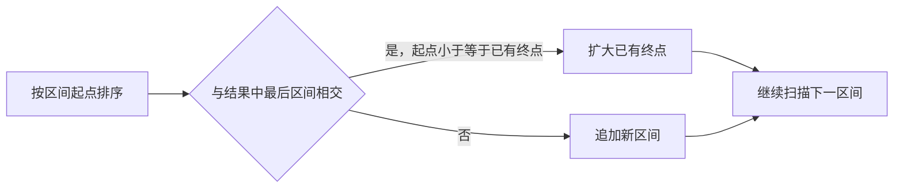

# SQL、编程与故障分析练习

[首页](../README.md) · [问答索引](技术学习笔记.md) · [SQL 分类](SQL.md)

先确定输入、数据粒度、排序和空值规则，再独立推导；对照参考解法后，用边界输入手工走查。SQL 示例主要面向 MySQL 8.x，跨 Oracle 使用前确认语法；Java 示例使用 Java 8。示例表、状态码与字段均为题设，不代表现有业务定义。

## 练习目录

- [E01 每个订单取最新一条状态记录](#e01-每个订单取最新一条状态记录)
- [E02 查询每个部门支付金额排名前三的客户](#e02-查询每个部门支付金额排名前三的客户)
- [E03 对账发现一边缺记录 或金额不同](#e03-对账发现一边缺记录-或金额不同)
- [E04 手画一个数据库幂等回调处理流程](#e04-手画一个数据库幂等回调处理流程)
- [E05 合并有交集的闭区间](#e05-合并有交集的闭区间)
- [E06 报表金额变成业务库的两倍 如何定位](#e06-报表金额变成业务库的两倍-如何定位)

## E01 每个订单取最新一条状态记录


问题：order_event 包含 order_id、event_time、event_id 和 status。每个订单返回最新一条；时间相同以 event_id 最大者为准。event_id 在订单内唯一。

<details>
<summary>查看最新状态 SQL、并列处理与索引思路</summary>

参考 SQL：适用于支持窗口函数的数据库，如 MySQL 8 和相应 Oracle 版本。

```sql
SELECT order_id, event_time, event_id, status
FROM (
    SELECT order_id, event_time, event_id, status,
           ROW_NUMBER() OVER (
               PARTITION BY order_id
               ORDER BY event_time DESC, event_id DESC
           ) AS rn
    FROM order_event
) ranked
WHERE rn = 1;
```

解题思路：先按订单分组，再按时间和唯一事件序号倒序编号，取第一条。不能只按最大时间关联原表，因为相同时间可能返回多条。本题假定时间非空且 event_id 只用于打破同时间并列；如果业务有权威版本号，应优先按业务版本判断新旧。

进一步思考：问 ROW_NUMBER 与 DENSE_RANK 区别，前者给每行不同序号，后者保留同排序值并列。问索引设计，先比较按订单与时间的访问方式，再查看执行计划。

</details>


## E02 查询每个部门支付金额排名前三的客户


问题：payment 包含 dept_id、customer_id、amount 和 status。只计算 status 为 PAID 的记录。并列名次全部保留，前三是前三个不同金额档位。

<details>
<summary>查看汇总排名 SQL 与并列名次边界</summary>

```sql
WITH customer_total AS (
    SELECT dept_id, customer_id, SUM(amount) AS total_amount
    FROM payment
    WHERE status = 'PAID'
    GROUP BY dept_id, customer_id
), ranked AS (
    SELECT dept_id, customer_id, total_amount,
           DENSE_RANK() OVER (
               PARTITION BY dept_id
               ORDER BY total_amount DESC
           ) AS amount_rank
    FROM customer_total
)
SELECT dept_id, customer_id, total_amount, amount_rank
FROM ranked
WHERE amount_rank <= 3
ORDER BY dept_id, amount_rank, customer_id;
```

解题思路：先汇总到部门和客户粒度，再在部门内排名。题目要求前三个金额档位且保留并列，所以用 DENSE_RANK，返回人数可能超过三人。如果要求恰好三人，需要 ROW_NUMBER 并补充稳定的并列规则；如果要比赛式跳号名次，应使用 RANK。

边界：题设金额为有效精确数值。退款、币种、空值和时间范围必须另行确认，不能默认混加。也不能把示例的 PAID 状态码当成真实系统定义。

</details>


## E03 对账发现一边缺记录 或金额不同


问题：source_total 与 target_total 都已按 biz_id 聚合，biz_id 唯一且非空，total_amount 非空。找出源端缺失、目标端缺失和金额不一致的业务。

<details>
<summary>查看双向对账 SQL 与空值边界</summary>

```sql
SELECT s.biz_id, s.total_amount AS source_amount,
       t.total_amount AS target_amount
FROM source_total s
LEFT JOIN target_total t ON t.biz_id = s.biz_id
WHERE t.biz_id IS NULL OR s.total_amount <> t.total_amount
UNION ALL
SELECT t.biz_id, s.total_amount AS source_amount,
       t.total_amount AS target_amount
FROM target_total t
LEFT JOIN source_total s ON s.biz_id = t.biz_id
WHERE s.biz_id IS NULL;
```

解题思路：第一段覆盖源端存在而目标缺失，以及双方都有但金额不同；第二段补上只存在于目标端的业务。两段集合在条件上不重叠，所以可以 UNION ALL。不能只做一边 LEFT JOIN，也不要用 INNER JOIN 把缺失记录过滤掉。

进一步思考：金额可空时先定义空的业务含义再比较；不是简单把所有空都换成零。若存在误差容忍，先确定精度与对账规则。双方应使用相同时间边界与币种口径。

</details>


## E04 手画一个数据库幂等回调处理流程


问题：同一审批事件可能重复或并发到达，需要避免本地状态重复变更。假定事件具有来源系统、唯一 event_id、流程实例和业务版本，本题只覆盖同一数据库内的副作用。

<details>
<summary>查看幂等处理流程与事务失败边界</summary>

参考流程：

```text
校验身份签名与必填字段
构造稳定事件键  来源系统加 event_id
开始本地事务
  尝试插入具有唯一约束的事件处理记录
  根据业务版本与允许的旧状态 执行条件更新
  核对影响行数 区分成功 过期与非法状态
  记录本次明确结果
提交事务后返回稳定响应
```

解题思路：唯一事件记录和业务变更必须原子提交。正常失败回滚时，不能留下一个“已成功”标记。遇到唯一冲突，要按所用数据库和事务框架正确退出或回滚当前事务，再读取已提交结果；不能假定捕获异常后当前事务还能继续使用。先前请求仍在处理时，按协议返回处理中或可重试结果。历史重复与相同事件键但载荷不同要区分，后者应记录冲突并告警。

进一步思考：条件更新影响零行时，不直接认定已处理，要区分过期事件、数据不存在和不允许的业务变更。若需要远程调用，转入 Q48 的可靠推进与幂等设计，不能扩张本题本地事务的保证。

关联原理：[Q46 审批回调如何做到幂等](topics/distributed-systems.md#q46-审批回调如何做到幂等)、[Q48 本地事务与远程调用 如何保证最终一致](topics/distributed-systems.md#q48-本地事务与远程调用-如何保证最终一致)。

</details>


## E05 合并有交集的闭区间


问题：输入一组整型闭区间。端点相同算重叠；相差一的区间不合并。示例中的数组可直接被排序，调用方接受修改顺序。

<details>
<summary>查看区间合并代码、复杂度与手工走查</summary>

```java
/**
 * 合并相交闭区间 会调整输入数组顺序
 * 空数组返回空数组 非法区间抛出参数异常
 */
static int[][] merge(int[][] intervals) {
    if (intervals == null) {
        throw new IllegalArgumentException("区间数组不能为空");
    }
    for (int[] interval : intervals) {
        if (interval == null || interval.length != 2
                || interval[0] > interval[1]) {
            throw new IllegalArgumentException("区间格式不合法");
        }
    }
    java.util.Arrays.sort(intervals,
        (a, b) -> Integer.compare(a[0], b[0]));
    java.util.List<int[]> result = new java.util.ArrayList<>();
    for (int[] interval : intervals) {
        if (result.isEmpty()
                || result.get(result.size() - 1)[1] < interval[0]) {
            result.add(new int[]{interval[0], interval[1]});
        } else {
            int[] last = result.get(result.size() - 1);
            last[1] = Math.max(last[1], interval[1]);
        }
    }
    return result.toArray(new int[result.size()][]);
}
```

解题思路：先按起点排序，再维护结果中最后一个已合并区间；若下一个起点超过当前终点就新建，否则扩大终点。排序时间 O(n log n)，扫描 O(n)，结果空间 O(n)，排序还可能有辅助空间。比较用 Integer.compare 避免相减溢出，输出区间另建数组，避免修改输入行对象。

手工走查：空数组；只有一段；完全包含；相同起点；端点相交；完全不相交；负数和极值。这里用比较而不用终点加一，避免改变闭区间语义和整数溢出。

</details>



端点相同算相交；`[1, 2]` 与 `[3, 4]` 不合并。图中的规则与代码中的严格小于判断保持一致。

## E06 报表金额变成业务库的两倍 如何定位


问题：报表昨日金额明显偏高，实时任务近期重启过，但目前没有根因证据。

<details>
<summary>查看排查路径、修复策略与核对方法</summary>

原理与做法：我先确认报表与业务库比较的是同一日期、时区、币种和业务状态，再保留异常查询与任务记录。接着按业务键抽样，从展示 SQL、汇总表、明细表、计算输入到源记录逐层比较。近期重启是线索，不能直接当根因：还要检查重复输入、Sink 重放、关联一对多放大、实时与补数重叠，以及状态更新重复累加。定位到重复影响路径后，先控制错误继续扩散，再按明确范围重算或替换，并核对明细与汇总。

追问一：发现明细最终去重正确，汇总为什么仍偏高。原理与做法：汇总可能在重复插入时已累计，源表后台去重不会自动抵消已发生的增量聚合；需要检查汇总计算时机和更新语义。

追问二：为什么不能立即清空重跑。原理与做法：还没明确错误范围、重跑幂等性和数据可恢复性，清空可能扩大影响；应先保存证据，确认源数据保留、补数边界和发布策略。

追问三：怎样证明修复完成。原理与做法：分日期与主体核对条数、业务键和金额，抽查异常明细，观察新数据和恢复后重复窗口，并确认下游使用方结果。

</details>
