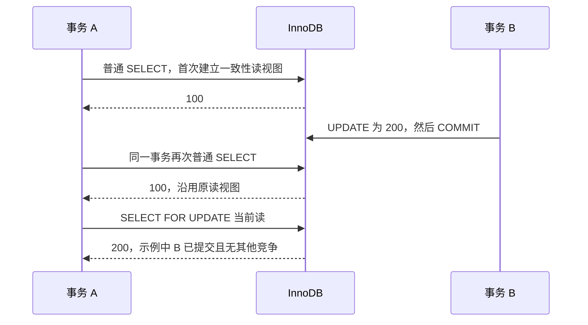

# 数据库原理与 SQL 优化

[返回分类](../interview_mysql.md) · [全部问答](../技术学习笔记.md) · [练习](../practice.md) · [版本与资料](../references.md)

按执行计划 → 索引 → 事务与锁 → 分页和数据修复的顺序学习。

**适用版本与前提：** MySQL 8.x / InnoDB 为主要基线，执行计划参考 MySQL 8.4；Oracle 差异单列说明，不能直接套用。

## 阅读目录

- [Q13 一条慢 SQL 你会怎么优化](#q13-一条慢-sql-你会怎么优化)
- [Q14 联合索引如何设计 为什么有索引也没用上](#q14-联合索引如何设计-为什么有索引也没用上)
- [Q15 MVCC 隔离级别和锁是什么关系](#q15-mvcc-隔离级别和锁是什么关系)
- [Q16 乐观锁 悲观锁与唯一约束分别解决什么](#q16-乐观锁-悲观锁与唯一约束分别解决什么)
- [Q17 深分页和大批量导出怎么设计](#q17-深分页和大批量导出怎么设计)
- [Q18 Oracle 和 MySQL 的关键行为差异是什么](#q18-oracle-和-mysql-的关键行为差异是什么)
- [Q19 如何修复线上错误数据](#q19-如何修复线上错误数据)
- [Q20 报表金额为什么可能被关联查询放大](#q20-报表金额为什么可能被关联查询放大)

## Q13 一条慢 SQL 你会怎么优化

类型：排障题。优先级：最高。

原理与做法：先确认慢 SQL 的真实参数、数据量和发生频率，再看执行计划与资源等待。重点检查估算与实际行数差异、访问路径、连接顺序、过滤时机、排序聚合和返回数据量。之后才考虑调整索引、改写 SQL、减少不必要关联或分页方式。优化前后使用可比条件，同时核对结果是否一致。MySQL 的 EXPLAIN ANALYZE 会实际执行查询，生产分析时必须理解执行成本；Oracle 的实际计划与统计获取方式另行确认。

进一步思考：问“看到全表扫描就加索引吗”，回答不是。小表、低选择性条件或返回大量数据时，全表扫描可能合理。资料见 [S08](../references.md#s08)。

## Q14 联合索引如何设计 为什么有索引也没用上

类型：原理题。优先级：高。

原理与做法：以常见 B 树联合索引为例，列顺序要结合过滤、排序和数据分布设计，左侧前缀通常影响能否有效定位。选择性差、返回比例高、隐式类型转换或对列进行某些计算，都可能影响收益；最终还由优化器选择访问路径。范围条件之后的列也不应简单说完全没用，可能用于过滤或覆盖，具体看计划。索引会增加写入和维护成本，所以不为每个字段建一个索引。

进一步思考：问“a 等值 b 范围 c 等值，c 是否无效”，回答区分索引定位、过滤和覆盖作用，使用实际计划验证，避免背绝对结论。

## Q15 MVCC 隔离级别和锁是什么关系

**图解：同一行初始值为 100，事务 A 使用 InnoDB 的 REPEATABLE READ。**

这个例子区分普通一致性读和锁定读；不包含 A 自身写入、DDL 或其他并发事务。READ COMMITTED 的一致性读通常每次建立新快照。范围加锁是否出现 gap / next-key lock，还受隔离级别、索引、访问范围和约束检查影响。参考 [MySQL 8.4 一致性读](https://dev.mysql.com/doc/refman/8.4/en/innodb-consistent-read.html)。

类型：原理题。优先级：高。

原理与做法：MVCC 通过多个数据版本支持一致性读取，隔离级别决定事务观察并发变化的规则，但写操作和锁定读仍涉及锁。以 InnoDB 为例，READ COMMITTED 与 REPEATABLE READ 的快照使用方式不同，范围锁行为也受隔离级别、语句和索引条件影响。不能把 MySQL 的实现细节直接套到 Oracle；回答前先明确数据库与读写类型。

进一步思考：问“可重复读就绝对没有幻读问题吗”，回答要区分快照读与当前读以及具体语句；不能仅凭隔离级别名称推断所有操作结果。资料见 [S09](../references.md#s09)。

## Q16 乐观锁 悲观锁与唯一约束分别解决什么

类型：方案题。优先级：高。

原理与做法：乐观锁通常通过版本或旧状态作为更新条件，检查影响行数来发现竞争；悲观锁在事务中锁定相关记录，适合需要串行保护的短临界区；唯一约束直接保护某个键不能重复。它们保护的规则不同，可以组合使用。接口幂等常需要唯一事件标识和业务事务，扣减或状态变更可能还需要条件更新。锁持有期间避免长时间远程调用，并考虑固定更新顺序以降低死锁风险。

进一步思考：问“更新影响 0 行就重试吗”，先区分数据不存在、版本冲突和业务状态不允许，不能无条件重试。

## Q17 深分页和大批量导出怎么设计

类型：方案题。优先级：中。

原理与做法：深分页要明确是否必须随机跳页。如果按稳定顺序连续翻页，可以用排序字段与唯一键组成游标，避免不断跳过前面的大量记录。导出则考虑异步任务、分批读取、流式写入和资源限制，不一次把全部数据加载到内存。需要明确导出期间数据变化的语义：是某个一致性快照，还是允许部分变化的近似实时视图。

进一步思考：问“按更新时间翻页是否会漏”，回答更新时间变化和非唯一排序都可能造成移动与重复，应结合固定边界、复合游标或快照机制设计。

## Q18 Oracle 和 MySQL 的关键行为差异是什么

类型：原理题。优先级：中。

原理与做法：比较数据库时，需要覆盖数据类型、空值与空串、日期处理、分页、主键生成、函数、事务和锁行为。Oracle 的空字符串处理与 MySQL 不同，语法能够转换不代表结果完全等价。还需盘点序列、存储程序、数据库链接和依赖对象，并核对数值精度、隐式类型转换、排序规则与并发行为。涉及具体能力时，应明确数据库及版本，不能将一种数据库的实现细节直接套用到另一种。

进一步思考：问“把 NVL 换成 IFNULL 是否足够”，回答还需核对参数类型、转换规则、空值语义和结果精度；表结构、事务边界与外部依赖也需要分别处理。

## Q19 如何修复线上错误数据

类型：方案题。优先级：高。

原理与做法：先界定异常范围和正确业务状态，再确认是否仍有写入源不断制造错误。我会先查询并保存修复前快照，明确预期影响行数，用业务键和旧值等条件限定修改；涉及多表时核对关联不变量与外围同步。执行后做前后对比和业务抽查，再按既定流程提交或回滚。修复数据还要处理根因，否则只是暂时恢复表面结果。

进一步思考：问“脚本执行成功算完成吗”，回答还要验证状态、金额、关联关系及下游结果，成功执行不等于业务正确。技术交流时使用脱敏案例，不展示真实敏感数据。

## Q20 报表金额为什么可能被关联查询放大

类型：SQL 场景题。优先级：高。

原理与做法：先看每张表的粒度与关联基数。订单头金额关联多条订单明细后，头金额会重复出现；如果再关联多条付款记录，可能进一步形成乘积。通常先将各明细表聚合到共同业务粒度，再关联；或者仅为存在性过滤时使用 EXISTS。不能看到重复就随意加 DISTINCT，因为相同金额可能来自不同合法业务，去重后反而丢数据。

进一步思考：问“SUM DISTINCT 金额可以吗”，回答不可以通用处理，它按金额值去重，不按业务记录去重。关联前后都要检查行数、主键数量与合计金额。

---

[返回分类](../interview_mysql.md) · [全部问答](../技术学习笔记.md) · [练习](../practice.md) · [版本与资料](../references.md)
