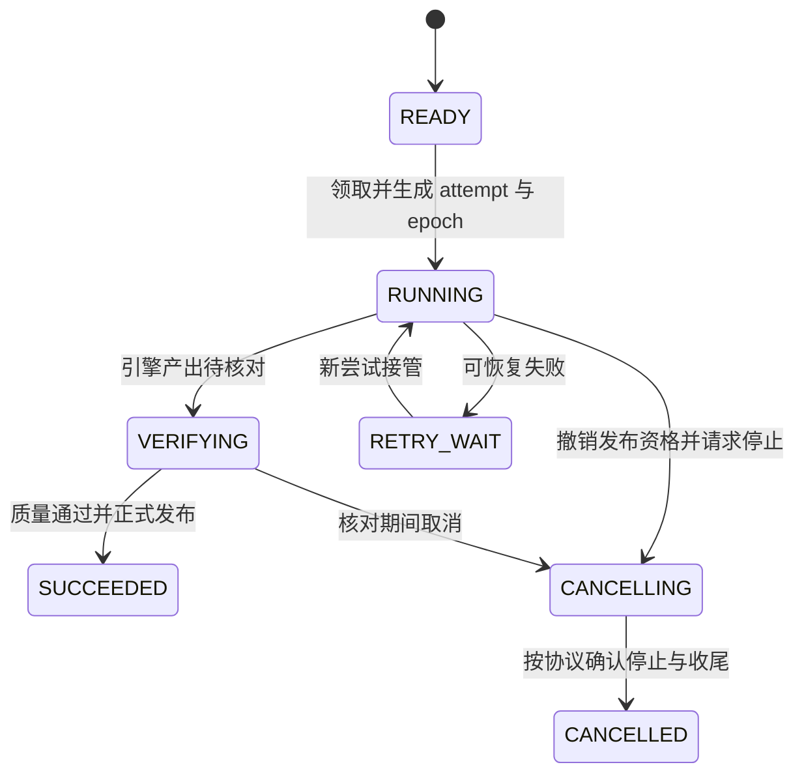
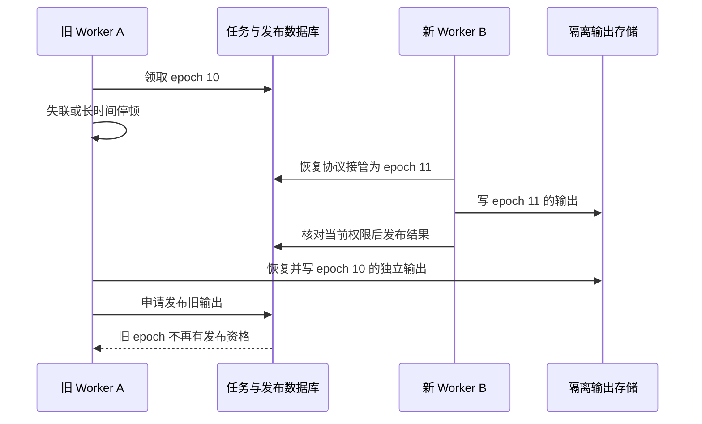

# 分布式调度、补数与结果发布

[数据平台分类](../interview_bigdata.md) · [领取与 Fencing](lease-fencing.md) · [实时结果一致性](flink-clickhouse-consistency.md) · [首页](../../README.md)

设计目标：调度节点高可用、Worker 失联和恢复、自动重试、人工重跑及实时/补数并行时，任务状态与数据产出仍然可追踪，不让旧执行者发布过期结果。

**范围与前提：** 教学任务协议，数据库示例以 MySQL 8.x 为基线；可由现有调度系统承担触发与依赖，再补充业务窗口、质量和发布约束。未运行任务、引擎取消或故障实验。

## 阅读目录

<details>
<summary>展开分布式调度与补数知识点</summary>

- [完整题目与不变量](#完整题目与不变量)
- [任务定义、运行实例与尝试](#任务定义运行实例与尝试)
- [调度、领取和执行状态](#调度领取和执行状态)
- [旧 Worker 恢复后为什么不能发布](#旧-worker-恢复后为什么不能发布)
- [依赖成功与数据就绪](#依赖成功与数据就绪)
- [实时与补数的输出隔离](#实时与补数的输出隔离)
- [重试、人工重跑与取消](#重试人工重跑与取消)
- [故障窗口与恢复](#故障窗口与恢复)
- [深入追问与参考回答](#深入追问与参考回答)
- [手工走查与观测](#手工走查与观测)
- [参考资料](#参考资料)

</details>

## 完整题目与不变量

两个 Scheduler 都发现同一业务日需要运行，Worker A 失联后 B 接管；A 后来恢复并声称成功。同时有人重跑该日期，实时任务也在写相同结果范围。如何判定谁可以发布、取消和重试？

不变量：同一个调度命令不会无约束地产生重复实例；每次执行尝试有独立身份；只有当前有效尝试能推进状态与发布；正式结果对应明确输入和规则版本；数据不完整不能假成功。

## 任务定义、运行实例与尝试

| 对象 | 关键字段与约束 |
| --- | --- |
| task_definition | 定义 ID、版本、参数 Schema、资源要求与依赖 |
| task_instance | run_id、业务窗口、定义版本、参数 Hash、revision、status、version、current_epoch、output_generation |
| execution_attempt | attempt_id、run_id、epoch、owner、lease_until、引擎任务 ID与日志位置 |
| trigger_receipt | 外部命令或调度触发身份唯一，避免重复创建 |
| input_manifest | 输入分区、截止水位、依赖产出版本 |
| output_generation | 隔离输出、质量结果、分片和校验 |
| publication | 业务窗口的正式输出指针与发布版本 |

相同实例可有多个重试 attempt；人工重跑通常建立明确的新 revision 或新实例，而不是清空旧记录。逻辑窗口与参数的唯一范围应按业务定义，不能只用“某天一个任务名”忽略租户、时区或口径版本。

原始任务定义、实例参数和输入版本应可恢复。业务窗口使用明确时区与边界，不把服务器当前日期当作所有任务的业务日期。

## 调度、领取和执行状态



实际还需永久失败和人工介入状态。租约到期触发恢复判断，不自动证明旧进程停止。领取与状态写入使用短事务、唯一约束及版本条件，网络引擎提交在受控协议中处理。

引擎提交也可能结果未知：应保存稳定提交身份，查询实际引擎任务再决定重试；不能每次超时都新建一个无法关联的执行。

## 旧 Worker 恢复后为什么不能发布



结果文件或中间表按 run、attempt、generation 隔离。发布时在同一权威事务内核对当前 epoch、owner、任务状态、输入和规则版本、质量结果，再更新发布指针与实例终态。

状态更新示意，必须与发布元数据的条件修改共同提交：

```sql
UPDATE task_instance
SET status = 'SUCCEEDED', output_generation = :generation,
    version = version + 1
WHERE run_id = :run_id
  AND current_epoch = :epoch
  AND status = 'VERIFYING'
  AND version = :expected_version;
```

不能在实例更新失败后，仍独立修改正式结果。旧执行者的数据库写、外部调用和文件覆盖若绕开隔离协议，单靠调度状态也保护不了它们。

## 依赖成功与数据就绪

上游进程退出码为 0，不等于输入分区齐全。依赖可以要求：固定业务窗口的已发布版本、Schema 与规则兼容、预期分区完整、条数或金额校验通过，以及对应数据水位可用。

下游创建 input_manifest，固定使用哪些上游版本。不能运行到一半发现某分区更新就随意混用新旧口径。对于允许滚动更新的任务，必须另有明确的一致性契约。

## 实时与补数的输出隔离

补数限定日期、租户和源范围，固定规则与输入版本；写入独立 generation，核对后再切换相应业务窗口的发布指针。

实时流与补数都直接往同一累计表追加，会产生重复、覆盖和部分可见问题。需要决定补数替换哪个范围、实时进度如何衔接，以及旧事件是否还会落入已替换区间。参见[实时结果一致性](flink-clickhouse-consistency.md)。

多个日期一起发布若要求跨日期一致，应有一份整体发布 manifest；逐个更新分区指针只能提供相应分区级保证，不能冒充整体原子切换。

## 重试、人工重跑与取消

**重试：** 同一逻辑实例的另一次尝试，保留输入与规则语义，生成新 attempt 和领取代际。永久数据错误要隔离，不能无限占用资源。

**人工重跑：** 明确是重新计算同一事实，还是按新规则建立新结果版本；保存操作者、原因、参数与发布策略，不删除旧记录假装第一次执行。

**取消：** 先通过状态与版本阻止后续发布，再尽力取消底层引擎。若尚不能确认底层停止，保持 CANCELLING 或明确的未知处置状态；不能仅因取消请求接口返回就声称任务已终止。

成功发布与取消通过同一权威状态竞争：谁先形成合法终态，就按该终态返回；不能让两个入口各自无条件写 SUCCEEDED 和 CANCELLED。

资源治理包括全局与租户配额、依赖并发、队列优先级、重试退避和实时任务保留容量。取消、超时和重试都要防止制造更多重叠执行。

## 故障窗口与恢复

| 故障 | 恢复规则 |
| --- | --- |
| Scheduler 重复触发 | 触发身份和业务实例唯一约束仲裁 |
| 引擎提交成功、响应丢失 | 按稳定身份查询，避免重复提交不同任务 |
| Worker 失联后恢复 | 旧 epoch 不能发布或覆盖新尝试状态 |
| 数据生成完成但质量未通过 | 不进入正式成功，不暴露为完整产出 |
| 发布已提交、Worker 未收到响应 | 查询稳定发布记录，不重复替换其他版本 |
| 人工重跑与自动重试交错 | run / revision / attempt 分开，发布权由当前协议决定 |
| 取消与完成同时到达 | 状态 CAS 与发布事务决定唯一结果 |
| 补数只完成一半 | 未完成代际保持隔离，旧正式版本继续按契约可读 |
| 下游已使用旧版本 | 重算与通知版本变化，不能只删旧文件就认为下游已恢复 |

## 深入追问与参考回答

**调度是否能保证业务只执行一次？** 不能单凭触发与执行状态这样承诺。重复 attempt、失联恢复与未知外部结果仍需业务幂等；调度协议主要明确谁有资格运行、恢复和发布。

**为什么需要实例和尝试两层？** 重试应保留同一业务意图和输入范围，又要区分每次执行的日志、引擎身份、输出与权限。混成一行会丢失恢复证据。

**为什么运行锁不直接覆盖整个任务？** 长任务可能超过租约且无法及时续约。运行资格之外，最终写入与发布仍需要验证当前权限。

**怎样避免补数拖垮实时？** 分开资源预算、限并发、按范围分批并监控延迟；让补数可暂停和恢复，而不是无限制堆积执行器。

**已经有 DolphinScheduler 等引擎还需要自建吗？** 优先复用能满足要求的触发、依赖与执行能力，把业务参数、输入版本、权限、对账和发布语义作为必要扩展；不为学习协议假设必须重造调度器。

## 手工走查与观测

固定一个业务窗口，推演双 Scheduler、旧 Worker 复活、提交响应丢失、人工重跑、质量失败、取消竞争和补数部分完成。核对每个尝试的结果归属、唯一正式指针及下游读取版本。

观察排队与依赖等待、租约过期、旧 epoch 拒绝、引擎未知状态、取消滞留、质量失败和数据窗口缺口。日志与告警按定义、run、attempt、epoch、业务窗口和输入/输出版本关联。

## 参考资料

执行器可能重复运行同一工作是需要处理的现实边界，可参考 [Kubernetes Job 文档](https://kubernetes.io/docs/concepts/workloads/controllers/job/)的执行与恢复说明，但本页不要求使用 Kubernetes。权限与版本仲裁参考 [etcd 3.5 API guarantees](https://etcd.io/docs/v3.5/learning/api_guarantees/)。业务窗口、attempt、质量门槛和发布协议是本文教学设计，不是这些组件自动提供的完整业务语义。
