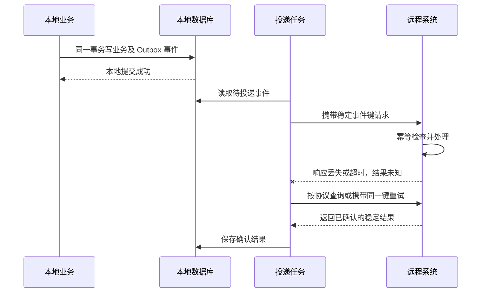

# 分布式一致性与平台设计

[返回分类](../interview_design.md) · [全部问答](../技术学习笔记.md) · [练习](../practice.md) · [版本与资料](../references.md)

先定义事件身份和本地原子范围，再考虑远程未知状态、可靠投递、重试与对账。

**适用版本与前提：** 方案描述假定数据库支持事务和唯一约束；远程系统的查询、幂等与确认能力是额外协议条件。

## 阅读目录

- [Q46 审批回调如何做到幂等](#q46-审批回调如何做到幂等)
- [Q47 回调乱序 或远程成功但本地超时 怎么办](#q47-回调乱序-或远程成功但本地超时-怎么办)
- [Q48 本地事务与远程调用 如何保证最终一致](#q48-本地事务与远程调用-如何保证最终一致)
- [Q49 设计一个 BI 数据查询 API 平台](#q49-设计一个-bi-数据查询-api-平台)
- [Q50 设计一个调度与补数管理能力](#q50-设计一个调度与补数管理能力)

## Q46 审批回调如何做到幂等

类型：方案题。优先级：最高。

原理与做法：先定义一次事件的稳定标识，不能只按业务单据 ID 去重，因为同一单据可能有多次审批或撤回。接收后校验来源与数据，再在同一数据库事务中写事件处理记录并执行受保护的状态变更，利用唯一约束或条件更新抵御并发。成功重复请求可以返回稳定结果，失败重试要能恢复；如果还要调用外部系统，不能假设数据库回滚能撤销远程副作用，需要另行设计可靠推进机制。

进一步思考：问“先 Redis 标记已处理再执行业务呢”，回答业务失败后可能把未完成事件当成完成。问“只有流水表就够吗”，回答记录与业务提交的原子性、并发状态和外部副作用仍要明确。

## Q47 回调乱序 或远程成功但本地超时 怎么办

类型：方案题。优先级：最高。

原理与做法：乱序先依赖业务状态机、流程实例或版本判断，而不是简单比较状态数字。撤回、驳回与重新提交通常不能靠单向大小关系表达。远程调用超时则先标记结果未知，使用稳定请求号查询或对账确认，再按幂等协议重试。不能直接认定远程失败并重新创建一笔。对长期未知状态设置告警与人工处理入口，保留请求与最终确认记录。

进一步思考：问“对方没有查询与幂等接口怎么办”，回答这是协议能力限制，需要协商业务核对或人工确认，不能靠本地重试凭空建立全局一次性保证。

## Q48 本地事务与远程调用 如何保证最终一致

**图解：本地业务与待发送事件同事务保存，远程副作用按稳定事件键处理。**

远程系统必须实际支持对应幂等或查询协议，不能只由调用方声称幂等。投递可以重复，失败需持续重试、告警与对账；Outbox 只解决本地业务提交与事件记录之间的原子性，不提供跨系统瞬时一致。

类型：方案题。优先级：最高。

原理与做法：我先定义哪部分必须本地原子提交，哪部分可以异步完成。一个候选方案是在本地业务事务中同时保存待发送事件，提交后由独立任务可靠投递；接收端幂等处理，发送端保留重试、失败与确认记录，再用对账发现长期不一致。这样仍需要处理投递后未记录成功而重复发送的窗口。是否采用 Outbox 要结合时效要求、投递吞吐、维护成本和对账机制判断。对于要求立即一致的业务，需要进一步评估协议与成本。

进一步思考：问“事务提交后发消息就安全吗”，回答提交与发送之间进程故障可能导致遗漏；单纯 afterCommit 回调不等于持久可靠投递。

完整链路见 [Transactional Outbox、RocketMQ 与 Inbox 幂等消费](outbox-rocketmq-inbox.md)，包含表结构、Relay 租约、消费确认、状态机、乱序、超时宕机与重放恢复。

## Q49 设计一个 BI 数据查询 API 平台

类型：设计题。优先级：最高。

原理与做法：先问清用户、查询类型、时效与权限。控制面维护数据集、参数、指标版本和授权；查询服务将受控参数映射成查询，执行行列权限、时间范围、并发与超时限制。小结果同步返回，大查询转异步任务并可查询进度。缓存键必须包含会影响结果的参数、权限范围和口径版本。记录查询标识、耗时、扫描量与错误，支持审计和定位。第一版先围绕固定数据集和明确场景建设，避免一开始开放任意 SQL。

进一步思考：问“为什么后端过滤权限不够”，回答必须在可信查询路径中强制执行，不能只依赖前端隐藏。异步取消也要确认底层执行是否真正终止。

## Q50 设计一个调度与补数管理能力

类型：设计题。优先级：高。

原理与做法：先定义任务、依赖、数据周期与执行实例，不能把同一个任务的配置和每次运行记录混为一谈。平台记录参数、口径版本、状态、日志与产出；支持有限重试、超时告警和依赖判定。补数按时间范围生成可追踪实例，限制并发并明确与实时任务的资源和数据边界。已有 DolphinScheduler 能满足的能力优先复用，自己开发业务参数、权限或对账等必要扩展。

进一步思考：问“调度显示成功是否数据就好了”，回答不一定，还要验证产出时间、分区完整性和质量规则，进程退出码不是唯一成功标准。

---

[返回分类](../interview_design.md) · [全部问答](../技术学习笔记.md) · [练习](../practice.md) · [版本与资料](../references.md)
