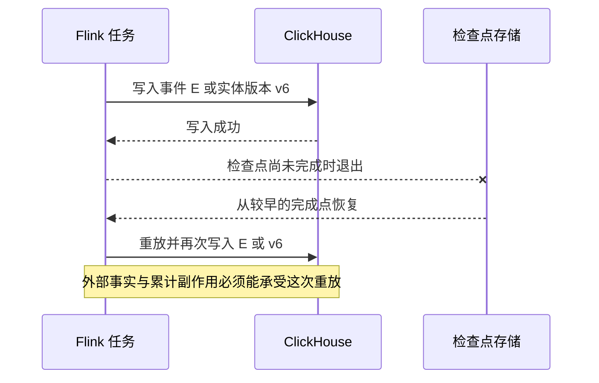

# Flink 与 ClickHouse 的重放、去重和汇总一致性

[数据平台分类](../interview_bigdata.md) · [Flink 基础](flink.md) · [ClickHouse 基础](clickhouse.md) · [首页](../../README.md)

设计目标：任务重启、消息重投、实体状态变化和历史补数发生时，解释每一层的恢复语义，避免“明细最终去重，金额却已经多算”的问题。

**范围与前提：** Flink 概念参考 1.20；ClickHouse 参考 MergeTree 家族与增量物化视图机制，实际服务端与连接器版本需单独固定。SQL 为教学示例，未执行；没有声称任意 Sink 组合天然提供端到端 Exactly Once。

## 阅读目录

<details>
<summary>展开实时结果一致性知识点</summary>

- [完整题目与语义选择](#完整题目与语义选择)
- [检查点覆盖哪些资源](#检查点覆盖哪些资源)
- [不可变事件与可变实体](#不可变事件与可变实体)
- [为什么明细去重不等于汇总正确](#为什么明细去重不等于汇总正确)
- [示例一按最新事实计算](#示例一按最新事实计算)
- [示例二构建可发布的结果版本](#示例二构建可发布的结果版本)
- [实时与补数怎样衔接](#实时与补数怎样衔接)
- [故障窗口与恢复](#故障窗口与恢复)
- [深入追问与参考回答](#深入追问与参考回答)
- [手工走查与观测](#手工走查与观测)
- [参考资料](#参考资料)

</details>

## 完整题目与语义选择

订单 v5 的净额为 10000 分，v6 部分退款后净额为 6000 分。两条事实都可能重投；任务在写入 ClickHouse 后、完成检查点前退出。怎样让按日金额正确？

先区分：事件只追加还是实体会更新；指标是累计交易流水还是当前净额；迟到修正允许多久；读者要求暂时收敛还是一个固定、可核对的数据版本。没有这些约束，不能只根据引擎名选择方案。

## 检查点覆盖哪些资源


Flink 恢复托管状态和输入进度的能力，并不自动撤销检查点之后已经暴露到外部的写入。端到端语义还取决于 Source 重放、Sink 提交、幂等身份、外部存储及读取方式。



## 不可变事件与可变实体

| 模型 | 稳定身份 | 正确计算需要什么 |
| --- | --- | --- |
| 不可变交易事件 | event_id 或真实交易流水身份 | 同一事实重复不累计；冲正作为新事实有明确关联 |
| 实体最新状态 | tenant_id、order_id 与 business_version | 每实体选择正确版本，再按业务属性聚合 |
| 状态差量 | 变更身份、旧贡献与新贡献 | 差量不能被重复应用，恢复也不能重复累计 |

Flink 中先记住某事件“处理过”，然后外部写入仍会失败；反过来外部已写、检查点尚未完成也会重放。只在内存状态做一次去重，不能独自覆盖所有外部写入窗口。

## 为什么明细去重不等于汇总正确

ReplacingMergeTree 的后台合并和增量物化视图的插入处理不是同一件事。若同一份 100 元被两次插入并已触发累计，源明细以后只保留一份，不代表下游已累计的 200 元会自动减回 100 元。

实体从净额 100 变成 60，正确的当前净额是 60，而不是把两份 after-image 相加得到 160。若选择差量，第二步应表达从旧贡献到新贡献的变化，并继续解决差量重放问题。

插入去重、去重 token、物化视图的去重设置等能力有特定版本、窗口和配置条件；不能仅凭“用了某个 MergeTree”就推导业务永久不重不丢。

## 示例一按最新事实计算

一个便于解释正确性的模型是保存带业务版本的完整事实，再按每个实体的最新版本聚合。假定同一实体、同一版本的语义载荷相同；冲突先隔离，不任意挑一个。

```sql
CREATE TABLE order_fact_versions (
    tenant_id UInt64,
    order_id String,
    business_version UInt64,
    biz_date Date,
    net_amount_minor Int64,
    is_deleted UInt8,
    event_id String
)
ENGINE = ReplacingMergeTree(business_version)
ORDER BY (tenant_id, order_id);
```

示例没有按业务日期分区，避免日期变化让同一实体版本散落到不能按预期替换的分区。生产分区方案应按数据规模设计，同时证明版本替换范围正确。

```sql
SELECT tenant_id,
       latest.1 AS biz_date,
       sum(latest.2) AS net_amount_minor
FROM (
    SELECT tenant_id, order_id,
           argMax(tuple(biz_date, net_amount_minor, is_deleted),
                  business_version) AS latest
    FROM order_fact_versions
    GROUP BY tenant_id, order_id
)
WHERE latest.3 = 0
GROUP BY tenant_id, latest.1;
```

先选择最新事实，再过滤可变属性和聚合；若先按旧日期或旧状态过滤，可能保留不该计入的历史版本。金额使用精确单位，生产还要验证总量范围和合适数值类型。

代价是查询需要处理版本集合；实际需评估排序、数据范围、分区和资源。它说明如何在当前可见事实中取正确版本，不自动提供跨分片同一时刻的全局事务快照。

## 示例二构建可发布的结果版本

对于正式报表或补数，可固定输入水位 W，在独立 generation 中计算完整结果，完成条数、金额、业务键和缺失分区核对后，再发布读取指针。

| 记录 | 需要的信息 |
| --- | --- |
| input_manifest | 输入分区与截止位置、Schema、规则版本 |
| result_generation | generation_id、构建状态、业务日期范围、质量结果 |
| output_part | 版本内的分片、条数、金额与校验 |
| publication | 对外可见版本与 CAS 条件，禁止旧任务覆盖 |

W 可能是多个输入分区的协调范围，不一定是一个时间戳。计算完成前不让读者混读半个新版本；“发布指针”必须是所有相关查询真正遵守的读取入口。

这种方案交换了实时可见性、存储和构建成本。若要让已发布批次再叠加实时变化，需要单独定义 W 之后的覆盖范围、去重和新旧事实合并，不能把同一部分重复计算。

## 实时与补数怎样衔接

补数写入独立结果代际，不与实时流无约束地向同一累计表追加。固定补数输入范围、业务版本和计算规则；发布后明确哪些实时事件已经包含、哪些还需继续处理。

不能用更大的 run_id 代替更大的业务版本，也不能假定补数结果总是比实时更新更权威。若从原始事实重建，明确权威输入、截止范围与补数期间新变化的承接方式。

## 故障窗口与恢复

| 故障 | 恢复规则 |
| --- | --- |
| 外部写成功、检查点未完成 | 允许重放，Sink 与查询模型识别同一事实 |
| v6 先到、v5 后到 | 较旧版本不覆盖新事实 |
| 同版本载荷不同 | 记录冲突并核对源端，不随机选胜者 |
| 删除后旧状态重放 | 删除版本或事实生命周期规则阻止复活 |
| 明细合并后汇总仍偏大 | 查累计传播路径，按确定输入范围重建或修正 |
| 补数只写完部分分区 | 不发布为完整版本 |
| 新版本已发布、旧任务恢复 | 当前发布 epoch / 版本条件拒绝旧覆盖 |
| 状态清理后历史事件重放 | 检查去重窗口与权威版本，不能只依赖已过期状态 |

## 深入追问与参考回答

**为什么定期 OPTIMIZE FINAL 不是完整解法？** 合并有成本，也不能自动撤销已传播的累计副作用。还需正确的实体身份、版本与计算模型。

**有 Checkpoint 是否可以不做对账？** 检查点描述相应处理资源的一致恢复状态，不能替代业务口径、外部写入和下游使用方的核对。

**为什么业务主键不一定能作为事件去重键？** 同一订单可以有支付、退款、状态更新等多个合法事实。只按订单 ID 去重可能丢掉后续变化。

**使用最新版本聚合就一定满足财务流水要求吗？** 不一定。当前状态投影与逐笔不可变账务记录是不同契约；后者需要真实流水和冲正关系，不能把中间事实随意覆盖。

**FINAL 和 argMax 可以随意替换吗？** 要看引擎、排序键、分区、版本和查询范围的语义与成本。先证明返回的业务事实相同，再评估性能。

## 手工走查与观测

用 v5=10000、v6=6000、重复 v6、迟到 v5 和删除版本推演，比较原始插入、最新事实与汇总结果。再加入重启、补数部分完成和发布失败，核对每个读取版本的输入范围。

观察输入 lag、检查点失败和恢复位置、Sink 重试、同版本冲突、part/合并压力、版本构建进度和金额差异。没有运行真实 Flink、ClickHouse 或吞吐实验。

## 参考资料

组件能力参考 [Flink 1.20 Fault Tolerance](https://nightlies.apache.org/flink/flink-docs-release-1.20/docs/learn-flink/fault_tolerance/)、[ClickHouse 增量物化视图](https://clickhouse.com/docs/concepts/features/materialized-views/incremental-materialized-view)与[ReplacingMergeTree](https://clickhouse.com/docs/engines/table-engines/mergetree-family/replacingmergetree)。本页的事实建模、输入 manifest 和发布协议是教学设计。
