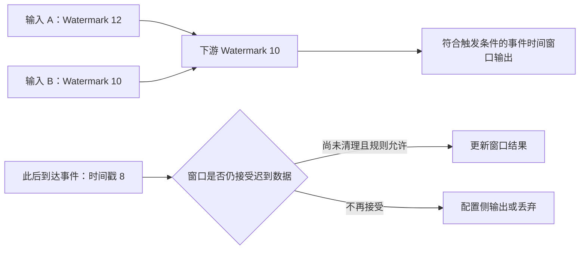
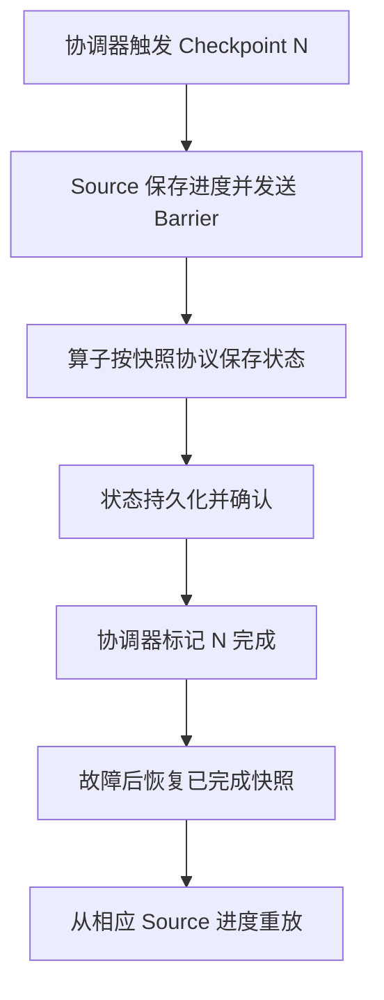

# 数据平台与 Flink

[返回分类](../interview_bigdata.md) · [全部问答](../技术学习笔记.md) · [练习](../practice.md) · [版本与资料](../references.md)

从数据时效与采集衔接出发，依次理解时间、状态、恢复，再分析反压、倾斜和数据质量。

**适用版本与前提：** 概念与图解固定参考 Flink 1.20 文档；Source / Sink 连接器、状态兼容与部署模式按实际版本核对。

## 阅读目录

- [Q29 离线与实时数仓有什么区别 如何选择](#q29-离线与实时数仓有什么区别-如何选择)
- [Q30 全量与增量采集如何衔接](#q30-全量与增量采集如何衔接)
- [Q31 Event Time Watermark 与迟到数据如何解释](#q31-event-time-watermark-与迟到数据如何解释)
- [Q32 Flink State 与 Checkpoint 分别是什么](#q32-flink-state-与-checkpoint-分别是什么)
- [Q33 Checkpoint 与 Savepoint 有什么区别](#q33-checkpoint-与-savepoint-有什么区别)
- [Q34 开启 Checkpoint 就能保证写入 ClickHouse 不重不丢吗](#q34-开启-checkpoint-就能保证写入-clickhouse-不重不丢吗)
- [Q35 反压和数据倾斜怎么区分](#q35-反压和数据倾斜怎么区分)
- [Q36 Flink 关联和状态膨胀如何处理](#q36-flink-关联和状态膨胀如何处理)
- [Q37 实时任务失败或 Checkpoint 超时怎么排查](#q37-实时任务失败或-checkpoint-超时怎么排查)
- [Q38 数据质量 对账和补数怎么设计](#q38-数据质量-对账和补数怎么设计)

## Q29 离线与实时数仓有什么区别 如何选择

类型：方案题。优先级：最高。

原理与做法：我先看业务更新频率和决策时效。按天结算或历史分析通常可以用批处理，实时监控或及时反馈才需要持续加工。实时链路增加了乱序、状态、故障恢复和持续资源占用等复杂度，因此不是所有报表都应该实时。数据分层的作用是明确原始事实、公共明细、可复用汇总和应用指标；是否叫 ODS、DWD、DWS、ADS，以及各层是否独立落地，应由数据复用、查询需求与维护成本决定。

进一步思考：问“你们是不是 Lambda 架构”，先画实际链路再判断，不为了名词强行归类。数仓分层也不等于必须部署某个特定存储产品。

## Q30 全量与增量采集如何衔接

类型：方案题。优先级：高。

原理与做法：目标是在初始化全量和持续增量之间建立清晰边界，既不漏也能识别重叠。先确认采集工具如何建立快照与日志位点，记录全量期间的增量，再按它支持的协议衔接。仅凭更新时间轮询要考虑相同时间戳、迟提交、删除和时间精度问题；即使窗口重叠，也必须由下游去重。删除事件、表结构变化和重启恢复都要有明确语义。

进一步思考：问“从当前时间往后读就够了吗”，回答事务提交与快照边界可能不一致，不能随意用应用时间代替数据库日志位置。采集保证需要结合实际工具、配置和恢复协议分析。

## Q31 Event Time Watermark 与迟到数据如何解释

**最小场景：先读懂输入进度，再讨论乱序。**

| 观察到的情况 | 下游怎么理解 |
| --- | --- |
| 输入 A 已发出 Watermark 12，输入 B 只发出 10 | 两个输入均活跃时，下游通常只能推进到 10 |
| A 又收到更多新数据，B 的进度没变化 | 仅 A 变快不会自动让下游跳过 B |
| 下游 Watermark 到 10 后，收到时间戳为 8 的记录 | 需要进入相应窗口的迟到处理规则，不能说该记录“不可能存在” |

**图解：两个活跃输入的 Watermark 分别为 12 和 10，下游通常取最小值 10。单位仅作示意。**

Watermark 表示系统对事件时间进度的判断，不能证明更早的数据永远不会再来。是否接受迟到数据由窗口、触发器、`allowedLateness` 和状态清理规则决定；侧输出也需要显式配置。空闲输入可通过 idleness 策略处理，不能直接忽略所有慢分区。参考 [Flink 1.20 时间语义](https://nightlies.apache.org/flink/flink-docs-release-1.20/docs/concepts/time/)。

类型：原理题。优先级：最高。

原理与做法：Event Time 是事件携带的发生时间，Processing Time 是算子处理时的时间。Watermark 表示事件时间的推进预期，用于推动窗口等计算，但不是绝不会再来旧数据的承诺。迟到策略需要在结果时效、完整性和状态成本之间权衡，视所用 API 选择允许更新、侧输出或离线修正。多个输入的时间推进通常受较慢输入影响，空闲分区还可能阻塞推进，需要合理配置空闲检测。

进一步思考：问“Watermark 延迟 5 秒是否就等于窗口结果固定延迟 5 秒”，回答不是，还受事件分布、并行输入、触发与下游耗时影响。资料见 [S11](../references.md#s11)。

## Q32 Flink State 与 Checkpoint 分别是什么

**图解：Checkpoint 将输入进度与算子状态组成可恢复的一致快照。**

图省略多输入对齐、非对齐 Checkpoint 和具体 Sink 协议。能恢复状态不代表外部 HTTP 或数据库副作用天然只发生一次；继续阅读 Q34，检查 Source 可重放性、Sink 提交协议及幂等键。参考 [Flink 1.20 故障恢复](https://nightlies.apache.org/flink/flink-docs-release-1.20/docs/learn-flink/fault_tolerance/)。

类型：原理题。优先级：高。

原理与做法：State 是计算需要保存的中间信息，例如按用户累计金额、去重标记或关联等待数据；Checkpoint 是对可恢复状态及相关进度的一致性快照。状态后端负责状态如何组织和访问，Checkpoint 存储负责快照持久化，两者需要区分。选择时看状态大小、访问模式、恢复时间和运维成本，不只看内存是否够用。状态后端的能力和配置方式应按实际 Flink 版本核对。

进一步思考：问“Checkpoint 就是定时把业务库备份吗”，回答不是，它服务于流作业恢复，不是外部数据库通用备份。资料见 [S12](../references.md#s12)。

## Q33 Checkpoint 与 Savepoint 有什么区别

类型：原理题。优先级：中。

原理与做法：Checkpoint 通常由系统周期性触发，主要服务故障恢复；Savepoint 通常用于有计划的升级、迁移或调整，并由操作方管理其生命周期。恢复是否成功还取决于算子标识、状态结构、并行度变化和版本兼容等条件。不能因为保存了 Savepoint，就认为可以任意修改作业或升级任意版本。升级前需要验证兼容路径，并保留回退方案。

进一步思考：问“改了状态类型还能恢复吗”，回答要核对序列化器和状态兼容规则，不能只比较 Java 类名是否相同。

## Q34 开启 Checkpoint 就能保证写入 ClickHouse 不重不丢吗

类型：原理与场景题。优先级：最高。

原理与做法：不能直接保证。Checkpoint 可用于恢复 Flink 管理的状态与处理进度，但端到端结果还依赖 Source 是否可重放、Sink 是否具备相应事务或幂等能力，以及连接器与配置。比如一批数据已经写入外部系统，但相关 Checkpoint 尚未完成，恢复后可能再次写入。因此我会明确 Sink 的实际语义，再设计业务键、版本或可替换结果，验证失败窗口。不能把最终后台去重等同于每次查询都准确。

进一步思考：问“那 Flink 的 exactly-once 是假的”，回答不是，关键是保证对象与边界；状态一致性和外部可见结果要分别讨论。资料见 S12 S14。

## Q35 反压和数据倾斜怎么区分

类型：排障题。优先级：高。

原理与做法：反压说明下游处理能力限制了上游推进，可能来自慢 Sink、网络、计算或资源竞争；倾斜是负载在分区或键之间分布不均，两者可能同时出现。我会比较各算子的吞吐、忙碌与反压情况，以及不同 subtask 的差异，沿链路找到最早的瓶颈。增加并行度未必解决单个热点键，可能要调整聚合方式；使用加盐等方案前必须确认业务语义可拆分并可正确合并。

进一步思考：问“所有反压都加并行度吗”，回答不是，下游存储饱和、外部限流或单键瓶颈时，应先解决限制因素。

## Q36 Flink 关联和状态膨胀如何处理

类型：方案题。优先级：高。

原理与做法：先区分实时双流关联、时间区间关联和维表查询，它们对时间与状态的要求不同。无限保留等待关联的数据会导致状态持续增长，但随意设置 TTL 又可能丢失合法匹配。我要先明确允许的匹配时差、迟到范围和业务完整性，再决定清理、补偿与查询策略。维表还要明确使用事件发生时版本还是处理时最新版本，缓存与异步查询不能改变指标口径。

进一步思考：问“TTL 设一天是否足够”，回答取决于业务最长延迟和补数策略；TTL 是资源与语义的选择，不是通用正确性开关。

## Q37 实时任务失败或 Checkpoint 超时怎么排查

类型：排障题。优先级：高。

原理与做法：先看最早失败原因，区分算子异常、外部连接、资源不足与快照超时。对 Checkpoint 我会分段看触发、对齐、状态快照和持久化耗时，再结合反压、状态大小与存储吞吐判断。处理之前确认最近可用快照和源端保留范围，避免盲目重置位点。增加超时时间只能缓解某些现象，不能代替定位。恢复后要核对积压、下游结果和重复处理情况。

进一步思考：问“不开 Checkpoint 任务就恢复了可不可以”，回答这会改变恢复保障，必须明确数据风险，不能只以进程重新运行作为完成标准。

## Q38 数据质量 对账和补数怎么设计

类型：方案题。优先级：最高。

原理与做法：先定义指标粒度、时间、币种、状态过滤与撤销退款规则，再按相同口径对账。检查不只看条数，还包括业务键覆盖、金额、重复和关键字段空值。补数前明确范围、版本和写入策略，优先隔离计算并核对，再使用受控替换或幂等合并；实时与补数重叠必须定义归属。修正结果还要能追溯是哪批任务、哪版口径产生的。

进一步思考：问“总金额一样就准确吗”，回答不同错误可能相互抵消，需要分日期、业务主体与明细层逐级核对。重算不能无条件追加到累计结果。

---

[返回分类](../interview_bigdata.md) · [全部问答](../技术学习笔记.md) · [练习](../practice.md) · [版本与资料](../references.md)
