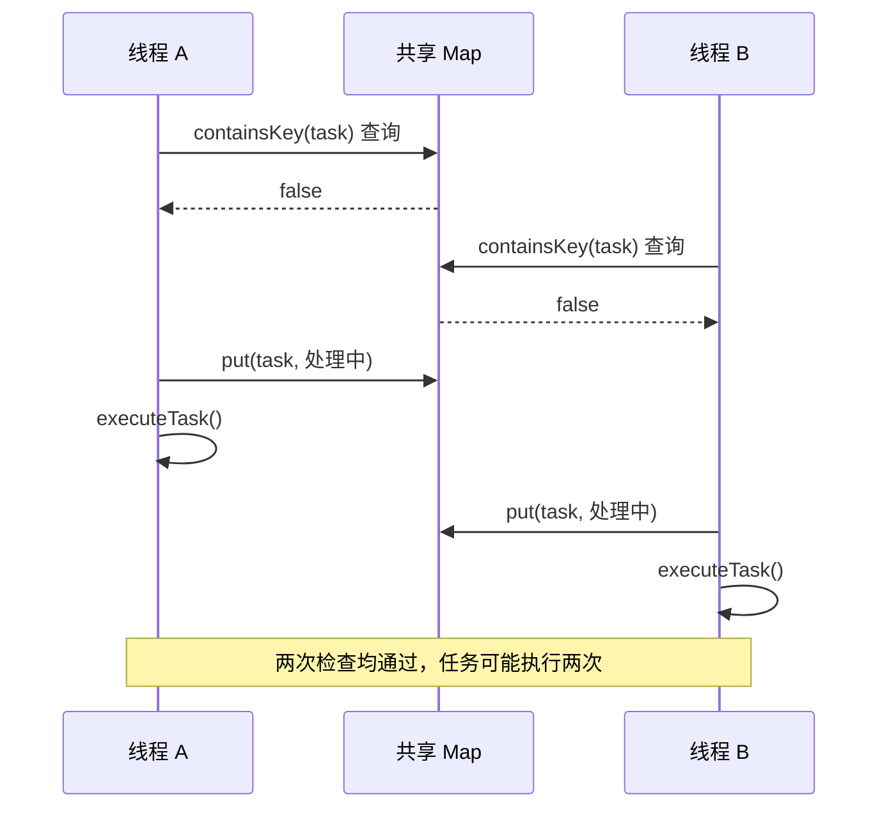
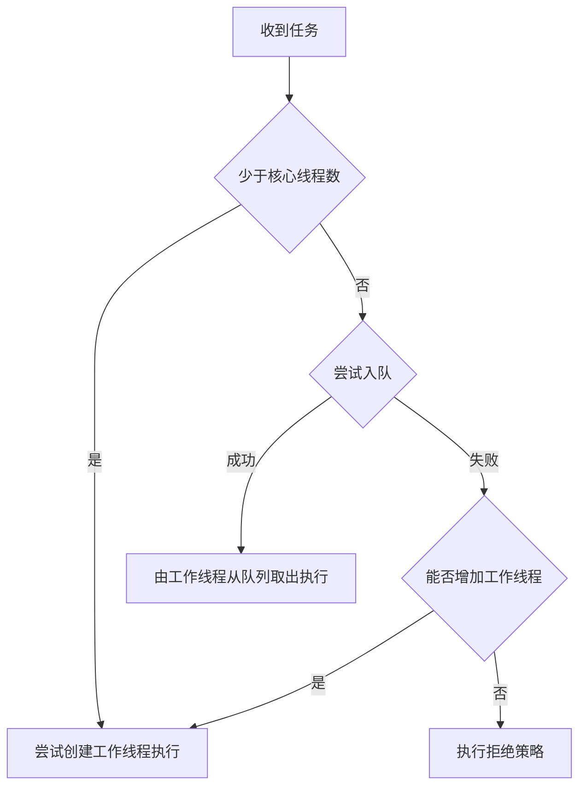

# Java 集合与并发

[返回分类](../interview_java.md) · [全部问答](../技术学习笔记.md) · [练习](../practice.md) · [版本与资料](../references.md)

理解共享数据、可见性和复合操作，先读 Q01–Q03，再读线程池、异步调用与上下文管理。

**适用版本与前提：** 以 Java 8 为示例基线；集合实现阈值与调度细节按具体 JDK 核对。

## 阅读目录

- [Q01 HashMap 的原理和使用风险是什么](#q01-hashmap-的原理和使用风险是什么)
- [Q02 ConcurrentHashMap 线程安全 为什么先判断再写仍有问题](#q02-concurrenthashmap-线程安全-为什么先判断再写仍有问题)
- [Q03 volatile synchronized 和 CAS 怎么选](#q03-volatile-synchronized-和-cas-怎么选)
- [Q04 线程池怎么执行任务 参数怎么确定](#q04-线程池怎么执行任务-参数怎么确定)
- [Q05 CompletableFuture 并行调用要注意什么](#q05-completablefuture-并行调用要注意什么)
- [Q06 ThreadLocal 为什么可能导致内存或上下文问题](#q06-threadlocal-为什么可能导致内存或上下文问题)

## Q01 HashMap 的原理和使用风险是什么

类型：原理题。优先级：高。

原理与做法：以常见 JDK 8 实现为例，HashMap 用数组定位桶，在桶内处理哈希冲突，冲突较多并满足条件时可能树化。键先计算哈希，再定位并通过 equals 判断是否同一个键。它不保证遍历顺序，也不保证线程安全。业务上我更关注键是否稳定、equals 与 hashCode 是否一致，以及容量和扩容的成本。作为键的对象如果在插入后修改了参与哈希或相等判断的字段，后续查找可能出现问题。

进一步思考：问树化阈值时，JDK 8 常见实现的树化阈值常量为 8，最小树化容量为 64；实际触发还与插入流程有关，应以版本源码为准。不要把实现阈值当成 Map 接口承诺。资料见 [S01](../references.md#s01)。

## Q02 ConcurrentHashMap 线程安全 为什么先判断再写仍有问题

类型：原理题。优先级：高。

原理与做法：它保证所提供操作的并发安全，但多个操作组合起来不自动成为原子操作。两个线程都可能先判断键不存在，再分别写入或执行业务。因此我会按语义使用 putIfAbsent、compute 或外部同步；回调函数要保持短小，避免在其中做长时间网络调用。JDK 8 的实现与早期分段锁版本不同，不能混在一起解释。它也不允许 null 键和 null 值。

**通俗理解：一次操作安全，不代表“先判断、再写入”这一整段逻辑也安全。**

假设两个线程共享同一个 `ConcurrentHashMap<String, String>`，变量名为 `map`。我们想用它记录任务，避免同一个任务被重复执行：

```java
if (!map.containsKey("task-001")) {
    map.put("task-001", "处理中");
    executeTask();
}
```

这段代码的意思是：没有任务记录，就先登记，再执行任务。但两个线程同时运行时，可能出现下面的顺序：

| 顺序 | 线程 A | 线程 B |
|---|---|---|
| 1 | 检查任务不存在，进入 if | |
| 2 | | 检查任务也不存在，进入 if |
| 3 | 写入记录，执行任务 | |
| 4 | | 写入记录，也执行任务 |

**图解：单次调用安全，多次调用之间仍可以交错。**



把判断与写入合成 `putIfAbsent` 后，在记录未被删除、所有竞争者共享同一个 Map 的前提下，只有成功写入的线程获得这次处理资格。业务失败和跨实例处理仍由下面的边界规则约束。

**最后 Map 里只有一条记录，但任务执行了两次。** 两个线程检查时，都还没有人写入。等它们进入 `if` 后，即使另一个线程已经写入，也不会自动重新判断。

`containsKey()` 和 `put()` 各自是线程安全的，但它们是两次调用，中间允许其他线程执行。要把“判断不存在”和“写入”合成一个原子操作，可以改成：

```java
if (map.putIfAbsent("task-001", "处理中") == null) {
    executeTask();
}
```

`putIfAbsent` 的含义是：key 不存在时写入；已经存在时保留原来的值。它把判断与条件写入作为一个原子操作完成。

它返回的是**原来的值**：

- 返回 `null`：原来没有值，这个线程成功写入，可以执行任务。
- 返回非 `null`：已经有值，这个线程跳过任务。这里利用了 `ConcurrentHashMap` 不允许存储 `null` 值的规则。

因此，在 key 原本不存在、竞争期间没有删除该记录的前提下，两个线程的执行结果是：

```text
线程 A：成功写入，返回 null → 执行任务
线程 B：发现已有记录，返回“处理中” → 跳过任务
```

**适用边界：** 这个示例只解决同一个进程内、共享同一个 Map 时的竞争。它不保证任务成功完成；写入后任务失败，记录仍然存在，后续请求可能被跳过。失败重试、记录清理和多个服务实例之间的去重，需要另外设计。

进一步思考：问“放进 map 就能保证订单只创建一次吗”，回答不能。多进程共享业务仍要依赖数据库约束或适当的分布式协调，内存 map 不能跨实例兜底。资料见 [S02](../references.md#s02)。

## Q03 volatile synchronized 和 CAS 怎么选

类型：原理题。优先级：高。

原理与做法：volatile 适合发布状态等需要可见性和特定有序性的场景，但不能让 i++ 这类复合操作自动原子化。synchronized 通过互斥保护临界区，并建立线程间的可见性关系。CAS 是比较后更新的原子操作，可以用于计数和状态竞争，但需要考虑失败重试、热点竞争，以及引用值可能出现的 ABA 问题。我的选择依据是保护一个独立值，还是保护多个字段构成的业务不变量。

进一步思考：问“用 AtomicInteger 扣库存就够了吗”，回答它只能保护当前进程内该变量的操作，不能自动保护数据库库存、订单和多实例之间的一致性。

## Q04 线程池怎么执行任务 参数怎么确定

**图解：以正常运行中的 ThreadPoolExecutor 为例。**



“还能创建线程”需要核对 `maximumPoolSize`、运行状态及创建是否成功。图中省略了关闭状态与入队后的状态复查。无界队列通常使任务优先排队，不能期待只调大 `maximumPoolSize` 就增加并发。参数同时受下游容量、任务耗时和排队延迟预算约束。参考 [Java 8 API](https://docs.oracle.com/javase/8/docs/api/java/util/concurrent/ThreadPoolExecutor.html)。

类型：原理与方案题。优先级：最高。

原理与做法：ThreadPoolExecutor 通常先尝试创建核心线程，之后尝试入队；队列无法接纳时再尝试扩到最大线程数，仍无法接纳则执行拒绝策略。参数要结合任务耗时、CPU 与 I/O 比例、下游连接数和容许排队时间，不直接套固定公式。我会使用有边界的队列，明确拒绝后是返回失败、调用方执行还是转入可追踪的异步流程，并监控活跃线程、排队、耗时和拒绝次数。

进一步思考：问“最大线程设 200 为什么只有 10 个在工作”，先看核心线程和队列是否尚未饱和；大队列可能使扩容迟迟不发生。CallerRunsPolicy 也可能拖慢请求线程，不能当成没有代价。资料见 [S03](../references.md#s03)。

## Q05 CompletableFuture 并行调用要注意什么

类型：方案题。优先级：高。

原理与做法：我先判断几个调用是否真正独立，再决定是否并行。阻塞 I/O 任务通常使用明确配置的执行器，避免随意占用公共线程池。每个子任务要有超时、异常处理和结果缺失策略，整体请求也有时间预算。需要区分等待超时与底层调用取消，返回超时不代表远程工作已经停止。并行以后还要检查下游连接池、限流，以及日志链路上下文是否正确传递。

进一步思考：问“thenApply 一定换线程吗”，回答不一定，非 Async 阶段可能由完成前序任务的线程执行。超时辅助 API 的可用性要看 Java 版本；JDK 8 不能直接照搬后续版本的方法。资料见 [S04](../references.md#s04)。

## Q06 ThreadLocal 为什么可能导致内存或上下文问题

类型：原理题。优先级：中。

原理与做法：ThreadLocal 将值与当前线程关联，线程池中的线程可能比一次请求活得更久。如果没有清理，下一个任务可能读到上一次请求的用户或链路信息，也可能长期保留较大的对象。常见实现里的弱引用键并不等于值会立刻释放，所以需要在合适边界用 finally 清理。跨线程任务也不能假定上下文自然传递，应明确复制必要信息并在任务结束后恢复或清理。

进一步思考：问“传递一个请求对象是否方便”，回答只传业务真正需要的最小上下文，避免把大对象和敏感信息长期绑定在线程上。

---

[返回分类](../interview_java.md) · [全部问答](../技术学习笔记.md) · [练习](../practice.md) · [版本与资料](../references.md)
