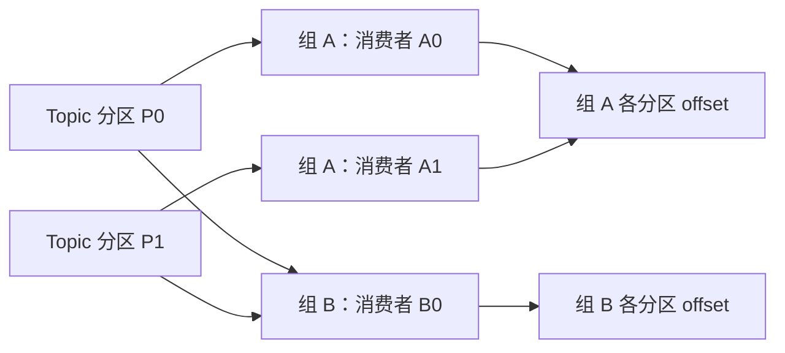

# Kafka 消费与可靠性

[返回分类](../interview_bigdata.md) · [全部问答](../技术学习笔记.md) · [练习](../practice.md) · [版本与资料](../references.md)

先画清 Topic、Partition、Consumer Group 和 offset，再分析顺序、重复、积压与事务边界。

**适用版本与前提：** 命令笔记包含 Kafka 3.5.0 示例；协议说明另列 Kafka 4.1 官方资料，升级时核对客户端和服务端配置。

## 阅读目录

- [Q24 Kafka 为什么会重复消费 怎么避免业务重复](#q24-kafka-为什么会重复消费-怎么避免业务重复)
- [Q25 Kafka 顺序性怎么理解](#q25-kafka-顺序性怎么理解)
- [Q26 Kafka 积压怎么定位和处理](#q26-kafka-积压怎么定位和处理)
- [Q27 如何设计失败重试和死信处理](#q27-如何设计失败重试和死信处理)
- [Q28 如何理解 Kafka 的可靠性与恰好一次](#q28-如何理解-kafka-的可靠性与恰好一次)

## Q24 Kafka 为什么会重复消费 怎么避免业务重复

类型：原理与方案题。优先级：最高。

原理与做法：一个典型时序是业务写入已成功，但消费位点尚未成功提交，进程故障后这条消息会再次读取。我会承认重复投递是需要处理的正常场景，用稳定事件标识和业务幂等避免重复副作用。处理成功后提交位点也要考虑并发批次的提交顺序，不能跳过尚未完成的较早消息。生产端幂等解决特定发送重试的重复，并不会自动让外部数据库业务幂等。

进一步思考：问“先提交位点再处理呢”，回答故障时可能业务没执行而位点已越过，产生遗漏风险。保证范围要落到具体消费者与外部写入。资料见 [S10](../references.md#s10)。

## Q25 Kafka 顺序性怎么理解

**图解：同一消费组内分配分区，不同消费组独立消费。**

图描述常规 Consumer Group 的稳定分配状态；每组每分区通常分配给一个消费者实例，组间互不排斥。分区内日志有顺序，不等于消费线程池中的业务副作用自动有序。固定 key 的路由还要核对分区器与分区数变化。

类型：原理题。优先级：高。

原理与做法：Kafka 的顺序主要在分区范围内讨论，跨分区没有统一全局顺序。同一业务键可以按确定规则进入同一分区，但消费者如果又并发处理，业务完成顺序仍可能改变。分区数量调整、生产者配置与重试策略也可能影响业务对顺序的依赖。因此我更倾向在业务端定义版本和合法状态变更，不能只依赖消息到达先后保护状态。

进一步思考：问“按订单 ID 分区后还要状态校验吗”，回答要，历史重放、不同来源和应用并发仍可能带来过期或非法事件。

## Q26 Kafka 积压怎么定位和处理

类型：排障题。优先级：最高。

原理与做法：先看积压持续时间、增长速度和受影响分区，再比较生产速率与消费速率。然后判断是消费计算慢、下游写入慢、频繁重试与再均衡，还是个别业务键导致倾斜。扩容消费者前要看分区数量及消费模型，传统消费组内某个分区同一时刻通常只分配给一个消费者。处理时优先恢复有效吞吐，必要时限制非关键流量，再评估批量、并发和下游承受能力。

进一步思考：问“分区不变一直加消费者呢”，回答传统消费组会出现空闲消费者；而下游已饱和时增加并发会恶化。不要为消除积压直接跳过未经确认的业务消息。

## Q27 如何设计失败重试和死信处理

类型：方案题。优先级：高。

原理与做法：先区分临时故障与永久错误。网络抖动可以有上限地退避重试，并加入抖动，避免同步冲击；参数错误或业务不允许的状态应进入明确的失败处理。超过重试上限后保留原始事件、失败原因和处理记录，进入隔离队列或人工处理流程。补处理仍要幂等，并明确是否影响业务顺序。只有保存失败消息而没有告警、处理责任和重放规则，还不算闭环。

进一步思考：问“失败就阻塞分区吗”，回答要结合顺序要求；强顺序业务和可隔离独立事件，处理策略不同。

## Q28 如何理解 Kafka 的可靠性与恰好一次

类型：原理题。优先级：高。

原理与做法：我会按生产、存储、消费和外部副作用分别说明。生产确认、复制配置与可用副本影响消息持久性；消费位点和业务提交的先后影响遗漏或重复。Kafka 事务可以支持 Kafka 范围内的原子写入与相关位点处理，但不能默认覆盖任意外部 HTTP 或数据库写入。最终要回答的是，在哪些故障假设下，哪种业务结果被保证一次，而不是笼统说用了消息队列就不丢不重。

进一步思考：问“acks=all 就绝不丢吗”，回答还要结合副本、min.insync.replicas、故障范围和实际配置，不能给无限范围的保证。资料见 [S10](../references.md#s10)。

---

[返回分类](../interview_bigdata.md) · [全部问答](../技术学习笔记.md) · [练习](../practice.md) · [版本与资料](../references.md)
