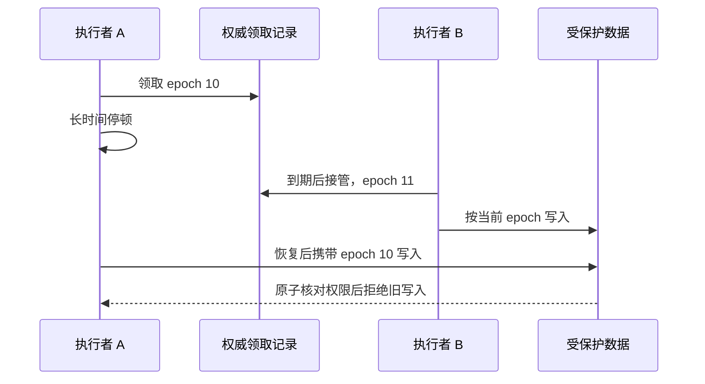
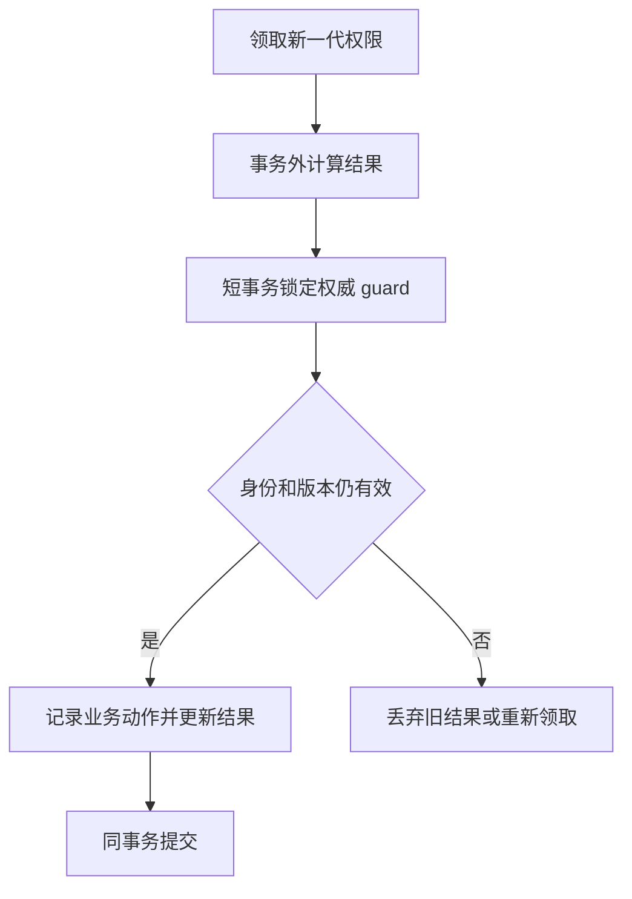

# 租约失效、Fencing 与旧执行者隔离

[锁与并发协调](../DISTRIBUTED_LOCK.md) · [分布式设计](../interview_design.md) · [任务调度](distributed-scheduling-backfill.md) · [首页](../../README.md)

设计目标：锁或任务租约到期后，新执行者已经接管，旧线程却恢复运行时，阻止它覆盖新的业务结果。获得锁、正确释放锁和保护最终写入，是不同层次的问题。

**范围与前提：** 教学模型，数据库示例以 MySQL 8.x / InnoDB 为基线。示例的领取权与受保护记录位于能够共同加锁和提交的数据库中；外部系统需要另行核对条件写或幂等能力。没有执行 SQL、停顿或故障切换实验。

## 阅读目录

<details>
<summary>展开租约与 Fencing 知识点</summary>

- [完整题目与不变量](#完整题目与不变量)
- [为什么安全解锁仍不够](#为什么安全解锁仍不够)
- [身份、Epoch 与受保护资源](#身份epoch-与受保护资源)
- [同库领取与写入协议](#同库领取与写入协议)
- [协调器与资源不在同一处时](#协调器与资源不在同一处时)
- [外部文件与不可逆副作用](#外部文件与不可逆副作用)
- [故障窗口与恢复](#故障窗口与恢复)
- [深入追问与参考回答](#深入追问与参考回答)
- [手工走查与观测](#手工走查与观测)
- [参考资料](#参考资料)

</details>

## 完整题目与不变量

A 持有资源租约，读取数据后因 GC 或网络停顿失联。租约到期，B 领取新权限并更新结果；A 恢复后继续使用旧计算结果写入。如何阻止旧结果覆盖新结果？



关键不变量：**受保护操作在线性化的授权检查点，不能接受已经失去相应权限的执行者。** 新执行者接管和旧执行者写入谁先获得权威仲裁，应有明确顺序。租约过期本身不会终止旧线程。

## 为什么安全解锁仍不够

Redis 锁常用随机 token 标识持有者，释放时原子比较 token 并删除。这能防止 A 误删 B 的新锁，但 A 仍可能拿旧数据调用 UPDATE、上传文件或请求外部扣款。

续约减少任务超过租约的机会，不证明进程永远不会停顿；停止本地任务也只是尽力取消，不能保证外部请求尚未生效。需要让最终受保护资源参与判断，而不是只在入口执行一次 GET。

## 身份、Epoch 与受保护资源

| 概念 | 示例与用途 |
| --- | --- |
| resource_key | `report:tenant7:2026-11-05`，定义互斥保护的业务范围 |
| owner_id | 本次执行者身份，不能单独表示新旧次序 |
| epoch / fencing token | 由权威仲裁产生的新一代授权编号；本例每次接管增加 |
| lease_until | 当前领取的到期条件，使用一致的时间与比较规则 |
| operation_id | 同一业务动作的稳定身份，处理相同 epoch 内的重试 |
| 资源版本 | 数据或发布指针的版本，参与条件更新与防覆盖 |

随机 UUID 适合区分身份，不能直接比较大小来判定接管先后。机器时间戳也不能天然提供可靠单调顺序。若发号源会故障回退或复用编号，token 的安全前提就不成立。

## 同库领取与写入协议

最小逻辑结构：

| 表 | 关键字段 |
| --- | --- |
| resource_guard | resource_key 主键；epoch、owner_id、lease_until、version |
| resource_data | resource_key 主键；business_value、result_version、last_operation_id |
| operation_receipt | 资源与 operation_id 唯一；请求 Hash 和稳定结果 |

本例领取过程：

```text
开始短事务
  SELECT resource_guard FOR UPDATE
  检查该资源是否允许领取或接管
  增加 epoch，写新 owner 与 lease_until
提交，返回新的 epoch
```

真正写业务时，再次在数据库内原子地核对权限：

```sql
START TRANSACTION;

SELECT epoch, owner_id, lease_until
FROM resource_guard
WHERE resource_key = :resource_key
FOR UPDATE;

-- 应用核对 epoch、owner、到期条件；不满足则回滚。
-- 在同一事务中检查 operation_id，并修改受保护业务记录。
UPDATE resource_data
SET business_value = :result,
    result_version = result_version + 1,
    last_operation_id = :operation_id
WHERE resource_key = :resource_key
  AND result_version = :expected_result_version;

COMMIT;
```

领取与写入都竞争相同 guard 记录，授权检查至业务提交之间保持相应锁，因此不能在检查后让 B 已完成接管、A 却仍无条件提交旧写入。所有相关写入路径都必须遵守协议，不能留管理员脚本或后台任务绕开它。

这提供的是接管与受保护写入的串行仲裁，不是承诺到达墙上时钟的某一毫秒后，所有已进入数据库的旧事务会立即停止。长停顿也可能让接管等待锁，需要同时限制临界区时长并观察恢复延迟。

事务保持短小，不在 guard 持锁期间进行网络调用或大计算。先计算、最后校验并提交；期间权属变化时，计算结果可以被丢弃。



`epoch` 相同只表示同一代权限，并不证明某个扣减动作尚未做过。同一执行者重试仍需 operation_id 或业务唯一约束。

## 协调器与资源不在同一处时

常见 fencing 设计让资源记住已经接受的最高 token，拒绝更旧的 token。必须注意：如果 B 在协调器拿到了 11，但还没有把 11 安装到资源，资源只知道 10，就不能凭空知道 A 已过期。

因此，“拒绝覆盖已接受的新 token 结果”和“接管瞬间立即拒绝所有旧写”是不同承诺。后者需要资源原子校验当前权威权限、可靠的 token 安装协议或其他能证明的协调方式；不能把 Redis 的一次查询和另一个系统的无条件写拼成原子操作。

etcd 等系统的有序版本与事务能力可以作为协调依据，但它不会自动把另一个数据库或 HTTP 服务纳入同一原子提交。需要按 API 的线性一致性、事务、恢复和版本语义核对。

## 外部文件与不可逆副作用

对象存储不支持所需 fencing 时，可以让每次尝试写入不同的不可变文件路径，例如 resource / epoch / part。最终通过带 epoch 的数据库条件更新发布 manifest；旧执行者可以留下待回收文件，但不能覆盖当前发布指针。

文件上传和数据库发布不是同一事务：先上传、后发布会留下可清理的孤立文件；先发布、后上传则可能暴露缺失文件。详细协议见[可恢复导出](resumable-export.md)。

对于扣款、发短信等外部副作用，不能靠“最后不发布本地结果”撤销已经发生的动作。需要对方验证幂等键、授权版本或提供可查询的业务协议；不支持时要承认保证范围不足。

## 故障窗口与恢复

| 故障 | 协议要求 |
| --- | --- |
| A 停顿，B 接管后 A 恢复 | 最终资源拒绝 A 的过期授权 |
| 续约响应丢失 | 不把本地没收到结果理解为续约一定失败或一定成功；按权威状态处理 |
| 领取提交结果未知 | 查询当前 owner / epoch，不伪造一个新本地编号 |
| 同 epoch 操作被重复调用 | operation_id 与业务变更同事务去重 |
| token 发号源恢复到旧数据 | 不允许未识别的编号回退继续写；设计恢复与代际隔离 |
| 上传完成但发布前宕机 | 文件未被正式引用，重试核对或后续回收 |
| 旧任务绕开 guard 直接调用外部接口 | 本协议无法保护，必须修改受保护接口或业务流程 |

## 深入追问与参考回答

**为什么执行前检查锁还在不够？** 检查后可能停顿，真正写入前权限已经转移。检查和受保护操作需要一个可证明的原子边界。

**有 fencing token 就能实现所有场景的强互斥吗？** 不能。token 需要可靠产生、传递并在资源侧执行；还要定义授权安装时机、多个写入的次序及相同 token 内的幂等。

**已经超时的 A 可以取消吗？** 可以尽力通知，但不能把取消成功作为正确性前提。旧进程可能不可达，远程请求也可能已经执行。

**为什么不把所有计算都放到数据库锁内？** 可以在极短本地修改中使用锁，但长计算或外部调用会扩大锁等待和故障影响。把昂贵工作放外面、最后原子验权发布，通常更容易限制临界区。

**读到旧副本会怎样？** 权属仲裁必须使用满足所需一致性的读写路径，不能让缓存或延迟副本判定当前 epoch。否则检查本身可能接受旧权限。

## 手工走查与观测

固定同一 resource_key，推演 A 领取 10、停顿、B 领取 11、A/B 交错写入，以及相同 operation_id 重试。检查只有被允许的一代结果能够发布，旧写拒绝与孤立输出都有记录。

观察接管次数、旧 epoch 拒绝、续约失败、临界区耗时、guard 锁等待、同动作重复和孤立文件年龄。租约时长应结合尾延迟与恢复目标决定，不能用一个固定数值证明安全。

## 参考资料

版本与时钟风险参见 [Redis Distributed Locks](https://redis.io/docs/latest/develop/clients/patterns/distributed-locks/)；协调 API 保证参见 [etcd 3.5 API guarantees](https://etcd.io/docs/v3.5/learning/api_guarantees/)。本页的同库 guard 与不可变输出协议是教学设计，不是这些组件自动提供的跨系统事务。
