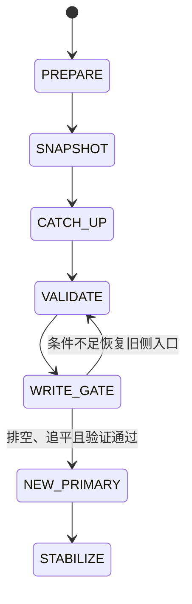
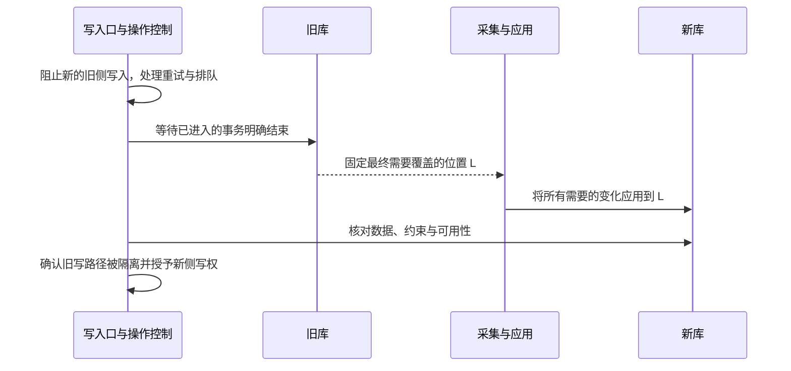

# 不停机数据库迁移、切换与回退

[数据库分类](../interview_mysql.md) · [快照与 CDC](snapshot-cdc.md) · [旧执行者隔离](lease-fencing.md) · [首页](../../README.md)

设计目标：旧库到新库的历史迁移、增量追平、读写切换和故障恢复都有明确依据，防止双写分叉、漏同步，以及新库接收写入后错误回退。

**范围与前提：** 教学迁移协议，不执行现有项目的去 Oracle 改造，也不提供可直接用于生产的切库脚本。MySQL 一致性与数据类型按实际版本核对；异构迁移还需源库专用的采集、类型映射和 SQL 兼容验证。

## 阅读目录

<details>
<summary>展开迁移、切换与回退知识点</summary>

- [完整题目与成功条件](#完整题目与成功条件)
- [权威源与控制模型](#权威源与控制模型)
- [准备、全量与增量](#准备全量与增量)
- [读切换与写切换](#读切换与写切换)
- [为什么双写还不够](#为什么双写还不够)
- [新库写入后的回退](#新库写入后的回退)
- [故障窗口与恢复](#故障窗口与恢复)
- [深入追问与参考回答](#深入追问与参考回答)
- [手工走查与观测](#手工走查与观测)
- [参考资料](#参考资料)

</details>

## 完整题目与成功条件

业务全天运行，旧库持续写入。要求把历史数据和后续变更迁到新库，先验证查询，再切换写入口；切换后发现问题，需要判断能否安全回退。

成功条件不只是“行数相同”：主键、删除、金额精度、NULL、字符排序、时间语义、约束、事务行为、查询结果和调用方协议都需要满足明确映射。每个阶段明确哪边是权威写源。

“不停机”可以包含受控且有上限的写入等待或业务分片切换；若要求完全无等待，需要额外的协调与冲突协议，不能靠口头承诺省掉交接边界。

## 权威源与控制模型

| 对象 | 需要记录的内容 |
| --- | --- |
| migration_plan | 源/目标版本、表范围、转换规则版本、负责人和验收条件 |
| capture_progress | 一致快照与日志位置、各分区应用前沿、保留余量 |
| writer_authority | 业务分片、当前写源、epoch、状态与变更版本 |
| validation_run | 比较范围、共同水位、条数、业务键、金额与明细差异 |
| cutover_record | 排空结果、最终位置 L、目标追平证据、权限变更与回退条件 |



每个阶段推进都需要证据和状态版本。图中没有“任意时刻一键回旧库”的边，因为新库的新写入可能尚未存在于旧库。

## 准备、全量与增量

1. 盘点全部写入者，包括应用、批任务、脚本、存储过程及外部接口；未知写入者会破坏切换协议。
2. 固化类型、默认值、NULL、时区、主键生成、精度、排序和约束映射；异构系统逐项核对，不只改连接地址。
3. 建立可证明衔接的快照与变更日志，按[快照与 CDC 专题](snapshot-cdc.md)记录基线、位置、删除及 Schema 历史。
4. 用相同规则版本写目标，按稳定业务键核对；转换失败进入可追踪处置，不能静默跳行。
5. 对主键范围、业务日期、状态、金额等分段比较，抽查差异明细；Hash 辅助定位，不替代重要业务核对。

业务更新时间、最大 ID 或“同步延迟显示 0 秒”都不是完整的切换证据。多个输入分区必须全部达到需要的连续完成前沿。

## 读切换与写切换

读切换可通过影子查询、比对和限定流量逐步验证。新库尚有复制延迟时，需要明确读己之写、缓存和跨库读取的行为；不能让付款刚成功的用户立刻看到旧状态。

写切换本例使用有界写入门禁：



控制记录的 CAS 示意：

```sql
UPDATE writer_authority
SET active_database = 'NEW', epoch = epoch + 1,
    status = 'ACTIVE', version = version + 1
WHERE business_shard = :business_shard
  AND active_database = 'OLD'
  AND status = 'DRAINED'
  AND version = :expected_version;
```

这只是记录经过核对后的控制面决定，不是把两个数据库原子切换的魔法。实际必须让旧写入通过可验证的门禁、同库 guard、数据库权限或等价机制被阻断；配置缓存中的一个布尔值不足以隔离失联的旧进程。

门禁后等待旧事务结束并确定 L，目标应用到 L 后才开放新写。若不能确认旧事务结果、日志完整性或旧写隔离，不能假装切换已安全完成。大系统可按租户或业务分片进行同样的权属交接。

## 为什么双写还不够

| 双写问题 | 需要解决的内容 |
| --- | --- |
| 写旧成功、写新失败 | 哪边是权威，如何记录待同步事实和恢复 |
| 并发写在两边到达顺序不同 | 版本与顺序，不能无条件后到覆盖 |
| 两侧各自生成 ID | 稳定业务身份与主键分配策略 |
| 删除、默认值和触发逻辑不同 | 映射与数据生命周期一致性 |
| 失败后应用重试 | 请求幂等和重复效果，不能把不确定结果当未写 |
| 正反向同步形成循环 | 来源标识、所有权与去环协议 |

双写可以是过渡方式，但必须定义权威、版本、失败任务和修复策略。可靠事件或 CDC 也需要核对保留期和恢复能力，不自动成为跨库提交协议。

## 新库写入后的回退

**切换前：** 若新库没有承接独立业务写入，通常可以保留旧库权威，废弃或重建目标；仍需处理已经切换的读、缓存和应用兼容。

**切换后：** 新库可能存在新的订单、状态和删除。回退旧库之前，需要把这些事实以经过验证的映射补回旧库，排空新侧写入，再核对最终水位与权属；否则会把业务送回一个缺少新事实的数据库。

反向同步不是自动安全的：旧结构可能无法表达新字段、新业务语义或主键，转换可能不可逆。回退窗口内可限制新侧的破坏性 Schema 变化和不兼容写入；如果无法无损回退，应选择向前修复或明确的数据恢复方案。

## 故障窗口与恢复

| 故障 | 处理方向 |
| --- | --- |
| 全量中断 | 按快照协议恢复或重建代际，保留增量覆盖 |
| 目标应用报错但进度继续 | 阻止虚假追平，恢复缺口并对账 |
| 门禁时部分旧事务结果未知 | 查询权威结果与日志，不能直接开放另一侧独立写入 |
| 目标已追平，但旧脚本仍在写 | 切换前必须隔离，否则重新捕获最终位置 |
| 新侧开放后应用局部回退 | 防止双主写入，按分片权属和版本拦截 |
| 新写入无法反向映射 | 不能声称可直接回旧库，选择兼容限制或向前修复 |
| 源日志不再覆盖恢复范围 | 通过已验证备份日志或重建基线恢复 |
| 数据对齐但业务 SQL 语义不同 | 回到兼容验收，不能只凭行数批准切换 |

## 深入追问与参考回答

**RPO 为零是否只需要同步延迟为零？** 不够。需要说明所有写入者、已完成事务范围、连续应用水位、持久性及切换期间权属；延迟指标本身不能证明没有洞。

**读切换可以与写切换分开吗？** 可以，但要处理复制延迟、读己之写和多数据源读一致性，明确哪些请求应回到权威源。

**为什么需要发布和回退版本？** 数据转换、Schema 和应用代码之间存在兼容关系，回退旧代码不代表旧数据模型仍能解释新事实。

**网络分区时怎样保证旧侧不继续写？** 需要受保护写入路径的硬约束；不能只等配置通知。若无法证明，权属交接要暂停或按已明确的可用性与数据损失目标处理。

**业务不能接受全局门禁怎么办？** 可按业务分片逐个交接，或使用更复杂的转发与冲突处理协议；必须把范围、顺序与失败恢复讲清，不能省略原子边界。

## 手工走查与观测

推演全量更新/删除、CDC 重启、门禁期间长事务、旧脚本迟到写入、新侧首笔写入、反向同步失败和应用回退。为每一步标记权威库、可写集合、数据水位和允许的恢复操作。

记录各阶段耗时、日志保留余量、写入拒绝/等待、数据差异、应用错误和回退准备状态。本文没有执行切换、DDL、数据迁移或生产写入。

## 参考资料

一致性读取参考 [MySQL 8.4 Consistent Nonlocking Reads](https://dev.mysql.com/doc/refman/8.4/en/innodb-consistent-read.html)；采集边界参考 [Debezium 2.7 MySQL Connector](https://debezium.io/documentation/reference/2.7/connectors/mysql.html)。本页切换、权属和回退协议为教学设计，具体迁移必须核对源库与目标库版本。
