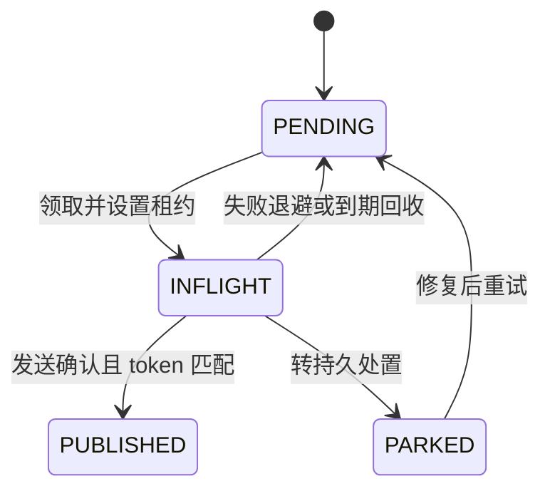
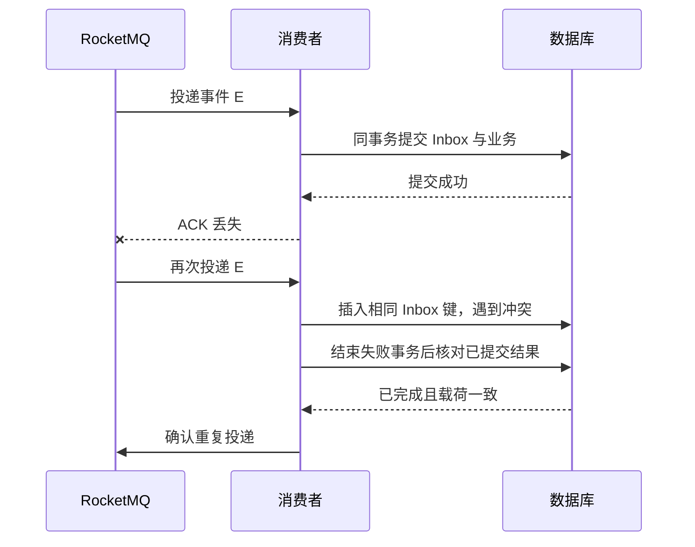
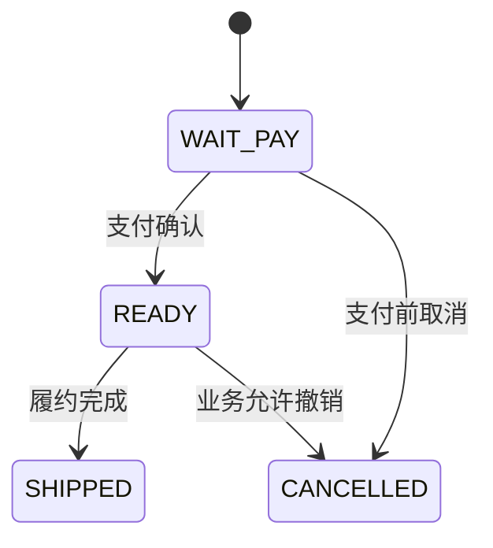

# Transactional Outbox、RocketMQ 与 Inbox 幂等消费

[分布式设计](../interview_design.md) · [一致性基础 Q46–Q48](distributed-systems.md) · [阅读路线](../LEARNING_PATHS.md) · [版本与资料](../references.md)

本文按“能讲清方案、能推演故障、能回答追问”整理。先掌握核心表述，再看两个本地事务与故障表，不必背完整建表和客户端 API。

**适用前提：** 示例使用事务数据库与 RocketMQ，组件行为参考 MySQL 8.x、RocketMQ 5.0；代码为教学伪代码，未运行。消费端业务修改能在一个短本地事务内完成；外部 RPC 另行处理。

## 核心表述

> 生产端在同一个本地事务中修改业务数据并写入 Outbox，避免业务已提交却没有可恢复的发送记录。Relay 扫描并异步投递 RocketMQ，发送失败或结果未知时保留任务重试，因此消息可能重复。消费端在同一个本地事务中插入 Inbox、执行业务并记录处理结果，提交后才确认消息。Inbox 唯一索引负责同一事件去重，业务唯一键和状态机负责业务效果去重及合法迁移；长期失败通过死信、告警和对账恢复，推动最终一致。

记住分工：**Outbox 保存发送责任，Inbox 记录已提交处理，唯一约束仲裁并发，状态机约束业务，重试与对账推动收敛。** 这不是无条件的全局 Exactly Once。

## 阅读目录

- [为什么常见写法不够](#为什么直接修改数据库再发送消息会出问题)
- [整体链路与两个本地事务](#整体链路与两个本地事务)
- [事件身份与最小表结构](#事件身份业务身份与消息身份)
- [Relay 的领取与恢复](#relay-如何领取投递与恢复)
- [Inbox 的事务与并发](#消费端如何提交-inbox-与业务)
- [状态机与乱序](#状态机如何处理重复与乱序)
- [故障窗口](#故障窗口对照表)
- [常见问题与参考解释](#常见问题与参考解释)

## 为什么直接修改数据库再发送消息会出问题

以“订单支付成功后通知履约”为例：先提交数据库再发消息，提交后宕机会漏通知；先发消息再提交，数据库回滚时下游却可能已处理。

### 在数据库事务里调用 MQ

普通 MQ 发送不参与数据库本地事务。Broker 收到消息后，数据库仍可能因后续 SQL 失败而回滚；数据库回滚无法撤回消息。持有数据库锁时等待网络响应和发送重试，还会延长锁持有时间。

### 只在 afterCommit 中发送

它保证回调在提交后执行，但不保存发送任务。**数据库已提交、回调发送前宕机**，内存回调会丢失；回调异常也无法回滚已提交业务。可以用它唤醒 Relay 加速投递，恢复依据仍是业务事务内写好的 Outbox。

### 给发送方法加重试

**超时表示结果未知，不表示 Broker 没收到。** Broker 已收消息但响应丢失，重试会产生重复；进程宕机又会中断内存重试。因此既需要持久任务恢复发送，也需要消费端幂等，运输重试必须保留原 event_id。

## 整体链路与两个本地事务


事务 A 保证“业务事实与待发事件一起提交”；事务 B 保证“消费记录与本地业务效果一起提交”。**A 和 B 独立提交，不是一个跨服务事务。** 各自内部要使用能共同提交的事务资源。

Outbox 标记已发送，只代表达到约定的发送确认标准，不代表下游业务已经完成。

## 事件身份、业务身份与消息身份

| 身份 | 作用 |
| --- | --- |
| event_id | 同一事件的稳定身份，重试与运输重放不变 |
| consumer_code | 稳定的逻辑处理器身份，不使用机器或线程 ID |
| effect_key | 一次业务效果的身份，例如支付流水号；防止不同事件重复表达同次动作 |
| RocketMQ Message ID / Keys | 运输追踪或业务检索字段，不能替代业务唯一约束 |

Inbox 去重键可用 `(consumer_code, producer_namespace, event_id)`；若事件只在租户内唯一，还需纳入 tenant_id。同键不同载荷要隔离核对，不能当普通重复。

## 教学表结构与索引

掌握字段职责与约束即可，不必背完整 DDL：

| 表 | 关键字段与约束 |
| --- | --- |
| Outbox | event_id、payload、status、attempts、next_attempt_at、claim_token、lease_until；事件身份唯一，扫描状态与重试时间有索引 |
| Inbox | consumer_code、producer_namespace、event_id、payload_hash、result；消费身份联合唯一 |
| 业务表 / 效果流水 | 状态、版本、支付流水等；业务效果键唯一，更新带旧状态或版本条件 |

生产端业务请求也需要幂等，避免重复请求创建不同事件、重复执行原业务。Outbox 不是生产端业务去重的替代品。

## Relay 如何领取、投递与恢复

1. 短事务领取到期待发记录，设置本次 claim_token 和租约；多个 Relay 用行锁或条件更新仲裁。
2. **领取事务提交后**发送 MQ，避免在数据库持锁期间等待网络。
3. 收到明确发送确认后，带 event_id、状态、claim_token 条件更新为 PUBLISHED，检查影响行数。
4. 失败退避重试；领取者宕机后，恢复任务按租约和领取身份回收记录。超过自动预算则保留事件并告警处置。



**租约到期不会停止旧线程。** token 防止旧 Relay 覆盖新领取状态，但新旧 Relay 仍可能重复发送，最终由消费端幂等保护。重试不换 event_id。

## 消费端如何提交 Inbox 与业务

```text
校验事件来源、身份与载荷
开始本地事务 B
  插入 Inbox 唯一记录
  校验业务效果键、当前状态与版本
  修改业务，核对影响行数
  将 Inbox 标记为完成并保存结果
提交事务 B
提交确认后返回消费成功 / ACK
```

业务失败时 Inbox 一起回滚，后续才能重试。不能先单独提交“已消费”，再执行业务；也不能先 ACK 再提交数据库，否则中途宕机可能漏处理。

## 唯一约束如何处理两个消费者并发

“先查询不存在再插入”存在竞争窗口，最终靠数据库唯一约束仲裁。A 插入未提交时，B 的同键插入可能等待；A 提交后 B 遇到唯一冲突，A 回滚则 B 仍有处理机会。锁超时或死锁按失败重试。



**不能捕获所有唯一冲突就直接返回成功。** 只有确认冲突来自目标 Inbox 去重键、载荷一致且已完成，才按重复处理；业务表的约束冲突可能是真错误。核对读权威数据库，暂时无法确认则重试。

## 状态机如何处理重复与乱序



Inbox 只能防同一事件重投。不同事件 ID 也可能对应同一笔支付，需要支付流水唯一键；迟到取消也不能把 SHIPPED 直接回退，需要状态条件约束。

```sql
UPDATE fulfillment_order
SET status = 'READY', version = version + 1
WHERE order_id = :order_id
  AND status = 'WAIT_PAY'
  AND version = :expected_version;
```

影响 0 行要区分已处理、版本变化、业务不存在和非法状态，不能全部按成功忽略。租户系统还需带租户条件。

乱序时：完整连续事件流可按序号发现缺口，可靠暂存并恢复前序；源实体版本不一定连续，不能机械要求 `version + 1`。新状态快照可以在协议允许时忽略旧版；**逐笔扣款、加积分等增量事件不能仅因版本较旧就跳过。** 顺序消息也不能修复 Relay 发送前已经颠倒的顺序。

## 消费超时与服务宕机的完整推演

超时不等于线程被终止，也不等于事务已回滚。原消费者仍在执行时，新投递由 Inbox 唯一约束、业务状态条件与事务仲裁；原事务提交则重复读取结果，回滚则允许后续处理。外部 RPC 不在此本地保护范围内。

最关键的区分是：**提交前宕机，整体回滚后重试；提交后 ACK 前宕机，读取已完成结果后再次确认。**

## 故障窗口对照表

| 故障 | 恢复方式 |
| --- | --- |
| 生产事务提交前宕机 | 业务和 Outbox 一起回滚，业务请求幂等重试 |
| 业务已提交，尚未发送 | Outbox 留有记录，Relay 后续扫描 |
| Relay 领取后宕机 | 到期回收并重新领取，保留事件身份 |
| Broker 已收，响应丢失或 Outbox 回写失败 | 重发可能重复，由 Inbox 与业务约束识别 |
| Inbox 已插入，业务失败或提交前宕机 | 同事务回滚，后续仍可处理 |
| 消费事务提交，ACK 丢失 | 重投核对已完成结果，不重复产生效果 |
| 数据库提交结果未知 | 新事务查证，或让重投通过幂等协议判断 |
| 消费超时，原线程仍运行 | 不假设已停止，靠事务与唯一约束仲裁 |
| 重试耗尽或永久错误 | 可靠转入死信或隔离处置，告警、修复、受控重放 |

## 重试、死信与人工重放

- 临时错误：退避、抖动和有预算的重试，避免多层重试放大压力。
- 永久错误或载荷冲突：可靠保存原消息与处置责任后隔离，不能静默丢弃。Outbox 的 PARKED 与 MQ 的消费死信队列是不同环节。
- 运输重放：保留原 event_id 和载荷；不要删除 Inbox 强迫已成功业务重做。业务纠错使用独立补偿动作。

对账至少看 Outbox 最老待发年龄、消费积压/死信，以及实际业务差异。Inbox 保留期需覆盖可能重放窗口；提前清理后，旧消息可能再次生效。最终一致依赖持久性、保留策略和持续恢复，不能承诺所有故障下都不丢。

## 与事务消息、Saga 和 TCC 的关系

| 机制 | 应该怎样区分 |
| --- | --- |
| RocketMQ 事务消息 | 用半消息与本地事务状态检查衔接业务和消息可见性，是另一条方案路线；仍需消费端幂等 |
| Outbox | 用本地事件记录与 Relay 恢复投递；代价是扫描、存储、清理和异步延迟 |
| Saga / TCC | 处理跨服务步骤补偿或资源预留；Outbox 可以运输其命令，但不会自动提供这些业务协议 |

## 常见问题与参考解释

**1. 这算 Exactly Once 吗？**

更准确地说，是允许重复投递，通过事务和幂等使受保护的本地业务不重复生效，再持续恢复到最终一致。外部副作用和灾难恢复需要各自协议。

**2. 为什么不用 Redis SETNX 标记消费？**

Redis 标记与业务数据库不在同一本地事务。先标记后业务失败会漏处理，业务成功后标记失败又会重复。数据库 Inbox 与业务同事务更容易建立原子边界。

**3. Inbox、业务唯一键、状态机为什么都需要？**

分别解决同一事件重复、不同事件表达同次业务效果、业务状态非法推进。三者保护的身份和规则不同。

**4. 消费端还要调用支付或其他 HTTP 接口怎么办？**

本地回滚无法撤销远程成功。可以再写下游 Outbox，并要求对方支持稳定幂等键、结果查询或对账；超时保留未知状态。详见[支付结果确认](payment-idempotency.md)。

**5. 任务很长，不能一直等消费完成怎么办？**

可以先可靠落地为本地待办再 ACK，由可恢复 Worker 执行。此时 ACK 表示责任已持久转交，PENDING 不代表业务已完成；还需租约、重试和发布约束。详见[调度与恢复](distributed-scheduling-backfill.md)。

**6. 能不能只靠顺序消息省掉状态机？**

不能。重复、人工回放、发送顺序颠倒和非法业务迁移仍可能存在；顺序能力不替代业务规则。

**7. RocketMQ 确认方式需要背哪些？**

记住“本地提交后确认”。PushConsumer 通过回调结果表达成功，SimpleConsumer 显式 ACK；超时、不可见时间和批量确认规则按实际 SDK 核对，不混背 4.x 与 5.x API。

**8. 为什么选这个方案，有什么代价？**

业务已经落在事务数据库、希望保留可追踪发送记录时，Outbox 较直观。代价是额外表、Relay、数据库扫描、异步延迟与清理运维；它也不会自动解决消费端重复、跨服务补偿和严格顺序。

## 参考资料

模式定义参见 [Transactional Outbox](https://microservices.io/patterns/data/transactional-outbox.html) 与 [Idempotent Consumer](https://microservices.io/patterns/communication-style/idempotent-consumer.html)；组件细节参见 RocketMQ 的[发送重试](https://rocketmq.apache.org/docs/featureBehavior/05sendretrypolicy/)与[消费重试](https://rocketmq.apache.org/docs/featureBehavior/10consumerretrypolicy/)。资料补充核对日期：2026-11-06。
