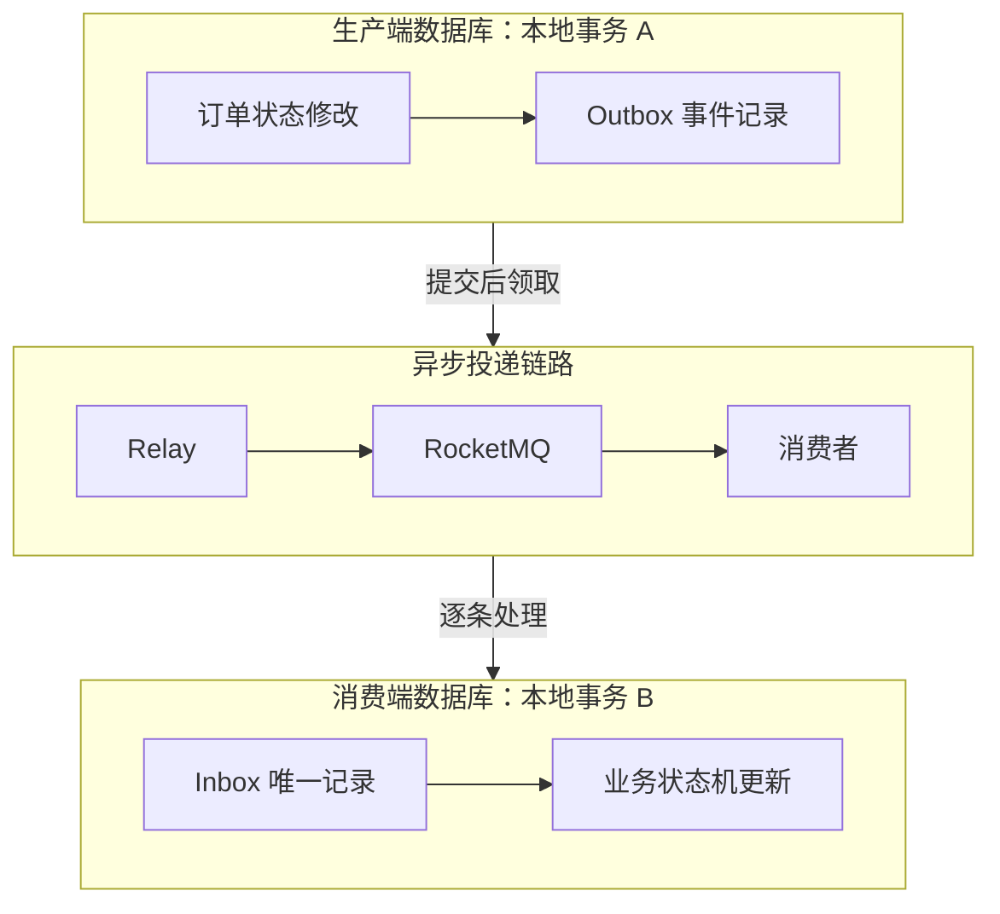
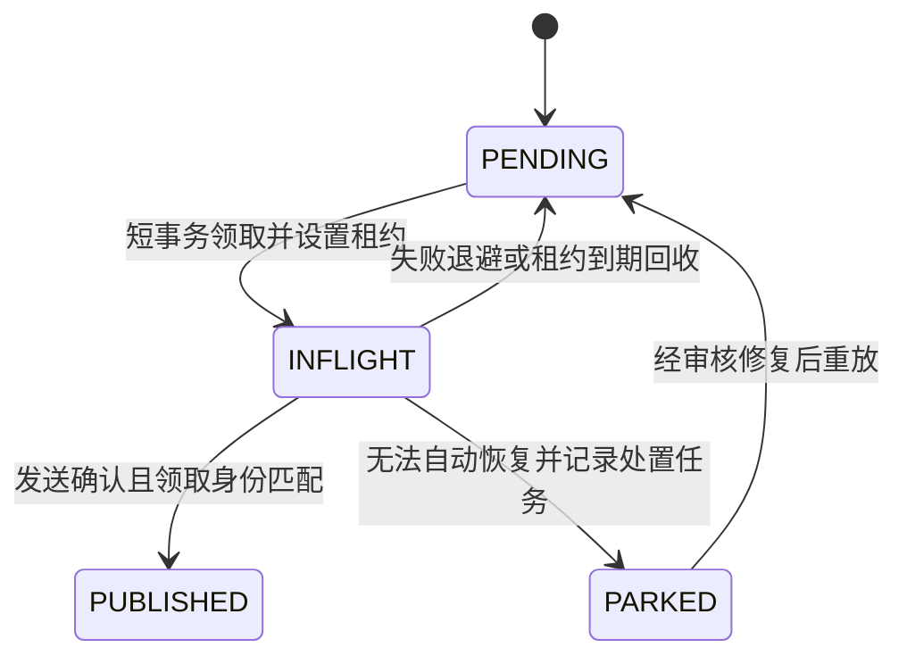
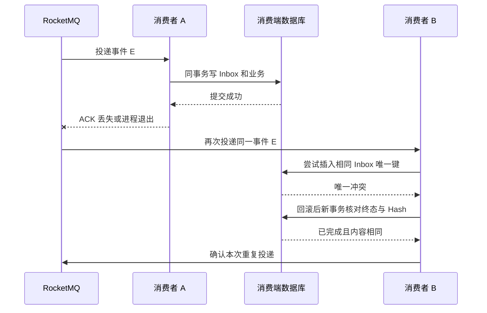
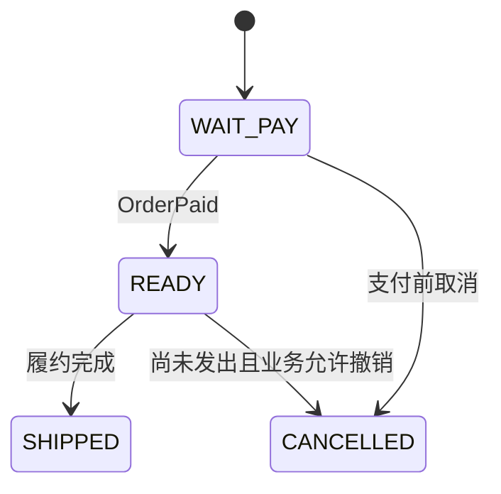

# Transactional Outbox、RocketMQ 与 Inbox 幂等消费

[分布式设计分类](../interview_design.md) · [一致性基础 Q46–Q48](distributed-systems.md) · [阅读路线](../LEARNING_PATHS.md) · [版本与资料](../references.md)

把生产端的业务修改和 Outbox 事件写进同一个本地事务，由 Relay 异步发送到 RocketMQ；消费端把 Inbox 记录和本地业务修改放进另一个本地事务，结合唯一约束和合法状态转换处理重复、乱序及故障恢复。

**学习场景：** 订单支付确认后，异步推进履约状态。表结构、SQL、状态名与伪代码均为教学设计，不对应实际生产系统，也不表示本仓库已经接入 RocketMQ。数据库使用 MySQL 8.x / InnoDB，锁定读取参考 8.4；RocketMQ 行为主要参考官方 5.0 文档，SDK 差异单独说明。SQL 与协议伪代码未在数据库或消息服务上执行。

## 阅读目录

<details>
<summary>展开完整知识点目录</summary>

- [先明确方案要保证什么](#先明确方案要保证什么)
- [为什么直接修改数据库再发送消息会出问题](#为什么直接修改数据库再发送消息会出问题)
- [整体链路与两个本地事务](#整体链路与两个本地事务)
- [事件身份、业务身份与消息身份](#事件身份业务身份与消息身份)
- [教学表结构与索引](#教学表结构与索引)
- [生产端如何原子地产生事件](#生产端如何原子地产生事件)
- [Relay 如何领取、投递与恢复](#relay-如何领取投递与恢复)
- [消费端如何提交 Inbox 与业务](#消费端如何提交-inbox-与业务)
- [唯一约束如何处理两个消费者并发](#唯一约束如何处理两个消费者并发)
- [状态机如何处理重复与乱序](#状态机如何处理重复与乱序)
- [消费超时与服务宕机的完整推演](#消费超时与服务宕机的完整推演)
- [故障窗口对照表](#故障窗口对照表)
- [重试、死信与人工重放](#重试死信与人工重放)
- [长任务与外部副作用](#长任务与外部副作用)
- [RocketMQ 版本与 SDK 的对应关系](#rocketmq-版本与-sdk-的对应关系)
- [监控、对账与数据保留](#监控对账与数据保留)
- [性能、顺序与扩展](#性能顺序与扩展)
- [与事务消息、Saga 和 TCC 的关系](#与事务消息saga-和-tcc-的关系)
- [常见问题与参考解释](#常见问题与参考解释)
- [手工走查与实现检查](#手工走查与实现检查)
- [参考资料](#参考资料)

</details>

首次阅读建议按“整体链路 → 事件身份 → 两端事务 → 宕机推演”理解，再按目录核对表结构、领取恢复、重放和运维。

## 先明确方案要保证什么

| 层次 | 需要建立的不变量 | 不由这一层单独保证的事情 |
| --- | --- | --- |
| 生产端本地事务 | 业务修改成功时，相应事件记录也成功；失败时一起回滚 | 消息此刻已经到达 Broker 或下游 |
| Outbox 与 Relay | 未确认发布的事件可被再次领取和发送 | 一次发送调用只产生一次投递 |
| RocketMQ | 按版本、配置和消费模型提供投递、确认与重试机制 | 任意外部业务副作用天然只执行一次 |
| Inbox 与唯一约束 | 同一逻辑处理器、同一事件身份，只有一个已提交的最终处理结果 | 两个不同事件 ID 是否表达同一次业务动作 |
| 业务状态机与业务约束 | 只接受合法迁移，维护版本、金额、库存等业务不变量 | 被错误设计的状态规则自动正确 |
| 对账与恢复 | 发现长期不一致，并将未完成事项重新纳入处理 | 永不丢失、无限期自动恢复或零人工介入 |

准确的表述是：**在事件可恢复、基础设施可靠性配置满足要求、失败持续被跟踪处理等前提下，以允许重复的投递配合事务内幂等，推进最终一致。** 对本地受保护的副作用，可以让重复处理不再改变结果；不能据此声称整个分布式系统具有无条件的全局 Exactly Once。

## 为什么直接修改数据库再发送消息会出问题

假设订单从 `WAIT_PAY` 变为 `PAID` 后，需要通知履约服务。

| 写法 | 失败窗口 |
| --- | --- |
| 先提交订单，再调用 MQ | 数据库提交后进程宕机，通知尚未发送 |
| 先发送 MQ，再提交订单 | 消息已经被处理，订单事务随后回滚 |
| 在数据库事务里调用 MQ | MQ 不参与该本地事务；既延长数据库锁持有时间，也不能消除跨资源窗口 |
| 只在 afterCommit 中发送 | 提交与回调执行之间仍可能宕机；内存回调缺少可恢复的发送任务 |
| 给发送方法加重试 | 超时可能发生在 Broker 已接收之后，重试仍可能产生重复 |

Outbox 把“以后必须发送这件事”变成数据库内的持久记录，业务提交后即使进程退出，其他 Relay 也能继续处理。模式背景见 [Transactional Outbox](https://microservices.io/patterns/data/transactional-outbox.html)。

## 整体链路与两个本地事务



事务 A 和事务 B 可以位于不同服务的数据库，但**各自内部必须使用能共同提交的本地事务资源**。仅仅调用了两个写库方法，或使用两个逻辑数据源名字，不足以证明它们处于同一个物理事务。

图中按生产、投递、消费三个阶段分层；消费者等待事务 B 真正提交后，再向 RocketMQ 确认本次投递。

`Outbox.PUBLISHED` 表示按选定的发送成功标准确认发布，不表示消费者已完成业务；MQ 消费确认也不等于所有下游服务完成。需要业务方展示“履约已完成”时，应由实际业务状态或独立的确认事件提供证据。

## 事件身份、业务身份与消息身份

本专题的事件约定如下，数字只用于推演：

```json
{
  "event_id": "evt-order-1001-paid-01",
  "producer_namespace": "order-service",
  "tenant_id": 7,
  "event_type": "OrderPaid",
  "event_version": 1,
  "aggregate_id": "order-1001",
  "aggregate_version": 13,
  "stream_name": "fulfillment-order-events-v1",
  "stream_seq": 3,
  "effect_key": "payment-8801",
  "occurred_at": "2026-11-05T09:00:00Z",
  "trace_id": "trace-demo-001",
  "data": {
    "payment_id": "payment-8801",
    "paid_amount_minor": 12900,
    "currency": "CNY"
  }
}
```

| 字段或概念 | 用途与约束 |
| --- | --- |
| `event_id` | 同一个生产者命名空间内稳定且唯一；SDK 重试、Relay 重试和运输层重放都保留它 |
| `producer_namespace` | 区分事件来源，使用服务协议身份，不能使用进程实例名 |
| RocketMQ Message ID | MQ 运输层身份；同一业务事件再次发送时可能不同，不能代替业务事件 ID |
| RocketMQ Keys | 设置事件 ID 等信息便于检索和追踪，不构成 Broker 的业务唯一约束 |
| `effect_key` | 标识一次业务效果，例如支付流水号；解决不同事件 ID 表达同一业务动作的问题 |
| `consumer_code` | 消费端稳定的逻辑处理器身份，例如 `fulfillment-state-v1`；不是机器、Pod 或线程 ID，也不应随每次应用发布自动变化 |
| `event_version` | 消息契约版本，用于解析和兼容，不是业务新旧顺序 |
| `aggregate_version` | 源实体版本；不一定每次变化都产生该消费者需要的事件 |
| `stream_seq` | 本例专门分配给该完整订阅事件流的连续序号；用来判断是否缺少前序事件 |
| `occurred_at` | 业务时间记录，不能用不同机器的时间戳替代严格顺序 |

Inbox 的去重键采用 **`consumer_code + producer_namespace + event_id`**。本例要求来源内事件 ID 跨租户也唯一；若实际契约只保证租户内唯一，必须把租户也纳入事件身份及去重键。

`payload_hash` 对不可变的事件身份、契约及业务载荷规范化后计算，例如使用 SHA-256，用于发现同一事件 ID 携带不同内容。重投时间、重试次数等运输元数据不参与它。JSON 字段顺序与数字格式需要统一规范，不能直接用两个随意序列化的字符串比较。Hash 只用于一致性核对，不能替代来源鉴权或消息访问控制。

RocketMQ 官方最佳实践也提示应用应处理重复，并区分运输 Message ID 与业务去重字段。参见 [Basic Best Practices](https://rocketmq.apache.org/docs/bestPractice/01bestpractice/)。

### RocketMQ 的配置身份也要分清

| 配置项 | 教学示例与含义 |
| --- | --- |
| Topic | `order-domain-events`，承载相应事件契约；普通与顺序消息类型按实际配置选择 |
| Tag / 订阅条件 | 若使用连续流序号，必须接收本流需要的全部前序事件，不能只过滤出 OrderPaid 后仍期待序号连续 |
| Consumer Group | 同一消费职责的负载分配与消费进度边界；新建消费组不等于要重复执行原业务 |
| MessageGroup / 顺序单元 | 需要顺序能力时按租户与订单选择，具体设置与 Topic 类型按 SDK 核对；它与 Consumer Group 不是同一概念 |
| Keys | 可以设置事件 ID 用于查找，不能用它替代 Inbox 和业务唯一索引 |

表里的名字是示例配置，没有在 Broker 上创建 Topic 或消费组。

## 教学表结构与索引

下面是说明算法所需的最小结构。示例的字符串身份字段按 ASCII、大小写敏感比较；真实系统还要确定租户隔离、字段长度、归档、审计和隐私要求。`DATETIME` 统一按 UTC 写入与比较，连接时区保持一致。数据库 A 与 B 分开部署时，分别创建各自的表。

<details>
<summary>查看生产端的业务表与 Outbox 表</summary>

```sql
-- 数据库 A：生产端。
CREATE TABLE producer_order (
    tenant_id BIGINT NOT NULL,
    order_id VARCHAR(64) CHARACTER SET ascii COLLATE ascii_bin NOT NULL,
    status VARCHAR(24) NOT NULL,
    aggregate_version BIGINT UNSIGNED NOT NULL,
    last_stream_seq BIGINT UNSIGNED NOT NULL,
    payment_id VARCHAR(64) CHARACTER SET ascii COLLATE ascii_bin NULL,
    PRIMARY KEY (tenant_id, order_id),
    UNIQUE KEY uk_order_payment (tenant_id, payment_id)
) ENGINE = InnoDB;

CREATE TABLE outbox_event (
    event_id VARCHAR(64) CHARACTER SET ascii COLLATE ascii_bin NOT NULL,
    producer_namespace VARCHAR(64) CHARACTER SET ascii COLLATE ascii_bin NOT NULL,
    tenant_id BIGINT NOT NULL,
    aggregate_id VARCHAR(64) CHARACTER SET ascii COLLATE ascii_bin NOT NULL,
    aggregate_version BIGINT UNSIGNED NOT NULL,
    stream_name VARCHAR(64) CHARACTER SET ascii COLLATE ascii_bin NOT NULL,
    stream_seq BIGINT UNSIGNED NOT NULL,
    event_type VARCHAR(64) CHARACTER SET ascii COLLATE ascii_bin NOT NULL,
    event_version INT UNSIGNED NOT NULL,
    effect_key VARCHAR(64) CHARACTER SET ascii COLLATE ascii_bin NOT NULL,
    payload JSON NOT NULL,
    payload_hash CHAR(64) CHARACTER SET ascii COLLATE ascii_bin NOT NULL,
    status VARCHAR(16) NOT NULL DEFAULT 'PENDING',
    attempts INT UNSIGNED NOT NULL DEFAULT 0,
    next_attempt_at DATETIME(3) NOT NULL DEFAULT CURRENT_TIMESTAMP(3),
    claim_token CHAR(36) CHARACTER SET ascii COLLATE ascii_bin NULL,
    lease_until DATETIME(3) NULL,
    created_at DATETIME(3) NOT NULL DEFAULT CURRENT_TIMESTAMP(3),
    published_at DATETIME(3) NULL,
    last_error VARCHAR(1000) NULL,
    PRIMARY KEY (event_id),
    UNIQUE KEY uk_outbox_stream
        (tenant_id, stream_name, aggregate_id, stream_seq),
    UNIQUE KEY uk_outbox_effect
        (tenant_id, producer_namespace, event_type, effect_key),
    KEY idx_outbox_due (status, next_attempt_at, event_id),
    KEY idx_outbox_lease (status, lease_until, event_id)
) ENGINE = InnoDB;
```

本例一笔支付对应一次 `OrderPaid`，因此事件类型与支付流水组成业务效果约束；退款等动作要使用自己的事件类型和业务键。它不是所有事件类型的通用配置：同一个业务对象允许多次合法变更时，需要对应的动作 ID 或版本参与效果身份。若删掉这些唯一记录，需要有独立的业务请求幂等记录继续保护身份，不能默认归档后约束仍存在。

</details>

<details>
<summary>查看消费端的 Inbox 与履约状态表</summary>

```sql
-- 数据库 B：消费端。
CREATE TABLE inbox_event (
    consumer_code VARCHAR(64) CHARACTER SET ascii COLLATE ascii_bin NOT NULL,
    producer_namespace VARCHAR(64) CHARACTER SET ascii COLLATE ascii_bin NOT NULL,
    event_id VARCHAR(64) CHARACTER SET ascii COLLATE ascii_bin NOT NULL,
    tenant_id BIGINT NOT NULL,
    payload_hash CHAR(64) CHARACTER SET ascii COLLATE ascii_bin NOT NULL,
    outcome VARCHAR(32) NOT NULL,
    business_result JSON NULL,
    received_at DATETIME(3) NOT NULL DEFAULT CURRENT_TIMESTAMP(3),
    completed_at DATETIME(3) NULL,
    PRIMARY KEY (consumer_code, producer_namespace, event_id)
) ENGINE = InnoDB;

CREATE TABLE fulfillment_order (
    tenant_id BIGINT NOT NULL,
    order_id VARCHAR(64) CHARACTER SET ascii COLLATE ascii_bin NOT NULL,
    status VARCHAR(24) NOT NULL,
    applied_stream_seq BIGINT UNSIGNED NOT NULL,
    source_version BIGINT UNSIGNED NOT NULL,
    payment_id VARCHAR(64) CHARACTER SET ascii COLLATE ascii_bin NULL,
    last_event_id VARCHAR(64) CHARACTER SET ascii COLLATE ascii_bin NULL,
    PRIMARY KEY (tenant_id, order_id),
    UNIQUE KEY uk_fulfillment_payment (tenant_id, payment_id)
) ENGINE = InnoDB;
```

本例 Inbox 的 `PROCESSING` 只在未提交事务内使用，提交前必须改为明确终态，例如 `APPLIED`、`IGNORED_STALE` 或 `IGNORED_DUPLICATE`。如果采用持久化长任务模式，需要另一套待处理、领取和恢复协议，不能直接沿用“查到 Inbox 就 ACK”的判断。

</details>

不能用“先 SELECT 查不到，再 INSERT”作为并发去重依据，最后的仲裁必须由数据库唯一约束或等价的原子条件完成。

## 生产端如何原子地产生事件

事务开始前校验身份、租户、支付来源、金额币种及消息契约；业务判断仍应根据可信数据库状态完成。以下是协议伪代码：

```text
开始本地事务 A
  按租户和订单读取并锁定需要更新的业务记录
  校验当前状态、金额与稳定支付流水号
  如果该支付已经成功处理，返回此前的稳定业务结果
  如果支付身份或状态冲突，拒绝或转入明确的核对流程
  条件更新订单：WAIT_PAY -> PAID，增加实体版本与流序号
  固化本次事件 ID、载荷、序号与契约版本
  插入 Outbox，状态 PENDING
提交事务 A
返回“本地支付确认已记录”，不承诺履约此刻已完成
```

更新与插入任一失败，整个事务回滚。使用 Spring 时确认实际经过事务代理、数据源和事务管理器正确，且异常没有被吞掉；参见 [Q07](spring-data-access.md#q07-spring-事务为什么会看起来不生效)。

客户端重试支付确认命令时，生产端也要按稳定业务请求身份处理，不能每次重新生成一个事件就认为消费者能自动兜底。事件记录必须来自本次已提交事实，Relay 不能改为读取“当前最新订单”来重新拼装一条历史事件。

事务提交结果也可能因为连接中断而未知。此时通过稳定请求号和权威业务记录核对结果，再决定重试，不能把异常直接等同于回滚成功。

## Relay 如何领取、投递与恢复

### 领取使用短事务

多个 Relay 可以竞争待发送记录。以 MySQL 8.x 的任务领取为例：

```sql
START TRANSACTION;

SELECT event_id
FROM outbox_event
WHERE status = 'PENDING'
  AND next_attempt_at <= CURRENT_TIMESTAMP(3)
ORDER BY next_attempt_at, event_id
LIMIT 100
FOR UPDATE SKIP LOCKED;

-- 对本批实际锁定的记录逐条领取，:claim_token 为本次新生成的身份。
UPDATE outbox_event
SET status = 'INFLIGHT',
    claim_token = :claim_token,
    lease_until = TIMESTAMPADD(SECOND, :lease_seconds, CURRENT_TIMESTAMP(3)),
    attempts = attempts + 1
WHERE event_id = :event_id
  AND status = 'PENDING';

COMMIT;
```

这里的命名参数是占位说明，不是可直接粘贴执行的 SQL。`SKIP LOCKED` 适合竞争领取队列任务，不提供全局一致快照或公平排序保证；数据库版本、事务隔离、索引与复制方式应按实际环境确认。参见 [MySQL 锁定读取](https://dev.mysql.com/doc/refman/8.4/en/innodb-locking-reads.html)。

### 网络发送放在事务外

领取事务提交后，Relay 发送持久事件载荷。只有达到所用客户端和可靠性配置定义的发送成功标准，才尝试：

```sql
UPDATE outbox_event
SET status = 'PUBLISHED', published_at = CURRENT_TIMESTAMP(3),
    claim_token = NULL, lease_until = NULL, last_error = NULL
WHERE event_id = :event_id
  AND status = 'INFLIGHT'
  AND claim_token = :claim_token;
```

必须核对影响行数。若新 Relay 已重新领取并换了 token，旧 Relay 不得覆盖新领取者的记录。失败回到 `PENDING`、更新下次尝试时间等操作也要带相同的领取身份条件。

异步 API 的“任务已交给 SDK”不等于 Broker 已确认。Broker 确认所代表的磁盘、复制和故障承受能力取决于部署与配置，不能仅从 `PUBLISHED` 状态推导永久不丢失。

### 领取者宕机后如何恢复



恢复任务将到期的 `INFLIGHT` 记录按旧状态与旧 token 条件回收，清除旧 token，再安排重试。比较租约尽量使用同一数据库时钟，参数需要覆盖正常发送耗时并有监控。

**租约到期不会杀死旧线程，也不会撤销已发送的消息。** 新旧 Relay 仍可能同时向 MQ 投递，但应保留同一个事件 ID；消费端需要接受这种重复。token 保护 Outbox 状态更新，不能当成防止一切重复发送的手段。

达到自动重试预算后可以转 `PARKED`，但要保留事件并建立告警、修复与再驱动入口；它是应用侧状态，不是 RocketMQ 的消费死信队列。

## 消费端如何提交 Inbox 与业务

主流程针对能在短本地事务内完成的数据库操作，每条消息独立决定处理结果：

```text
解析并校验事件身份、来源、租户与契约版本
计算规范化载荷 Hash
通过能等待真实提交完成的事务边界调用处理逻辑

  开始本地事务 B
    INSERT Inbox，状态仅在本事务内暂记 PROCESSING
    检查业务记录、流序号与允许的状态转换
    执行受业务条件保护的 UPDATE / INSERT
    核对影响行数并分类，不允许把所有 0 行都当成重复
    将 Inbox 改为明确终态并保存稳定结果
  提交事务 B

提交确认后才向 RocketMQ 返回消费成功或执行 ACK
```

示例履约行已由前序创建事件建立，当前是 `WAIT_PAY`、`applied_stream_seq = 2`。收到 `OrderPaid`、序号 3 时：

```sql
UPDATE fulfillment_order
SET status = 'READY',
    applied_stream_seq = :stream_seq,
    source_version = :aggregate_version,
    payment_id = :payment_id,
    last_event_id = :event_id
WHERE tenant_id = :tenant_id
  AND order_id = :order_id
  AND status = 'WAIT_PAY'
  AND applied_stream_seq = :expected_previous_seq;
```

本例 `:expected_previous_seq = 2`。成功更新与 Inbox 终态一起提交。不存在的履约行如何补建、等待哪个前序事件，必须由业务协议定义，不能在 UPDATE 为 0 时直接 ACK。

如果业务处理、唯一约束、锁等待或事务提交失败，不能返回成功。提交结果不明确时，用新事务核对 Inbox 和业务状态；必要时让消息重投，依赖幂等重新判断。

幂等消费者模式的背景见 [Idempotent Consumer](https://microservices.io/patterns/communication-style/idempotent-consumer.html)。本专题额外强调唯一冲突后的事务清理、载荷核对和业务状态分类。

## 唯一约束如何处理两个消费者并发

假设 A 已在事务 B 中插入 Inbox，但尚未提交；RocketMQ 又把同一事件交给 B。

1. B 尝试插入相同唯一键，由数据库进行并发仲裁；可能等待、超时或遇到死锁，不会因为应用先查不存在就获得第二份已提交记录。
2. A 提交成功后，B 的同键插入会遇到相应唯一冲突。B 先按框架和数据库规则结束或回滚自己的事务，再用新的事务查询已提交结果。
3. A 回滚时，该唯一记录不成立；B 在后续可获得处理机会，或按遇到的临时错误重新重试。
4. B 只有确认**冲突正好来自 Inbox 的目标去重键、Hash 相同且记录为可认可终态**，才把它当作成功重复消费。

不要把所有 `DuplicateKeyException` 或所有完整性异常都当成消费成功：业务表的唯一键冲突、事件身份复用、其他约束失败可能表示不同问题。

核对已提交结果应读取权威数据库，不能让有复制延迟的读副本或缓存把“已经完成”错误显示为“不存在”。若暂时无法确认，保持可恢复的重试或处置状态，而不是推测成功。



如果 Hash 不同，保存冲突证据并告警，不能用新载荷覆盖旧 Inbox。需要停止 Broker 的无效重试时，先把原消息、错误原因和待处置任务可靠落入隔离存储，再按明确策略确认消息；此时只是处理责任被持久接管，不表示业务处理成功。

## 状态机如何处理重复与乱序

### 合法迁移不是状态数字大小



已经发出的订单不应被一个迟到取消事件简单改成 `CANCELLED`，可能需要退款、退货或人工核对等另一条业务流程。状态机必须表达真实前置条件，不能只比较 `PAID > CREATED`。

### 区分四类新到达事件

| 观察结果 | 本例处理规则 |
| --- | --- |
| 相同事件键、相同 Hash、Inbox 已完成 | 返回稳定重复结果，不再修改业务 |
| 新事件键，连续序号正好是已应用序号加一 | 检查事件类型与合法旧状态，再做条件更新 |
| 新事件键，序号大于下一期待值 | 前序缺失，回滚本次 Inbox 和业务并等待重试；长期缺口进入持久处置流程 |
| 新事件键，序号小于或等于已应用序号 | 只有业务协议能证明是可忽略的旧投影或语义重复时，才提交明确忽略结果；内容冲突需隔离 |

只有完整订阅、连续编号的事件流才适合检查 `stream_seq = previous + 1`。源订单版本可能包含与履约无关的更新，消费者也可能过滤事件类型，所以不能不加分析就用 `aggregate_version + 1` 判断缺口。

**事件去重与业务去重需要分别设计。** 两条不同 ID 的 `OrderPaid` 也可能表达同一笔支付：生产端的业务效果约束、消费端的支付流水唯一性和状态条件共同保护这一情况。

若事件表示“扣款 100”“积分加 10”这类必须逐笔核算的增量副作用，还应在消费端使用稳定业务流水键记录效果，并与账户更新同事务提交；不能仅因收到更大的版本号，就跳过一个尚未执行的旧事件。状态投影和增量记账不能混用同一套“旧版本直接忽略”规则。

## 消费超时与服务宕机的完整推演

假设 A 的处理耗时超过本次消息的处理时间预算，B 收到了重投。示例时长不代表 RocketMQ 默认配置。

**A 尚未提交：** B 竞争相同 Inbox 唯一键，数据库决定等待或失败；B 若等待超时，按临时故障重试。A 后续提交，下一次处理会发现已完成；A 回滚，其他尝试可以重新完成业务。原子性来自本地数据库事务，不来自消费线程是否还活着。

**A 已提交但没有确认：** B 核对 Inbox 的已提交终态和 Hash 后直接确认，避免再次执行业务。

**A 的确认已被 Broker 记录：** 通常不需要本次重投，但人工回溯、其他运输层重复或旧请求仍要求幂等规则成立。

**进程被终止：** 生产端已提交的 Outbox 可继续领取；未确认领取由租约回收。消费端已提交结果由 Inbox 识别，未提交事务由数据库回滚或恢复。数据库连接释放和故障恢复可能需要时间，不能假定进程一退出所有等待立即解除。

消费超时不代表线程被终止、事务必然回滚或对方必然没执行。SimpleConsumer 的不可见时间与延长机制、PushConsumer 的处理与重试机制要分别按 SDK 确认，见 [RocketMQ Consumption Retry](https://rocketmq.apache.org/docs/featureBehavior/10consumerretrypolicy/)。

## 故障窗口对照表

| 故障位置 | 可观察的持久状态 | 恢复方式与注意点 |
| --- | --- | --- |
| 生产端事务提交前宕机 | 业务与 Outbox 均未提交 | 整体回滚，业务请求按稳定身份重试 |
| 提交成功后、Relay 尚未运行 | 业务已变更，Outbox 为 PENDING | 后续扫描继续投递 |
| Relay 领取后宕机 | INFLIGHT，租约尚未回收 | 到期回收，再领取；保留原事件 ID |
| Broker 已接收，发送响应丢失 | Outbox 未确认，Broker 可能已有消息 | 重发可能重复，交给消费端去重 |
| 收到发送成功，但 Outbox 回写失败 | Broker 已确认，Outbox 仍可被重试 | 不能先假装已发布；后续重发仍使用同一 ID |
| 旧 Relay 恢复，新 Relay 已重新领取 | 领取 token 已改变 | 旧进程不覆盖新状态；重复发送仍可能发生 |
| 消费者写 Inbox 后、事务提交前宕机 | Inbox 和业务都未提交 | 回滚后重新消费，不留下假成功标记 |
| 消费事务已提交，ACK 前宕机 | Inbox 与业务均完成 | 重投读取终态，不再产生副作用 |
| 数据库提交响应丢失 | 是否提交未知 | 新事务查证，或允许重投后按幂等判定 |
| 消费超时且原线程仍工作 | 可能存在未提交事务和重投 | 唯一约束、锁等待和状态条件负责仲裁 |
| 收到缺前序的事件 | 无明确最终业务结果 | 不默认 ACK；重试或可靠移交至待处置存储 |
| 同一 ID 携带不同载荷 | 身份与事实冲突 | 隔离、告警并保留原消息，不能按普通重复处理 |
| 消费重试耗尽 | 消息可能进入 DLQ | 责任人核对、修复后受控重放，不能直接删除 |
| Broker 保留期早于故障恢复时间 | 消息可能已不可回溯 | 依赖有保留策略的事件档案与业务对账补偿 |

这张表覆盖的是可恢复路径，不是“所有故障都不会丢”。数据库与 Broker 的持久化配置、磁盘灾难、保留期、备份恢复及人工操作都属于实际可靠性条件。

## 重试、死信与人工重放

### 三层重试分别负责什么

| 责任层 | 负责的问题 | 需要防止的失控方式 |
| --- | --- | --- |
| 生产者 SDK | 一次发送过程中的部分临时错误 | 网络超时后重发产生重复，调用总时长超预算 |
| Outbox Relay | 跨进程、跨重启的发送任务恢复 | 无退避无限热循环、只记日志就丢弃失败事件 |
| 消费重试 | 业务处理临时失败或消费确认缺失 | 毒消息阻塞、重试风暴、跳过不合法状态 |

按错误类别设置有上限的指数退避与抖动，并让 SDK 超时、Relay 租约、数据库锁等待和消费时间预算相互匹配。具体数值取决于处理时长与资源容量；Broker 重试次数和间隔不能跨版本照抄。

发送重试可能产生重复，SDK 最终失败也不代替应用恢复机制，参见 [RocketMQ Sending Retry](https://rocketmq.apache.org/docs/featureBehavior/05sendretrypolicy/)。

### 按错误类型选择出口

- 数据库连接暂不可用、锁超时等：回滚并走可控重试。
- 已完成的真实重复：核对终态与载荷后确认，不再执行业务。
- 契约无法解析、同键不同载荷、永久非法迁移：可靠隔离并告警，避免永远重试；确认前确保消息和处理责任已持久移交。
- 序号缺口、依赖状态尚未就绪：记录期待值与缺失范围，恢复前序或可靠挂起，不能仅靠不断加快重试解决。

### 重放保留什么，不能改什么

运输层重放保留原事件身份和载荷，记录操作者、原因、时间范围和重放批次。已成功事件再次重放，应该仍然不产生第二次效果。

不要删除 Inbox 来强迫已成功扣款再执行。修复错误业务结果应通过有独立身份和授权的冲正、补偿或重建流程；不能篡改同一个事件 ID 的事实。重建投影可以设计新的逻辑处理器身份，但要评估它是否会重复触发真实业务副作用。

RocketMQ DLQ 与应用隔离表、Outbox.PARKED 是不同存储与责任边界，要分别监控并建立闭环。

## 长任务与外部副作用

### 不在消费事务里等待很久

长耗时计算、RPC、邮件或支付调用放进数据库长事务，会扩大锁等待、连接池占用和超时重叠。消费时间上限调大只能调整重投时机，不能替代任务的取消、恢复与幂等协议。

需要持久长任务时，可以先把完整事件作为 Inbox 待办提交，再确认 MQ，由本地 Worker 持续推进；但必须增加领取 token、租约、重试、最终状态和过期恢复机制。**查到 PENDING / PROCESSING 不能当作业务已完成。** MQ 确认在这个变体中表示处理责任已可靠转交本地任务系统。

### HTTP 副作用不能被本地回滚撤销

如果消费端还要调用第三方，可以在事务 B 中再保存一条下游 Outbox，让本地业务和待发送动作一起提交。外部接口仍需要稳定幂等键、结果查询或对账能力。

例如“第三方扣款已成功、响应丢失”，Inbox 只记录本地事务不能阻止下一次错误地再次扣款。依赖外部系统的真实幂等与核对协议；无法提供时，应保留未知状态并设置人工确认入口。

## RocketMQ 版本与 SDK 的对应关系

| 使用方式 | 成功处理的表达 | 失败与时间预算需要核对 |
| --- | --- | --- |
| 5.x PushConsumer | 回调在本地提交完成后返回相应成功结果 | 消费超时、返回失败与异常、重试和消费组设置 |
| 5.x SimpleConsumer | 本地提交完成后显式 ACK | 不确认后的重新可见、InvisibleDuration 及按规则延长 |
| 历史 4.x 并发 Push 模型 | 使用相应的 CONSUME_SUCCESS 等返回状态 | RECONSUME_LATER、客户端配置及兼容性；顺序消费另有语义 |

本专题不把这些 API 混写成一段通用可运行代码。实际实现要确定 Broker、客户端依赖、Push / Simple / 顺序消费、单条 / 批量及集群消费方式。广播消费等模型的重试与负载分配也不能直接套用上表。

批处理时，不能因为一条消息成功就确认整批未完成的消息；逐条结果或整批重试方式按 SDK 协议实现。同组实例应保持一致的订阅与处理规则。Broker 使用 5.x 也不代表旧 SDK 自动具备所有 5.x 客户端行为。参见 [RocketMQ Consumer 兼容说明](https://rocketmq.apache.org/docs/domainModel/09consumer/)。

## 监控、对账与数据保留

### 每一阶段都要有可观察指标

| 阶段 | 建议观察 | 可回答的问题 |
| --- | --- | --- |
| 生产端 | 业务提交数、Outbox 插入数、业务身份冲突 | 是否出现有业务事实但没有对应事件 |
| Outbox | 到期未发布数量、最老记录年龄、attempts、过期租约、PARKED | 是否有人持续推进失败事件 |
| MQ | 发送错误、队列积压、消费重试、DLQ、存储和复制健康 | 投递链路是否受阻 |
| Inbox | 完成数、真实重复、Hash 冲突、锁等待和回滚 | 重复是否被正确识别，数据库是否拥堵 |
| 业务 | 序号缺口、非法迁移、支付与履约差异、未决状态年龄 | 最终结果是否真正对齐 |

日志关联 `trace_id`、租户、订单、事件 ID、消息运输 ID、消费处理器、投递尝试和领取 token。不要把重投产生的新 Message ID 当成新的业务事实；错误记录避免无界堆积完整敏感载荷。

### 对账检查业务效果

按业务时间范围和稳定业务键比较“已确认支付”和“应推进的履约状态”，不能只检查 Outbox 全是 PUBLISHED。多个订阅者各自完成情况要分开核对。

定义可观察的最终一致性时间目标与超限告警，区分等待发送、Broker 积压、消费失败和业务挂起；不能只用任务进程存活来代表可靠性。

### 清理会改变幂等边界

Outbox 事件归档或删除之前，确认重放来源、审计与恢复需求；未解决的 PENDING、INFLIGHT、PARKED 不能按统一时间直接删除。已发布数据是否保留完整载荷，也取决于 Broker 之外是否还需要再驱动。

Inbox / 业务效果记录的保留期应覆盖可能的消费重试、人工回溯、归档重放和恢复窗口。若删除后旧消息仍可能到达，必须有业务唯一键等长期约束继续保护，不能认为“以前去重过一次”就永久安全。

## 性能、顺序与扩展

1. 到期扫描与租约回收分别使用合适索引，按小批次处理；避免全表扫描和长事务占锁。
2. Relay 批量领取与发送并行度要受 Broker 和数据库容量限制；领取批次不能大到尚未发送就普遍过期。
3. 消费并行度受数据库连接、锁竞争和下游容量限制，增加线程不一定增加有效吞吐。
4. 同一聚合需要顺序时，可按业务键路由到适当的顺序单元；队列选择、MessageGroup 等配置按 SDK 核对。
5. **同键路由不能修复 Relay 在发送前已经颠倒的顺序。** 多 Relay、租约过期和重试可能改变发送先后；应采用同聚合串行调度，或由消费端序号和持久挂起策略处理。
6. Polling Relay 直观，CDC Relay 可减少轮询负担，但增加日志位点、恢复、变更兼容与运维要求；无论哪种，都仍需消费端幂等。
7. 分表分区与归档不能破坏去重唯一性的业务范围；按时间拆 Inbox 时尤其需要检查旧事件跨分区重投。

严格串行时，前序事件长期失败或 PARKED 可能阻塞同一聚合的后续事件；需要明确解除阻塞的业务恢复流程，不能跳过后还声称流连续。是否采用快照修复、前序补投或补偿，由事件语义和业务规则决定。

吞吐与延迟数字需要按实际数据量、批次、索引和故障场景测量，本专题不提供未经验证的性能承诺。

## 与事务消息、Saga 和 TCC 的关系

| 机制 | 主要关注点 | 与本方案的关系 |
| --- | --- | --- |
| Transactional Outbox | 本地业务与事件记录原子提交，后续恢复投递 | 本专题的生产端持久任务来源 |
| RocketMQ 事务消息 | 半消息、生产者本地事务执行及状态检查 | 另一种衔接本地事务与消息可见性的机制；本专题使用普通事件加 Outbox，不必无理由再叠加半消息 |
| Inbox 幂等消费 | 重投时识别已提交结果，并保护本地副作用 | 无论使用 Outbox 还是事务消息，消费业务仍需考虑重复 |
| Saga | 多个本地步骤及其业务补偿、协调与恢复 | 可以用 Outbox 发送 Saga 命令/结果，用 Inbox 保护每步；仍需独立设计补偿和协调状态 |
| TCC | Try / Confirm / Cancel 的资源预留与确认取消 | 需要业务参与预留与处理，不能把普通事件重试改个名字就称作 TCC |
| XA / 2PC | 协调参与资源的提交协议 | 与本例两个独立提交的本地事务不同，需评估参与者、锁和故障恢复 |

RocketMQ 事务消息也不能替代消费端真实业务完成的证明，参见 [Transaction Message](https://rocketmq.apache.org/docs/featureBehavior/04transactionmessage/)。最终一致推进不等于自动拥有 Saga 补偿能力。

## 常见问题与参考解释

<details>
<summary>为什么有了 Inbox，还需要状态机和业务唯一键</summary>

Inbox 防同一事件身份重投。状态机维护合法迁移与版本；业务唯一键识别不同事件 ID 表达同一个业务效果。三个层次不能互相替代，否则既可能重复扣减，也可能把合法的新业务误判为重复。

</details>

<details>
<summary>消费者先提交 Inbox，再执行业务，可以避免重复吗</summary>

不能直接作为本专题的短事务方案。Inbox 先被单独提交为“完成”，随后业务失败，会把未完成事件永久误判为成功。若需要先可靠落地后异步执行，应采用明确的持久任务变体，区分待处理与已完成，并提供恢复 Worker。

</details>

<details>
<summary>把数据库事务和发送 MQ 放在一个方法里，是不是就原子了</summary>

方法边界不等于事务资源边界。本地事务没有把普通 MQ 发送纳入同一个提交协议；方法中抛异常也不能撤销已经被其他服务消费的消息。Outbox 的做法是把“待发送事件”作为本地数据库写入的一部分。

</details>

<details>
<summary>为什么发送超时后不能换一个事件 ID 再试</summary>

Broker 可能已经接收原事件。运输重试保留稳定事件身份，Inbox 才能识别两份投递表达同一事实。若每次改 ID，消息去重失去依据，之后只能依赖额外的业务效果约束兜底。

</details>

<details>
<summary>业务已经提交但 ACK 失败，应该回滚业务吗</summary>

已提交事务不能因为后续 ACK 失败而直接回滚。让重投通过 Inbox 读取稳定结果，再次确认即可。若业务本身需要撤销，应产生独立、可审计的补偿动作，不是把 ACK 错误当作撤销依据。

</details>

<details>
<summary>消费超时后原线程还在运行，唯一约束是否足够</summary>

对于同一个事务数据库内、相同事件身份的副作用，它与“记录和业务同事务”的约束共同防止两次成功提交相同消费记录。仍需处理数据库等待、失败重试、业务唯一性和状态规则；如果旧线程还在调用外部接口，本地唯一约束不能控制该外部副作用。

</details>

<details>
<summary>顺序消息能否让状态机和版本检查省掉</summary>

不能。仍要考虑投递重试、Relay 发送顺序、配置变化、人工回放和业务不合法迁移。顺序能力减少部分乱序情形，状态规则则决定这条事件在当前业务条件下是否允许生效。

</details>

<details>
<summary>为什么不直接使用 Redis SETNX 标记已经消费</summary>

Redis 标记和关系数据库业务修改不是同一个本地事务。标记成功后业务失败，可能漏处理；业务成功后标记失败，又可能重复。Redis 可以辅助削峰，但业务正确性仍要落在可证明的事务、约束和协议上。

</details>

<details>
<summary>这套方案可以怎样准确描述其可靠性</summary>

生产端同事务写业务和 Outbox，投递任务按领取身份、租约和退避恢复发送；消费端同事务写 Inbox 和业务，通过唯一约束、载荷校验及状态条件识别重投和非法推进。业务提交后确认消息，长期失败进入死信或持久处置流程，由告警和对账推动闭环。保证范围要限定在选定的存储、投递、保留与恢复假设内。

</details>

## 手工走查与实现检查

按固定事件 `evt-order-1001-paid-01`、消费处理器 `fulfillment-state-v1`、期待序号 3 手工推演：

| 输入或故障 | 应得到的结果 |
| --- | --- |
| 首次正常处理 | 履约 WAIT_PAY → READY，Inbox APPLIED，提交后确认 |
| 同一事件连续重投 | 只返回原结果，业务不再推进 |
| 两个实例同时处理 | 唯一约束仲裁，失败或等待的一方按结果重试核对 |
| Inbox 插入后业务报错 | 事务整体回滚，后续仍有机会完成 |
| 本地提交后退出，未确认消息 | 重投读取已完成结果 |
| 同一 ID 换了金额或租户 | 身份冲突，可靠隔离，不覆盖旧结果 |
| 先收到序号 4，期待 3 | 不假装成功；处理缺口并恢复前序 |
| 已发货后收到非法取消 | 不直接回退状态，进入业务定义的异常或补偿流程 |
| 不同事件 ID 对应同一支付流水 | 依业务效果约束与事实核对判定，不重复建履约或扣款 |
| 清理 Inbox 后重放历史事件 | 重新评估业务唯一性与保留策略，不能默认安全 |

实现前核对：两端各自的事务资源与真实提交边界；生产端业务请求身份；事件不可变性；去重键范围；唯一冲突定位；UPDATE 影响行数分类；确认时机；租约回收；顺序与缺口；毒消息和 DLQ；归档、人工重放与对账责任。

以上是学习用的静态推演清单，不代表已经完成数据库、RocketMQ 或宕机恢复实验。

## 参考资料

表结构、领取状态机和示例业务规则是本文的设计示例；以下资料用于核对模式与特定组件行为。

- [Transactional Outbox 模式](https://microservices.io/patterns/data/transactional-outbox.html)
- [Idempotent Consumer 模式](https://microservices.io/patterns/communication-style/idempotent-consumer.html)
- [RocketMQ 5.0 文档：发送重试](https://rocketmq.apache.org/docs/featureBehavior/05sendretrypolicy/)
- [RocketMQ 5.0 文档：消费重试](https://rocketmq.apache.org/docs/featureBehavior/10consumerretrypolicy/)
- [RocketMQ 最佳实践：Keys 与消费幂等](https://rocketmq.apache.org/docs/bestPractice/01bestpractice/)
- [RocketMQ 消费者模型与版本兼容](https://rocketmq.apache.org/docs/domainModel/09consumer/)
- [RocketMQ 事务消息](https://rocketmq.apache.org/docs/featureBehavior/04transactionmessage/)
- [MySQL 8.4 锁定读取与 SKIP LOCKED](https://dev.mysql.com/doc/refman/8.4/en/innodb-locking-reads.html)
- [Spring 事务入口与提交边界](spring-data-access.md)

资料核对日期：2026-11-05。版本升级与实际实现时，继续核对 Broker、SDK、数据库和部署配置。
