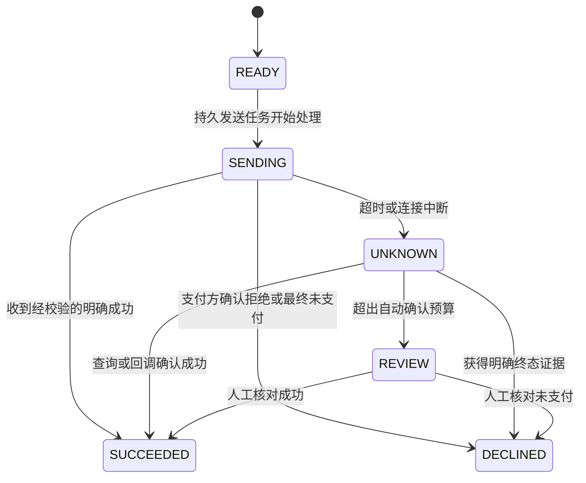
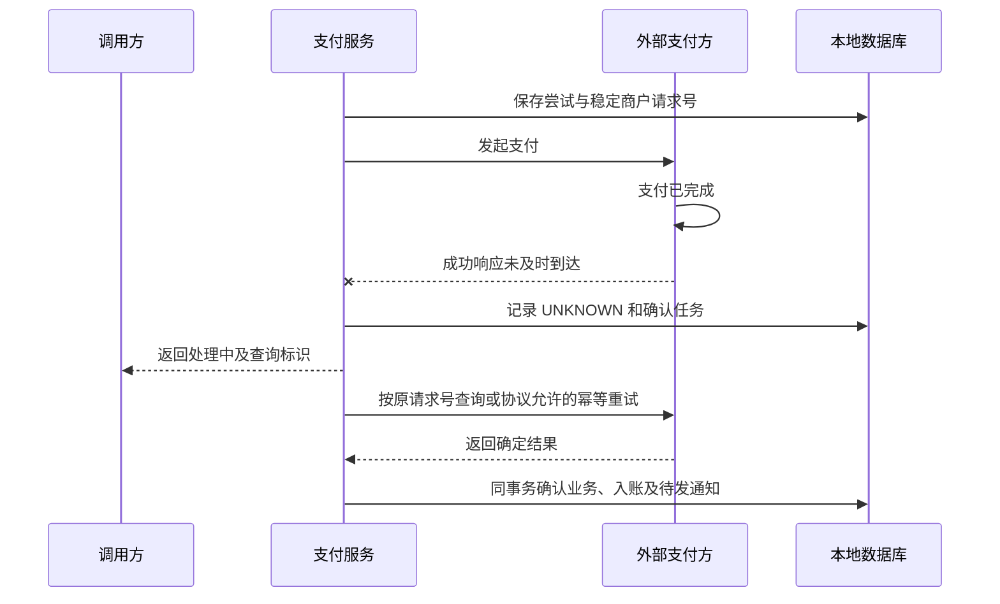

# 支付超时、重复请求与结果确认

[分布式设计](../interview_design.md) · [可靠消息](outbox-rocketmq-inbox.md) · [Saga 与资源预留](saga-tcc-workflow.md) · [首页](../../README.md)

设计目标：调用支付方超时、用户再次点击、回调重复或乱序、服务中途退出时，同一笔支付意图不会被误当成多次独立扣款，已发生的支付结果能被持续确认并正确入账。

**范围与前提：** 教学设计，不代表本仓库接入了真实支付。数据库示例采用 MySQL 8.x；金额使用明确币种下的最小货币单位整数。外部支付方是否支持幂等、查询、关单及其有效期，必须根据实际协议确认。SQL 为命名参数示意，未执行。

## 阅读目录

<details>
<summary>展开支付一致性知识点</summary>

- [完整题目与业务不变量](#完整题目与业务不变量)
- [身份与最小数据模型](#身份与最小数据模型)
- [状态机与成功协议](#状态机与成功协议)
- [超时不能直接判为支付失败](#超时不能直接判为支付失败)
- [重复请求与回调的处理](#重复请求与回调的处理)
- [故障窗口与恢复](#故障窗口与恢复)
- [深入追问与参考回答](#深入追问与参考回答)
- [手工走查与观测](#手工走查与观测)
- [参考资料](#参考资料)

</details>

## 完整题目与业务不变量

订单应付 12900 分。支付服务调用第三方后等待超时，用户再次点击支付；与此同时，第三方的成功回调到达两次，查询接口还返回了一次较早的处理中结果。如何处理？

需要守住的规则：

1. 同一次支付尝试使用稳定的商户请求号，运输重试不产生新的扣款意图。
2. 同一个订单只能按业务规则拥有相应的有效支付意图；不同客户端请求号也不能绕开这一规则。
3. 回调来源、商户、订单、金额、币种和支付流水必须相互匹配。
4. 明确成功的支付，不被迟到的处理中结果覆盖；退款是另一笔受控业务动作。
5. 入账结果、业务变更和待发事件按本地事务提交，未知结果持续有责任人推进。

“请求只执行一次”和“网络只调用一次”不同。允许同一请求号被重复发送，但外部支付方与本地业务都必须按约定识别同一次意图。

## 身份与最小数据模型

| 记录 | 关键字段与约束 | 用途 |
| --- | --- | --- |
| payment_intent | 主键 `(tenant_id, order_id)`；active_attempt_id、status、version | 仲裁订单当前允许的支付尝试 |
| payment_attempt | attempt_id；唯一 merchant_request_no；唯一 `(tenant_id, client_request_id)`；request_hash | 固化一次尝试的身份、金额、币种与接收方 |
| payment_result | 唯一 `(provider, provider_payment_id, action_type)`；本地业务关联 | 阻止同一外部资金动作重复入账 |
| callback_inbox | 提供方定义的稳定事件身份、payload_hash、最终结果 | 识别回调重投和同键不同载荷 |
| Outbox / 待确认任务 | attempt_id、下次查询时间、重试和处置状态 | 发送、查询与本地通知的恢复依据 |

客户端幂等键标识调用意图；商户请求号标识对外支付尝试；支付方流水标识实际资金动作。不能统一替换成 order_id，也不能依赖 HTTP 请求追踪号去重。

同一个幂等键对应不同金额、币种或接收方时，返回冲突，不复用旧结果去执行新参数。Hash 需要规范化，敏感原文不应无界写入日志。

## 状态机与成功协议



`UNKNOWN` 表示缺少结论，不是成功或失败。`DECLINED` 必须有足够的终态证据，不能由“等了几秒”推出。允许的终态与支付方协议一致；不是每个通道都有相同的状态含义。

一次受控的支付流程：

```text
本地事务：
  以订单记录仲裁 active_attempt_id
  若已有未决尝试，返回该尝试状态，不新建扣款意图
  固化幂等键、商户请求号、金额和币种
  保存支付尝试和待发送任务
提交
事务外：携带相同商户请求号调用支付方
本地事务：合并经校验的回调或查询结果，入账并写通知 Outbox
```

仲裁示意，必须与创建尝试和持久任务处于同一事务：

```sql
UPDATE payment_intent
SET active_attempt_id = :attempt_id,
    version = version + 1
WHERE tenant_id = :tenant_id
  AND order_id = :order_id
  AND status = 'UNPAID'
  AND active_attempt_id IS NULL
  AND version = :expected_version;
```

影响 0 行需要读取并分类：已支付、已有未决尝试、版本变化或订单不存在。释放旧尝试的仲裁权也必须核对旧 attempt_id 与明确的业务结论，不能因调用超时就清空它。

## 超时不能直接判为支付失败



查询、回调与主动请求可能同时返回。统一使用同一套结果合并逻辑，校验事实并按合法状态迁移更新，不让每个入口各自无条件覆盖状态。

支付方没有可靠幂等或查询能力时，本地唯一索引不能约束它已经发生的外部扣款。需要限制自动重试、保持未知状态、协商通道能力或人工核对；不能宣称靠本地代码实现外部全局一次性。

## 重复请求与回调的处理

- 同客户端幂等键、同参数：返回原尝试的稳定结果或处理中状态。
- 同订单、不同客户端键：由 payment_intent 的业务仲裁决定是否允许新尝试。
- 同回调事件身份：Inbox 与入账修改同事务提交，重复请求核对终态后返回协议要求的确认。
- 不同回调 ID、同支付流水：还需资金动作唯一约束，避免运输身份变化绕过去重。
- 成功回调后收到处理中查询结果：保留明确成功，记录观察信息而不回退。
- 同一流水对应不同金额或订单：隔离并告警，不把冲突视为普通重复。

本地成功结果确认之后再发送业务通知。回调响应失败导致支付方重投时，重复入站不应再入一次账。

## 故障窗口与恢复

| 故障 | 可能状态 | 恢复方式 |
| --- | --- | --- |
| 尝试创建前后宕机 | 本地全部回滚或已有持久尝试 | 按客户端键和订单仲裁恢复 |
| 外部已扣款、响应丢失 | 外部成功，本地 UNKNOWN | 按原商户请求号查询并校验流水 |
| 回调处理事务回滚 | 未形成已提交入账记录 | 返回可重试结果，后续重新处理 |
| 本地入账提交后未确认回调 | 已完成但通道可能重投 | 去重后返回稳定确认 |
| 查询暂时返回未找到 | 可能存在传播延迟或协议处理中 | 按通道含义继续核对，不立即建立新尝试 |
| 幂等键已超过通道保留期 | 同键重发可能不再受保护 | 优先查询、关单与人工确认，不盲目复用发送 |
| 本地超时关闭与支付成功同时发生 | 订单与资金结果冲突 | 按业务规则决定履约或独立退款流程 |

## 深入追问与参考回答

**为什么不能在超时后直接退款？** 退款需要明确的原支付身份和实际成功事实。未知状态下盲目退款可能找不到原单，或与后续确认交错；先确认，再以独立退款请求号推进，并对退款本身建立同样的幂等与未知结果处理。

**为什么支付成功不能只更新订单状态？** 状态不能完整表达流水、币种、实付金额与资金动作。需要可审计的结果记录；订单变更、唯一流水和事件通知在本地保持原子性。

**支付方成功、本地数据库持续不可用怎么办？** 外部副作用不会跟随本地回滚。通过持久任务、支付方查询和对账恢复，告警展示未决年龄；不能因为数据库失败而反复建立新扣款请求。

**使用 Redis 锁能替代业务约束吗？** 不能。锁过期、进程退出和外部未知结果不因锁存在而消失。锁可辅助降低竞争，最终仍需持久身份、状态条件与外部协议。

**这是不是 Saga？** 单个支付动作的幂等确认不是完整 Saga；当它作为多个服务步骤之一，并有持久协调和补偿流程时，才进入跨服务工作流设计。

## 手工走查与观测

固定订单、商户请求号和金额，推演重复点击、换客户端键、回调与查询交错、响应丢失、数据库提交结果未知，以及服务重启后恢复。核对每条资金动作最多形成一份有效本地账务结果，业务与支付方结果可以被关联查询。

监控 UNKNOWN 最老年龄、未确认金额、同键载荷冲突、回调验证失败、查询失败、重复结果和对账差异；按订单、attempt_id、商户请求号与外部流水关联日志。

## 参考资料

本页的数据模型与推演属于教学设计。幂等契约和原子记录的模式参考 [AWS Builders' Library：Making retries safe with idempotent APIs](https://aws.amazon.com/builders-library/making-retries-safe-with-idempotent-APIs/)。实际通道的查询、关单与幂等有效期需要核对其协议。

关联阅读：[Outbox 与 Inbox](outbox-rocketmq-inbox.md)、[Saga 与 TCC](saga-tcc-workflow.md)。本文未执行支付、SQL 或故障实验。
