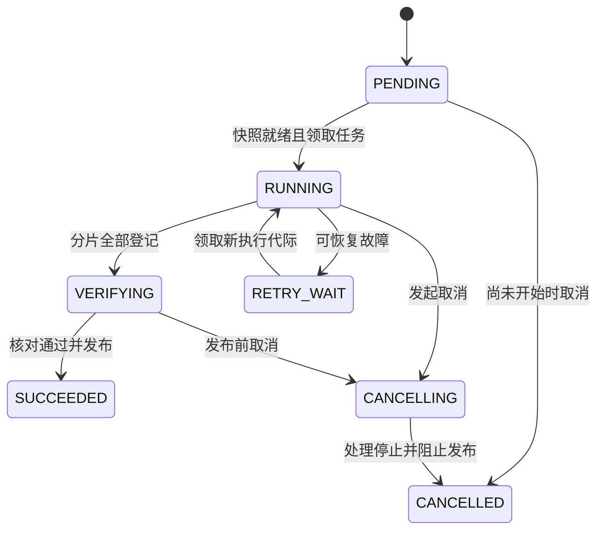
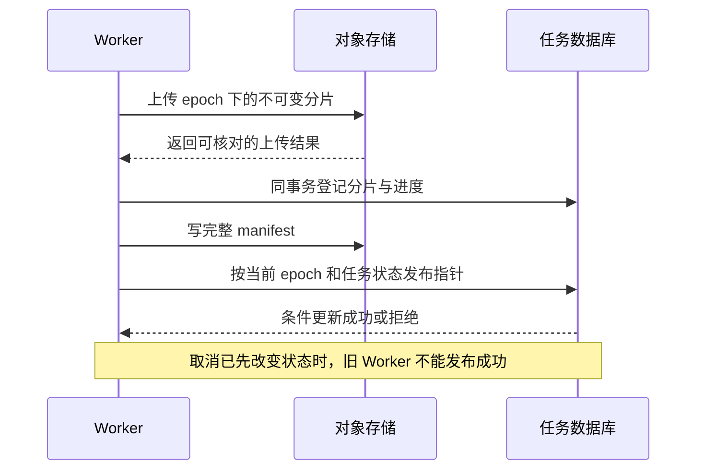

# 大规模异步导出、一致性与断点恢复

[工具与运行诊断](../linux.md) · [数据库与 SQL](database-sql.md) · [旧执行者隔离](lease-fencing.md) · [首页](../../README.md)

设计目标：导出千万级业务数据，业务仍在更新，任务可能重启或被取消。需要说明文件属于哪个数据版本，避免分页遗漏、重复发布和无限制占用在线资源。

**范围与前提：** 教学规模，不是实测吞吐承诺。数据库示例参考 MySQL 8.x；对象存储行为按具体产品核对。示例采用已完成的持久快照作为可恢复输入，不能把一个数据库连接上的临时读视图当作永久快照。未执行 SQL 或文件上传。

## 阅读目录

<details>
<summary>展开可恢复导出知识点</summary>

- [完整题目与输出契约](#完整题目与输出契约)
- [先决定读取一致性](#先决定读取一致性)
- [数据模型与任务状态](#数据模型与任务状态)
- [生成分片与持久进度](#生成分片与持久进度)
- [上传、发布与取消的竞争](#上传发布与取消的竞争)
- [故障窗口与恢复](#故障窗口与恢复)
- [资源治理与权限](#资源治理与权限)
- [深入追问与参考回答](#深入追问与参考回答)
- [手工走查与观测](#手工走查与观测)
- [参考资料](#参考资料)

</details>

## 完整题目与输出契约

用户导出某租户的千万级订单，要求文件内数据属于同一业务视图。执行期间订单持续修改，Worker 可能宕机，重复点击不重复创建相同任务，取消与完成可能同时发生。

先明确文件格式、排序、币种和时区、数据范围、字段权限、一致性等级、可接受时延与结果保留期。单个 Excel 工作表有格式容量限制，不能把“支持千万条”默认解释成一个可直接打开的单表文件；可选择 CSV 分片及 manifest。

成功条件包括：固定输入视图、每个有效记录在约定范围内出现一次、所有分片可校验、只发布一份当前结果、取消不能被旧执行者覆盖。

## 先决定读取一致性

| 选择 | 能解决什么 | 代价与限制 |
| --- | --- | --- |
| 实时弱一致分页 | 限制每批查询资源 | 数据变化可能改变页间结果，必须向使用方说明 |
| 单个 RR 一致性读事务 | 在相应条件下复用同一连接的读视图 | 长事务成本高；连接消失后不能按游标重建原视图 |
| 持久快照或版本化历史 | 以 snapshot_id 固定数据内容，支持跨执行者恢复 | 需要生成、保留、权限与存储成本 |

本例选择持久快照：先形成包含所需字段值的快照，并在完整核对后标记 READY，再由导出 Worker 分页读取。只保存一串订单 ID 不能冻结以后会变化的字段值；`updated_at <= cutoff` 也不等于能够重建被原地覆盖的旧值。

快照构建同样需要一致性协议。若构建时依赖的数据库读视图丢失，不能换一个新事务接着拼同一个快照；应废弃未完成代际，重新生成新的 snapshot_id，或使用明确支持版本读取的数据源。

## 数据模型与任务状态

| 记录 | 关键字段与约束 |
| --- | --- |
| export_task | task_id、tenant_id、request_key、request_hash、snapshot_id、scope_hash、schema_version、status、epoch、version、manifest_id |
| export_progress | 按分区持久化连续完成游标，不能只记录最大完成编号 |
| export_part | 唯一 `(task_id, epoch, part_no)`；object_key、checksum、row_count、起止游标 |
| export_manifest | manifest_id、固定顺序的分片引用、快照与字段版本、总条数及校验信息 |
| published_result | 当前对外结果指针；受任务状态、epoch 和版本条件保护 |



图省略永久失败与人工处置。`SUCCEEDED` 表示已核对并发布，不是最后一条 SQL 返回了成功。任务幂等键绑定租户、规范化参数、权限范围和数据版本；相同键但参数不同要报冲突。

## 生成分片与持久进度

对已经固定的快照使用稳定、唯一排序键。例如 snapshot_row_id 在快照内唯一：

```sql
SELECT snapshot_row_id, order_id, amount_minor, status
FROM export_snapshot_row
WHERE snapshot_id = :snapshot_id
  AND tenant_id = :tenant_id
  AND snapshot_row_id > :last_completed_id
ORDER BY snapshot_row_id
LIMIT :batch_size;
```

游标分页减少深 OFFSET 开销，但本身不提供快照。示例正确性的前提是 snapshot_id 对应的内容与排序不可变。非唯一排序时必须补稳定的并列键；多分区并行时分别保存游标。

每片的顺序：读取固定输入 → 生成临时内容并计算校验 → 写入本次尝试的不可变对象路径 → 确认上传结果 → 在本地事务内登记分片与连续完成进度。

若先推进游标再上传，宕机可能跳过缺失文件；先上传再登记，可能留下未引用文件，但可以核对并回收。跨数据库与对象存储不假设原子提交。

## 上传、发布与取消的竞争



发布示意，应和 manifest 业务元数据提交放在同一事务：

```sql
UPDATE export_task
SET status = 'SUCCEEDED', manifest_id = :manifest_id,
    version = version + 1
WHERE task_id = :task_id
  AND tenant_id = :tenant_id
  AND status = 'VERIFYING'
  AND epoch = :epoch
  AND version = :expected_version;
```

取消通过相同的状态与版本仲裁：若取消先提交，发布条件失败；若成功发布先提交，后续取消返回已完成或走独立撤销权限流程，不能同时对外声称两个终态。

任务重启时可复用旧代际中已校验、属于同一快照和参数的不可变分片，但必须由恢复协议明确接管引用。不能让任意旧 Worker 自行把输出挂入新 manifest。

## 故障窗口与恢复

| 故障 | 恢复规则 |
| --- | --- |
| 建立快照时连接丢失 | 未完成快照作废或按数据源协议恢复，不能拼接新视图 |
| 分片生成到一半宕机 | 从已登记的连续游标恢复，不使用未完成本地文件 |
| 上传成功、登记前宕机 | 按对象路径和校验恢复登记，或生成新片后回收孤立对象 |
| 登记已提交、Worker 未收到结果 | 查询分片唯一记录，避免重复推进进度 |
| 多分片乱序完成 | 只推进无缺口的完成前沿，不取最大完成游标 |
| 旧 Worker 恢复 | 允许留下独立临时输出，但拒绝旧 epoch 发布 |
| 取消与发布并发 | 同一权威状态 CAS 决定终态 |
| 用户已经下载后取消 | 不能收回已有副本，按结果授权与保留策略处理 |

## 资源治理与权限

限制租户和全局运行数、每批行数、扫描时间、对象分片大小与总输出量；给在线查询预留资源。大导出可使用适当副本、专门快照或离线引擎，但要说明数据延迟和一致性。

固化字段与行权限的语义，读取快照和下载结果时都校验租户与授权；不能只靠一个可猜测的 task_id。权限撤销后如何处理已有文件和下载凭证，需要明确产品规则。

对象路径包含任务和代际，避免旧尝试覆盖新结果。条件写可以增强保护，但必须核对具体存储的覆盖、版本与 multipart 完成语义；ETag 不应未经确认就当成文件内容的通用 MD5。

## 深入追问与参考回答

**只用主键分页为什么还可能不一致？** 它固定访问顺序，但没有冻结行的内容、成员资格或删除行为。必须先确定一致性契约，再选快照与恢复方式。

**断点恢复保存最后一个 ID 是否足够？** 还需保存快照、过滤和字段版本、已提交分片及其校验、多分区连续前沿和执行代际。否则可能在不同数据视图上拼出一份文件。

**为什么不直接覆盖 result.csv？** 旧尝试或失败上传可能覆盖正确结果。不可变内容加条件发布指针，把“生成内容”和“选择对外结果”分开。

**取消后仍在查询数据库怎么办？** 尽力取消底层查询并限制超时，同时从状态机上阻止发布；“收到取消请求”不等于底层进程已经停止。

**什么时候可以清理孤立对象？** 确认没有活动租约、恢复或已发布 manifest 引用，并经过安全保留期；清理也需要幂等和可追踪，不能按文件名最新时间随意删。

## 手工走查与观测

用固定快照推演重复创建、上传后宕机、登记结果未知、非连续完成、旧 Worker 发布和取消竞争。核对 manifest 条数、范围、顺序与 checksum，检查读取入口只暴露被正式发布的版本。

监控排队时间、快照生成时间、扫描与输出速率、连续完成进度、资源占用、失败重试、取消滞留和孤立对象年龄。没有进行实际千万级导出或压测。

## 参考资料

读取模型参考 [MySQL 8.4 一致性读](https://dev.mysql.com/doc/refman/8.4/en/innodb-consistent-read.html)；对象存储条件写参考 [Amazon S3 Conditional Writes](https://docs.aws.amazon.com/AmazonS3/latest/userguide/conditional-writes.html)。持久快照、manifest 和发布状态是本文教学协议，不是数据库或对象存储自动提供的跨资源事务。
