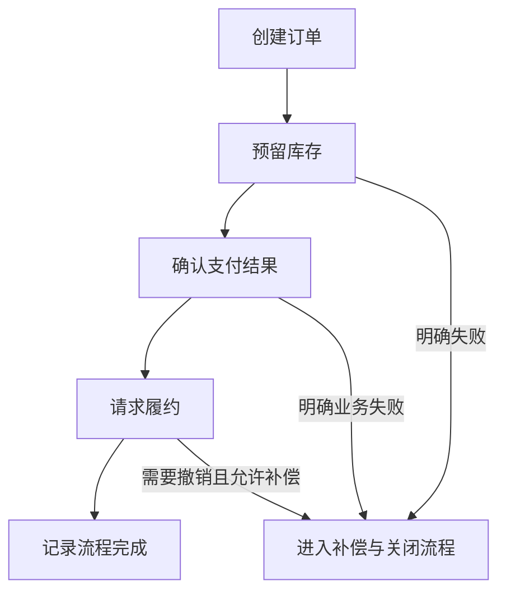
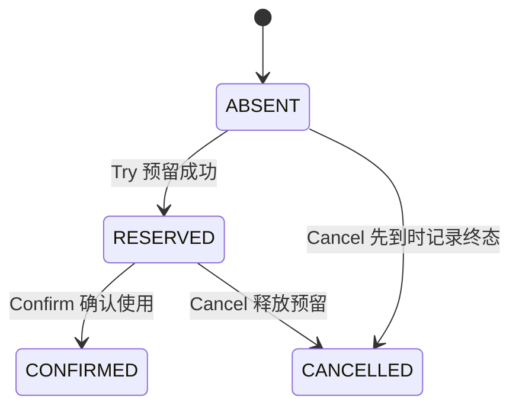

# Saga 编排、资源预留与跨服务补偿

[分布式设计](../interview_design.md) · [支付结果确认](payment-idempotency.md) · [Outbox 与 Inbox](outbox-rocketmq-inbox.md) · [首页](../../README.md)

设计目标：下单、预占库存、扣款和履约分别属于不同服务时，可靠推进每一步；遇到业务拒绝或结果未知时，选择继续确认、补偿或人工处置，而不是把跨库调用误当成本地回滚。

**范围与前提：** 教学协议。Saga 的协调模式与 TCC 的资源预留分开解释，是否组合取决于业务。数据库逻辑结构以支持事务和唯一约束为前提；消息运输沿用 Outbox / Inbox。没有接入 Seata 或真实库存、支付服务。

## 阅读目录

<details>
<summary>展开 Saga 与 TCC 知识点</summary>

- [完整题目与边界](#完整题目与边界)
- [编排式与协同式](#编排式与协同式)
- [持久状态与身份](#持久状态与身份)
- [Saga 如何推进与恢复](#saga-如何推进与恢复)
- [补偿不是数据库回滚](#补偿不是数据库回滚)
- [库存预留的 TCC 语义](#库存预留的-tcc-语义)
- [幂等、空回滚与防悬挂](#幂等空回滚与防悬挂)
- [故障窗口与恢复](#故障窗口与恢复)
- [深入追问与参考回答](#深入追问与参考回答)
- [手工走查与观测](#手工走查与观测)
- [参考资料](#参考资料)

</details>

## 完整题目与边界

订单创建后库存预留成功，支付结果还不确定，履约服务又发生长时间故障。协调器中途重启，有的命令和结果消息重复或乱序。如何知道哪些步骤已经完成，何时可以释放库存或退款？

不变量包括：同一分支的重复命令不重复扣减；结果未知不直接当成失败；预留释放与确认不能同时成功；补偿也要有持久进度；不可逆步骤之前需要明确业务决策。

Saga 通常由一系列本地事务及业务补偿组成，不提供整个过程的 ACID 隔离。其他请求可能看到中间状态，需要预留、业务锁定状态、版本条件或其他语义隔离。

## 编排式与协同式

| 方式 | 谁决定下一步 | 需要特别处理 |
| --- | --- | --- |
| 编排式 | 持久化的协调器根据当前步骤发命令 | 协调器恢复、实例版本、命令幂等与状态竞争 |
| 协同式 | 各服务订阅事件并发出后续事件 | 全局进度可见性、循环事件、故障归属与补偿链路 |

本例采用编排式，便于明确恢复入口；这不是所有业务必须集中编排的结论。参与者仍负责自己的本地事务和事实，协调器不直接修改参与者的数据库。



图简化了分支状态。网络超时先进入等待确认；不能沿“明确失败”的边直接跳到补偿。履约服务暂不可用也可能应该继续重试，而不是自动取消一笔已经支付的订单。

## 持久状态与身份

| 记录 | 核心字段和约束 |
| --- | --- |
| saga_instance | saga_id、business_key、definition_version、status、current_step、version；业务提交幂等键 |
| saga_step | `(saga_id, step_name)` 唯一；forward_state、compensation_state、command_id、participant_result |
| command_outbox | 稳定 command_id、分支身份、参数 Hash、下次投递时间 |
| participant_inbox | 参与者逻辑处理器与 command_id 唯一；与本地操作同事务 |
| resource_reservation | branch_id 唯一；资源数量、状态、预留截止条件和业务版本 |

同一分支的运输重试保留 command_id。补偿命令拥有独立、稳定的身份，并关联原正向动作；不能生成一个无法追溯的新操作去“猜测性撤销”。

流程定义在创建实例时固化版本。升级编排规则不能让运行中的旧实例在重启后突然按新步骤解释历史。

## Saga 如何推进与恢复

```text
协调器本地事务：
  读取实例与步骤版本
  判断当前结果是否允许发出下一命令
  条件更新流程状态，并写命令 Outbox
提交后可靠投递

参与者本地事务：
  按命令身份去重
  执行业务或资源预留
  保存结果，并写结果 Outbox
提交后返回或投递结果

协调器收到结果：
  去重并校验实例、步骤、方向与版本
  更新进度，决定继续、等待确认或补偿
```

协调器宕机后从数据库恢复未决实例和待发命令，不依赖内存中的方法调用栈。多协调器竞争同一实例时使用版本条件或领取协议；旧执行者不得覆盖新的流程决定。

例如进入补偿状态的比较更新，必须和补偿命令记录同事务：

```sql
UPDATE saga_instance
SET status = 'COMPENSATING', version = version + 1
WHERE saga_id = :saga_id
  AND status = 'RUNNING'
  AND version = :expected_version;
```

影响 0 行时重新读取和分类，不无条件再发一组补偿。`WAIT_CONFIRM`、`COMPENSATING`、`COMPENSATION_PENDING`、`SUCCEEDED`、`COMPENSATED`、`REVIEW` 是教学状态，各自的终止和恢复条件需定义清楚。

## 补偿不是数据库回滚

| 正向动作 | 可能的补偿 | 不能默认成立的假设 |
| --- | --- | --- |
| 预留库存 | 释放同一分支预留 | 不能把已经确认消耗的库存直接当未使用资源 |
| 生成应收或扣款 | 冲正、撤销或退款 | 退款不一定即时，也可能需要手续费、授权和独立核对 |
| 创建履约任务 | 取消尚未发出的任务 | 已发货可能需要退货流程，不能直接删除记录 |

补偿通常按依赖关系逆序组织，但不是所有分支都简单按数组倒序执行。已发送邮件、已发货等外部影响可能不可逆，需要业务上的后续动作。

补偿请求也会超时、重复或失败。保存每步补偿进度和稳定请求号，查询未知结果，重试可恢复错误；超出预算后进入有责任人的人工处置状态，不能直接标记“已回滚”。

## 库存预留的 TCC 语义

TCC 适用于能定义业务资源预留的参与者：Try 检查并预留，Confirm 确认使用，Cancel 释放预留。三步分别是有持久结果的本地操作，不应跨整个业务过程持有数据库行锁。



库存示例使用 available、reserved、consumed 等逻辑数量：Try 在一个本地事务里减少可用量、增加预留量并保存 branch；Confirm 将同一预留转为已使用；Cancel 将同一预留退回可用量。每次都按分支状态和数量条件处理，重复 Confirm / Cancel 返回稳定结果。

## 幂等、空回滚与防悬挂

**幂等：** 同一 branch 的 Try、Confirm、Cancel 可以被重投，但不能重复冻结、消耗或释放。

**空回滚：** Try 尚未成功，Cancel 先到了。Cancel 需要安全结束该分支的取消意图，不能凭空增加库存。

**防悬挂：** Cancel 已经结束后，迟到的 Try 不能再建立预留。可在资源参与者本地记录取消墓碑，让它与 Try 竞争同一个分支唯一键。

```text
Try：
  尝试建立 branch 记录，唯一约束负责并发仲裁
  已存在 CANCELLED：拒绝迟到的 Try
  本次新建：条件扣减可用量并建立 RESERVED
  分支记录和库存修改同事务提交

Cancel：
  分支不存在：持久化 CANCELLED 墓碑，不增加库存
  分支为 RESERVED：释放该分支数量，并改为 CANCELLED
  分支已 CANCELLED：返回同样的取消结果
  分支已 CONFIRMED：按协议拒绝或进入另一业务补偿流程
```

先查不存在、再无约束插入，无法防住并发 Try / Cancel。取消墓碑的保留期需覆盖迟到命令和恢复重投窗口；删除太早会重新打开悬挂窗口。

## 故障窗口与恢复

| 故障 | 处理方向 |
| --- | --- |
| 参与者已预留，结果响应丢失 | 按原分支查询或重发幂等命令，不建立第二份预留 |
| 支付结果未知 | 等待确认，不把超时直接当成可退款证据 |
| 参与者完成，协调器尚未记结果时宕机 | 参与者持久结果或结果消息恢复协调进度 |
| 协调器状态已变，下一命令尚未发出 | 命令 Outbox 恢复投递 |
| 补偿成功，确认响应丢失 | 按原补偿身份重试或查询，避免重复退款 |
| 补偿持续失败 | 保持未完成记录并告警，不伪造补偿完成 |
| 正向迟到结果与补偿决定交错 | 按步骤方向、实例版本与参与者事实核对，必要时 REVIEW |
| 多协调器同时推进 | 唯一记录、实例版本和投递身份仲裁 |

## 深入追问与参考回答

**Saga 为什么不等于最终数据库回到原样？** 补偿是新的业务事务，其他服务可能已观察或使用中间结果。目标是业务上可接受的结束状态，不是撤回所有外部观察。

**库存预留过期后直接释放安全吗？** 需要和 Confirm 仲裁。若支付已成功而确认消息迟到，自动释放可能让库存被其他订单占用；应定义截止规则、持久终态和后续退款/缺货处理，不能只用缓存 TTL 决定。

**TCC 的每步是不是 XA？** 不必。常见设计的每步可以是参与者自己的本地事务；TCC 的全局业务协议不等于每个步骤天然使用 XA。

**为什么需要定义版本？** 命令与历史状态的含义必须可恢复。流程发布后删除或重命名一个旧步骤，可能让重启实例无法正确确认或补偿。

**编排器会不会成为单点？** 逻辑集中不等于只能单进程。多个实例共享持久状态并通过并发协议仲裁，但必须处理重复调度、旧执行者和故障切换。

## 手工走查与观测

推演正常完成、Cancel 先到、重复 Try、Confirm / Cancel 竞争、支付未知、协调器重启和补偿响应丢失。核对每个分支只有合法终态，库存守恒，补偿未完成事项能继续被找到。

观察未决实例年龄、每步超时、预留总量、补偿积压、取消墓碑命中、同键载荷冲突，以及订单、资金和库存三方差异。进程运行正常不能替代业务对账。

## 参考资料

模式背景：[Saga](https://microservices.io/patterns/data/saga.html)。资源预留与异常问题参考 [Apache Seata TCC](https://seata.apache.org/docs/user/mode/tcc/)。本页协议与表模型是教学设计，不是框架默认配置，也未执行真实流程实验。

继续阅读：[支付幂等](payment-idempotency.md)、[领取与旧执行者隔离](lease-fencing.md)、[可靠消息](outbox-rocketmq-inbox.md)。
