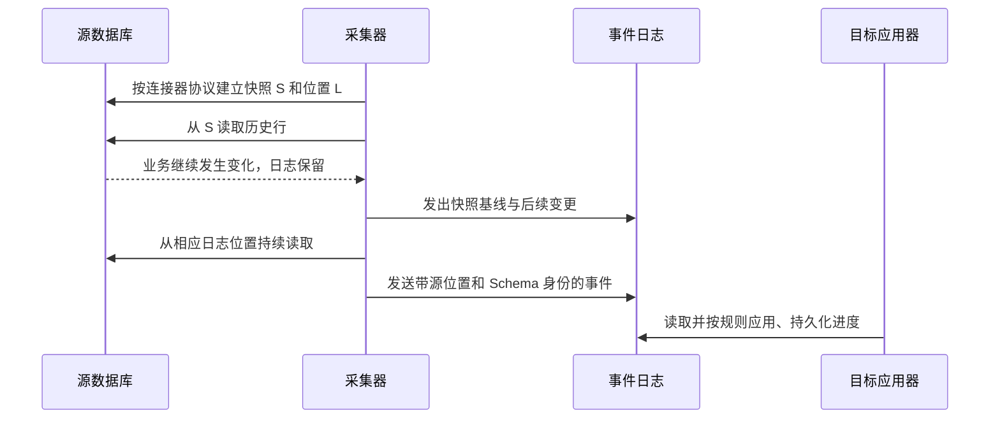
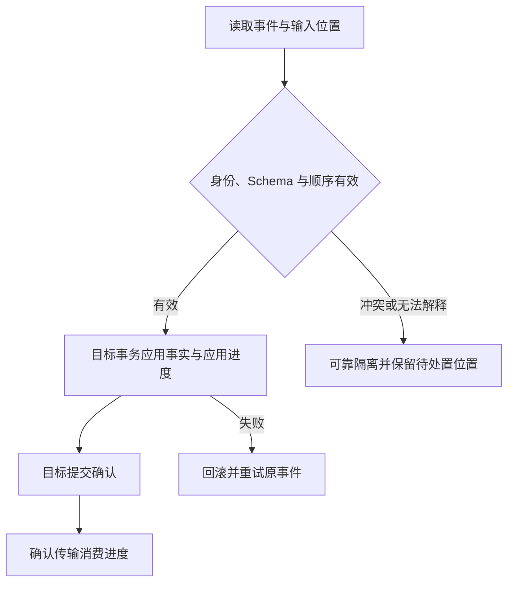

# 全量快照、CDC 衔接与可恢复数据同步

[数据平台分类](../interview_bigdata.md) · [不停机迁移](online-database-migration.md) · [实时结果一致性](flink-clickhouse-consistency.md) · [首页](../../README.md)

设计目标：历史全量导入期间源库仍在写入，能够把全量与增量衔接起来，处理更新、删除、DDL、采集重启和目标重放，避免数据缺失或旧值复活。

**范围与前提：** 原理固定参考 Debezium 2.7 的 MySQL 连接器；不同连接器、数据库与快照模式不能混用步骤。下面的目标应用协议是教学设计，不是已部署的 CDC 配置。没有执行采集或 SQL。

## 阅读目录

<details>
<summary>展开快照与 CDC 知识点</summary>

- [完整题目与不变量](#完整题目与不变量)
- [快照与日志位点必须成对建立](#快照与日志位点必须成对建立)
- [事件与进度的数据模型](#事件与进度的数据模型)
- [目标应用与连续完成前沿](#目标应用与连续完成前沿)
- [删除、DDL 与源切换](#删除ddl-与源切换)
- [初始快照与分块快照的区别](#初始快照与分块快照的区别)
- [故障窗口与恢复](#故障窗口与恢复)
- [深入追问与参考回答](#深入追问与参考回答)
- [手工走查与观测](#手工走查与观测)
- [参考资料](#参考资料)

</details>

## 完整题目与不变量

表有千万级历史行。全量扫描期间，一行从 A 更新为 B，另一行被删除，表还新增一列；采集器和目标写入服务分别可能重启。如何证明目标最后能收敛到源端的正确状态？

不变量：全量视图与增量边界之间没有未覆盖的变化；目标重放不覆盖更新事实；删除不被迟到快照复活；进度不会越过未完成写入；DDL 解释与事件发生时的 Schema 一致。

## 快照与日志位点必须成对建立

“先扫全表，扫完后再读取最新 binlog 位点”会遗漏扫描过程中已经发生、却不在读出结果中的变化。只记开始时间或最大主键也不能替代日志边界。

应由连接器协议建立一致性快照 S 与对应日志位置 L：S 提供基线，后续日志覆盖 L 之后的变化；重复覆盖的部分由接收与应用规则处理。S、L 和必要的 Schema 信息必须由相容的锁定和读取协议确定，不能将两个随意查询的结果拼在一起。



这里描述关系而非手写建快照 SQL。仅执行 `BEGIN` 或设置 RR，不足以自行证明读视图与记录位点已经精确配对。Debezium 对初始一致性快照和后续日志读取有具体协议，需按固定版本核对。

## 事件与进度的数据模型

| 对象 | 需要固化的信息 |
| --- | --- |
| capture_generation | 源身份、快照代际、模式、基线日志位置、Schema 历史与完成状态 |
| change_event | 主键、操作类型、before/after 或等价事实、源事务与行位置、Schema 身份 |
| mirror_row | 业务键、当前值、已应用源版本、是否删除、载荷 Hash |
| apply_checkpoint | 输入分区、连续完成位置、目标提交结果与代际 |
| reconciliation_run | 源与目标比较范围、读水位、条数、内容差异和修复进度 |

要分清三种进度：源数据库的日志位置、采集器发布到日志系统的进度、目标应用器已提交的消费位置。采集进程报“已读取”不代表目标已经持久化。

binlog 文件与位置、事务内行序号、GTID 集合和传输分区 offset 各有含义。GTID 集合不是可以随意相减的整数，文件名也不能不加规则地作字符串大小比较。跨源切换先证明继承关系，再确定可比较的顺序。

## 目标应用与连续完成前沿

对同一业务键，快照基线不能覆盖已经应用的较新变更。一个具备可比较版本的目标模型可采用：

```text
开始目标本地事务
  读取并仲裁对应业务键的目标版本
  新事件较新：应用 after-image 或持久删除标记
  同版本且内容相同：按重放处理，不重复产生效果
  同版本但内容不同：隔离冲突
  明确较旧：按协议忽略，不能覆盖新事实
  更新无缺口的已完成输入前沿
提交目标事务
之后再确认传输消费进度
```

这里的“版本”必须来自实际协议，不能拿业务时间戳或人工生成批次号假装具有源顺序。没有可靠版本比较时，需要每键有序应用、日志位置约束和明确的重建流程。

如果输入来自 Kafka，数据库里的应用进度与 Kafka 消费确认不是一个本地事务。目标先提交、确认后丢失可能重放，因此应用必须幂等；先确认再写目标，则可能丢失未完成数据。

并行处理时，后面的 offset 先完成不代表之前已经完成。保存连续前沿，或保存足以恢复未完成集合的协议，不能只把“最大已完成 offset”当安全检查点。



隔离方案要明确是否允许推进该分区进度，以及谁负责补齐隔离事实。不能既跳过错误事件，又声称目标已经完整。

## 删除、DDL 与源切换

**删除：** 直接物理删除目标行可能忘记它已经被较新事件删除，迟到快照再插入时产生复活。可以保留删除版本或墓碑，覆盖快照、重试与人工回放窗口；清理规则需要与重放来源一致。

**DDL：** 旧事件必须按相应的历史 Schema 解释。新增列、类型变化、字段重命名和不兼容 DDL 都需明确转换或暂停策略，不能只读取“现在的表结构”解释所有历史事件。

**源切换：** 新源必须包含继续采集所需的事务历史与日志。源代际号只标识切换，不能证明更高代际的数据一定更新；先验证 GTID / 位点继承与数据覆盖，再允许新源继续推进。无法证明时进行对账或重新建立基线。

## 初始快照与分块快照的区别

初始一致性快照通常建立统一基线后进入增量阶段；分块或增量快照则需要在每个块的读取期间协调并发变更，例如使用相应低高水位与冲突合并机制。

不能把“每次查 1000 个主键”直接称为正确的增量快照。分块完成、源变更与目标应用的仲裁规则需要由实际连接器模式提供，并记录可恢复状态。

## 故障窗口与恢复

| 故障 | 恢复方向 |
| --- | --- |
| 初始快照读取中断 | 按连接器模式恢复或重建新代际，不能未经证明拼接新读视图 |
| 目标已提交但消费确认丢失 | 重放同一事实，按主键与源版本处理 |
| 消费确认先行、目标尚未提交 | 存在数据缺口；协议应避免，发生后靠回溯与对账修复 |
| 更新事件先于迟到快照应用 | 快照不能覆盖新版本 |
| 删除后收到旧基线行 | 删除版本阻止复活 |
| 恢复需要的源日志已清理 | 停止虚假的“续跑成功”，重建基线或采用已验证的备份日志 |
| DDL 无法兼容 | 保留位置与错误事实，暂停或可靠隔离后转换 |
| 分区并发导致完成有洞 | 恢复未完成区间，不能跳到最大完成位置 |

## 深入追问与参考回答

**全量和增量一定不能重叠吗？** 可以有覆盖重叠，但必须有版本、顺序或合并协议识别它；关键是不能留空白，也不能让旧事实覆盖新事实。

**业务更新时间能替代日志位点吗？** 通常不能。时钟精度、补写、多个相同时间、删除和事务提交次序都可能不符合它的假设。

**只同步 insert/update，删除以后再说可以吗？** 如果目标表示源当前状态，就会留下多余数据。必须定义删除、软删除与墓碑语义；若目标是不可变事实日志，则需要另一种明确模型。

**连接器检查点成功是否目标就完整？** 需要分层看检查点覆盖哪些资源。采集发布、消息存储、目标事务和查询可见性可能是不同阶段。

**目标转换规则升级后能直接重放吗？** 需要保存规则版本和目标代际，避免同一事件在旧规则、新规则下写出无法比较的事实。必要时构建新目标版本并核对发布。

## 手工走查与观测

固定几行数据，列出快照读取、更新、删除、DDL 与重启顺序，逐步标记 S、L、传输位置、目标版本和应用前沿。核对每个源变化是否有确定去向、重复是否收敛、删除是否保留。

观察源日志保留余量、快照进度、采集延迟、目标应用延迟、未完成区间、Schema 冲突、删除差异与对账结果。比较时固定双方可比较的业务范围与水位，避免把两个不同时刻的结果直接当数据错误。

## 参考资料

组件协议参考 [Debezium 2.7 MySQL Connector](https://debezium.io/documentation/reference/2.7/connectors/mysql.html)。本页的目标镜像、检查点和冲突处置模型是教学设计；未安装连接器或执行采集。继续阅读[数据库切换](online-database-migration.md)与[实时结果语义](flink-clickhouse-consistency.md)。
