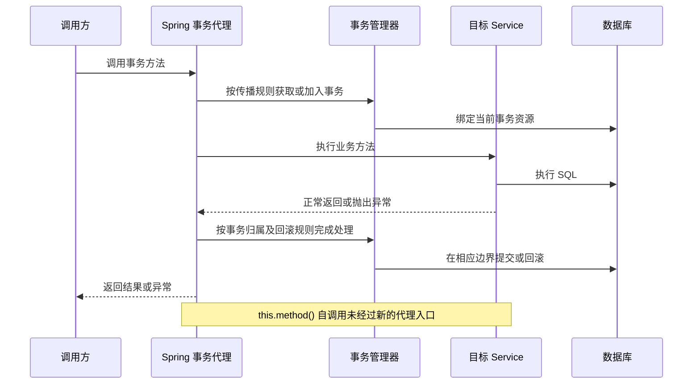

# Spring 事务与数据访问

[返回分类](../interview_spring.md) · [全部问答](../技术学习笔记.md) · [练习](../practice.md) · [版本与资料](../references.md)

先理解代理入口与本地事务，再讨论传播行为和 MyBatis 查询；默认讨论同一个线程内的常规调用。

**适用版本与前提：** 以 Spring Framework 5.2 的代理事务为基线；工程使用 Spring Boot 2.2.6.RELEASE，MyBatis 3 的映射规则单独参考。

## 阅读目录

- [Q07 Spring 事务为什么会看起来不生效](#q07-spring-事务为什么会看起来不生效)
- [Q08 REQUIRED 与 REQUIRES_NEW 有什么区别](#q08-required-与-requires_new-有什么区别)
- [Q09 Spring AOP 代理有什么边界](#q09-spring-aop-代理有什么边界)
- [Q10 MyBatis 中参数绑定 缓存与查询数量怎么检查](#q10-mybatis-中参数绑定-缓存与查询数量怎么检查)

## Q07 Spring 事务为什么会看起来不生效

**反例：调用方调用 submit，而事务配置只写在内部调用的 save 上。**

```java
class OrderService {
    /** 提交入口，示例中没有声明事务。 */
    public void submit() {
        this.save();
    }

    /** 默认代理模式下，自调用不会单独开启此处配置的事务。 */
    @Transactional
    public void save() {
        // 执行需要事务保护的数据库修改。
    }
}
```

示例省略 Bean 注册与数据库细节，使用默认代理模式。关键是 `this.save()` 直接调用目标对象方法；把注解写上去不会改变这条调用路径。让调用真正经过合适的事务代理入口，或显式使用事务模板，才能应用相应事务规则。

**先看一次正常的代理调用。**



自调用不会单独应用被调用方法上的事务配置，但仍可能运行在外层已有事务中。异常被捕获后正常返回、受检异常的默认规则、事务管理器和数据源不匹配，都需要分别核对。参考 [Spring 5.2 事务说明](https://docs.spring.io/spring-framework/docs/5.2.5.RELEASE/spring-framework-reference/data-access.html#transaction-declarative-annotations)。

类型：原理与排障题。优先级：最高。

原理与做法：我先确认对象是否由 Spring 管理、调用是否经过事务代理，再确认事务管理器、数据源和异常规则。默认代理模式下，同类内部调用另一个事务方法不会触发它自己的事务拦截。常规默认回滚规则主要针对 RuntimeException 和 Error，受检异常是否回滚取决于配置；异常被捕获吞掉也可能改变结果。异步线程不会自然继承原线程的本地事务。方法可见性和代理限制还要结合框架版本与代理方式判断。

进一步思考：问“内部调用是否一定完全没有事务”，回答如果外层已有事务，内部数据库操作可能仍参加外层事务；失效的是内部方法期望新增的拦截行为。不要说只要加注解就覆盖 HTTP 调用。资料见 [S05](../references.md#s05)。

## Q08 REQUIRED 与 REQUIRES_NEW 有什么区别

类型：原理题。优先级：高。

原理与做法：REQUIRED 没有事务时创建，有事务时加入；REQUIRES_NEW 则使用独立的新事务并挂起外层事务。内层 REQUIRED 标记了回滚，外层即使捕获异常，提交时仍可能发现事务已被标记 rollback-only。REQUIRES_NEW 的独立提交也有代价，例如额外占用数据库连接，以及外层回滚后内层记录仍存在。只有业务确实允许独立提交，我才会选择它。

进一步思考：问“审计日志是否都用新事务”，回答先明确日志是否必须独立持久化、连接资源和失败策略，不能为绕过回滚而随意改变业务原子性。资料见 [S06](../references.md#s06)。

## Q09 Spring AOP 代理有什么边界

类型：原理题。优先级：中。

原理与做法：AOP 常通过代理在目标方法前后增加事务、监控等行为。JDK 动态代理面向接口，基于类的代理通过生成子类工作，具体选择由配置和框架环境决定。直接 new 出来的对象、绕开代理的内部调用，以及无法覆盖的方法，都可能达不到预期增强效果。我排查时会看 Bean 的实际代理类型和调用入口，而不是只检查注解是否存在。

进一步思考：问“final 方法一定能被事务代理增强吗”，基于子类的代理不能覆盖 final 方法；接口代理也有自身边界，应结合实际调用方式分析。

## Q10 MyBatis 中参数绑定 缓存与查询数量怎么检查

类型：原理与方案题。优先级：高。

原理与做法：普通数据参数使用 #{} 绑定，${} 是文本拼接，只能在严格白名单等受控场景使用，例如动态排序字段。缓存要区分 SqlSession 范围的本地缓存与可配置的 namespace 二级缓存，实际行为还受事务和集成方式影响。性能上我会看最终 SQL、绑定参数、一次请求执行的 SQL 数量，以及关联查询是否产生 N+1；不能只看一条 SQL 很快就认为整个请求没问题。

进一步思考：问“排序字段为什么不能直接 #{}”，回答参数占位符表示值，不能直接替代任意 SQL 标识符；应把用户选项映射到允许的列。资料见 [S07](../references.md#s07)。

---

[返回分类](../interview_spring.md) · [全部问答](../技术学习笔记.md) · [练习](../practice.md) · [版本与资料](../references.md)
